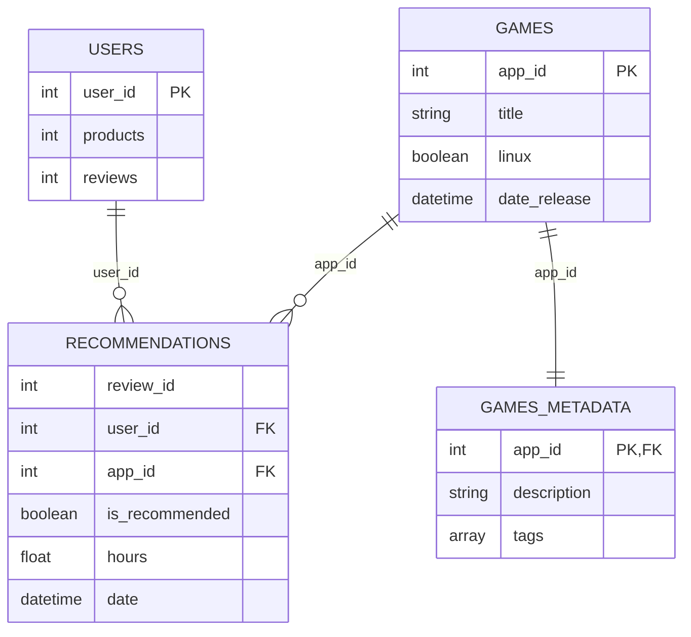

# 데이터셋 A — 네 파일의 구조와 관계

**Game Recommendations on Steam (v28)** · [Kaggle 원본](https://www.kaggle.com/datasets/antonkozyriev/game-recommendations-on-steam)

> 팀 저장소 [`main` README의 **A · 학습**](https://github.com/jinSeong-P/ML-game-recommendation/blob/main/README.md)에 적힌 **바로 그 데이터셋**이야. EDA에서는 A의 네 원본 파일을 사용했어.

## 1. 네 파일에는 어떤 데이터가 있을까?

| 파일 | 한 행의 의미 | 핵심 내용 | EDA에서 확인한 행 수 |
|---|---|---|---:|
| [`recommendations.csv`](A_recommendations.csv.md) | **사용자의 게임 리뷰 1건** | 사용자 ID, 게임 ID, 긍정·부정 추천 여부, 플레이 시간, 리뷰 날짜 | 41,154,794 |
| [`games.csv`](A_games.csv.md) | **게임 1개** | 게임 제목, 출시일, 가격, Windows/macOS/Linux 지원 여부, 평가 정보 | 50,872 |
| [`users.csv`](A_users.csv.md) | **사용자 1명** | 사용자 ID, 보유 **제품 수**, 작성한 리뷰 수 | 14,306,064 |
| [`games_metadata.json`](A_games_metadata.json.md) | **게임 1개** | 게임 ID, 설명, 태그 | 50,872 |

## 2. 파일 사이 연결 관계 (ER 다이어그램)

*PK = 기본 키, FK = 외래 키에 해당하는 **논리적 연결**이야. 실제 원본은 CSV·JSON 파일이므로 데이터베이스 제약조건이 설정되어 있는 건 아니야. 관계도에는 이해를 돕기 위해 주요 필드만 표시했어.*

| 관계 | 연결 컬럼 | 의미 |
|---|---|---|
| `users` → `recommendations` | `user_id` | **1:N**. 사용자 한 명이 리뷰를 0건 이상 작성할 수 있어 |
| `games` → `recommendations` | `app_id` | **1:N**. 게임 하나에 리뷰가 0건 이상 달릴 수 있어 |
| `games` ↔ `games_metadata` | `app_id` | **1:1**. 동일 App ID 게임의 기본 정보와 상세 정보가 대응해 |

즉, **사용자와 게임은 `recommendations`의 리뷰 기록을 통해 연결**되는 구조야. `users.csv`의 `products`는 보유한 게임 **목록이 아니라 개수**라는 점을 기억해 둬.

## 3. 실제 데이터에서도 연결되는지 확인했을까?

- EDA 결과, `recommendations`에 등장한 **모든 `user_id`는 `users`에 존재**해.
- `recommendations`에 등장한 **모든 `app_id`는 `games`에 존재**해.
- `games`와 `games_metadata`의 **App ID 집합이 완전히 같아**. 두 파일 모두 50,872행이며 각 App ID는 중복되지 않아.
- 다만 `recommendations`에는 **같은 (`user_id`, `app_id`) 조합이 21건 중복**돼. 따라서 이 두 열의 조합을 고유 기본 키로 단정할 수 없고, `review_id`의 고유성도 아직 확인된 사항이 아니야.

**근거:** [EDA 구조·중복 집계](../../reports/tables/01_structure.csv), [원본·키 정합성 결과](../../reports/eda_metrics.json), [원본 파일·버전 기록](../../data/raw/manifest.json)

> 이 문서는 **이미 수행한 EDA 결과를 쉽게 설명하기 위한 요약**이야. 추가 분석이나 전처리/학습셋 확정은 포함하지 않았어.
