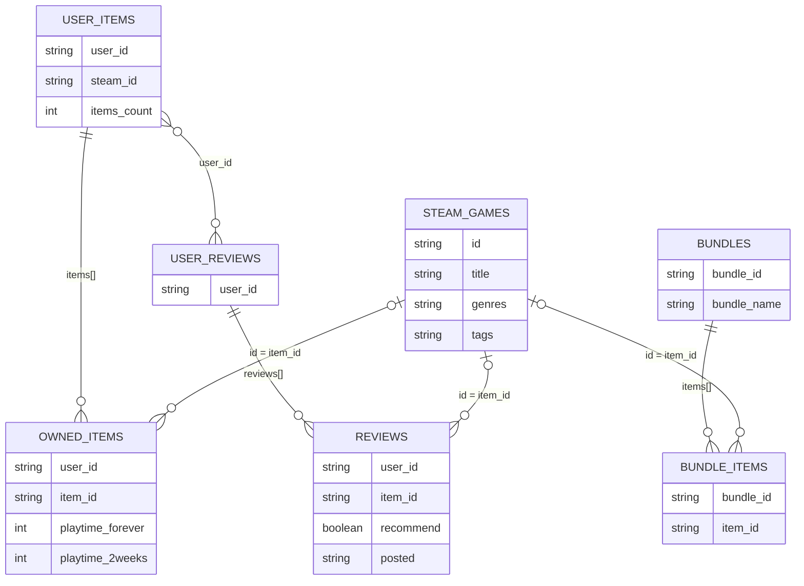

# 데이터셋 B — 파일 구성 및 데이터 간 관계

**Steam Video Game and Bundle Data (v1)** · [Kaggle 원본](https://www.kaggle.com/datasets/pypiahmad/steam-video-game-and-bundle-data)

> **데이터 출처:** 본 문서의 데이터셋 B는 프로젝트 [`main` README의 ‘B · 외부 테스트’](https://github.com/jinSeong-P/ML-game-recommendation/blob/main/README.md)에 명시된 **동일 데이터셋**이다. EDA에서는 해당 데이터셋의 v1을 사용하였다.

## 1. 파일 구성 및 주요 정보

| 파일 | 원본 데이터의 단위 | 핵심 내용 | EDA에서 확인한 규모 |
|---|---|---|---:|
| [`australian_users_items.json`](B_australian_users_items.json.md) | **사용자 1명의 보유 목록** (`items[]` 포함) | 사용자 ID, 보유 게임 ID·이름, 누적·최근 2주 플레이 시간 | 사용자 프로필 88,310행 / 펼친 보유 기록 5,153,209건 |
| [`australian_user_reviews.json`](B_australian_user_reviews.json.md) | **사용자 1명의 리뷰 묶음** (`reviews[]` 포함) | 사용자 ID, 리뷰한 게임 ID, 긍정·부정 여부, 리뷰 작성 정보 | 펼친 리뷰 59,305건 |
| [`steam_games.json`](B_steam_games.json.md) | **게임·상품 1개** | 게임 ID, 제목, 출시일, 장르·태그, 개발·유통 정보 등 | 32,135행 |
| [`bundle_data.json`](B_bundle_data.json.md) | **판매 번들 1개** (`items[]` 포함) | 번들 ID·이름, 번들에 포함된 게임·상품 ID | 고유 번들 615개 / 펼친 포함 관계 3,525건 |
| [`steam_reviews.json/steam_new.json`](B_steam_new_partial.md) | **전체 구조 미검증** | 별도 대용량 리뷰 자료 | 앞 64 MiB만 일부 확인, 분석·평가 미사용 |

`australian_*.json` 및 나머지 B 원본 파일은 일반적인 JSON 배열이 아니라 **행별 Python 딕셔너리 리터럴** 형식이다. 기존 전처리에서는 `ast.literal_eval`로 읽고 중첩된 게임·리뷰 목록을 개별 행으로 펼쳤다. 위의 '펼친 기록' 수는 **원본 사용자 행 수와 구분**한다.

## 2. 파일 간 연결 관계 (ER 다이어그램)

다음 그림은 **원본의 중첩 배열을 분석용 테이블로 펼친 논리적 구조**를 나타낸다. `OWNED_ITEMS`, `REVIEWS`, `BUNDLE_ITEMS`는 독립적인 원본 파일이 아니라 각각의 원본 배열을 펼친 결과이다.

*이 관계도는 **조인 가능한 식별자와 배열 포함 관계**를 표시한 개념도이다. 원본에는 DB의 PK·FK 제약조건이 없으며, 사용자 프로필·리뷰·게임 메타데이터에 중복 또는 누락이 존재하므로 일부 관계는 일치하는 레코드에서만 성립한다. 특히 `STEAM_GAMES`의 `id`는 결측·중복이 확인되어 검증된 기본 키로 표시하지 않았다.*

| 관계 | 연결 컬럼 | 의미 |
|---|---|---|
| 보유 목록 ↔ 리뷰 묶음 | `user_id` | **동일한 B 사용자**를 기준으로 보유 이력과 리뷰를 연결할 수 있음. 단, 모든 사용자가 두 파일에 존재하는 것은 아님 |
| 보유 목록 → 보유 항목 | `items[]` → `item_id` | **1:N**. 사용자 프로필 한 행에 여러 보유 항목이 포함될 수 있음 |
| 리뷰 묶음 → 리뷰 항목 | `reviews[]` → `item_id` | **1:N**. 사용자 리뷰 묶음 한 행에 여러 리뷰가 포함될 수 있음 |
| 게임 정보 ↔ 보유·리뷰 항목 | `steam_games.id` ↔ `item_id` | Steam App ID가 일치하는 경우 게임의 상세 정보를 연결할 수 있음 |
| 번들 → 포함 상품 | `items[].item_id` | **1:N**. 하나의 번들에 여러 게임·상품이 포함되며, 동일 상품이 여러 번들에 등장할 수 있음 |
| 게임 정보 ↔ 번들 포함 상품 | `steam_games.id` ↔ `item_id` | ID가 일치하는 상품에 한해 메타데이터 연결 가능 |

**B의 사용자 ID는 B 내부 파일끼리 연결하기 위한 값이다.** A 데이터셋의 사용자 ID와 동일 사용자를 나타낸다고 간주하지 않는다. A·C 등 다른 데이터셋과 연결할 때는 **Steam 게임 App ID**를 사용한다.

## 3. 연결 키의 정합성 및 데이터 특성

- **사용자 연결은 부분적으로 성립한다.** B 리뷰 작성 사용자 25,458명 중 **22,613명**이 보유 목록에 사용자 프로필을 가지고 있다.
- **리뷰 대상 게임과 보유 게임은 중복될 수 있다.** 사용자별 리뷰 게임의 **75.62%**가 해당 사용자의 보유 목록에도 포함되어 있었다. 외부 평가에서는 입력 보유 게임과 정답 리뷰 게임을 분리해야 한다.
- **보유 목록의 사용자 ID는 완전히 고유하지 않다.** 88,310개 프로필 행에서 고유 사용자 ID는 87,626개이며, 중복 프로필이 존재하는 사용자는 673명이다.
- **게임 정보는 모든 보유·리뷰 항목을 포괄하지 않는다.** `steam_games.json`에는 게임 ID 결측 2행과 중복 1행이 존재한다. 따라서 메타데이터와의 연결은 **조건부**이며, 모든 `item_id`에 대응하는 게임 정보가 있다고 가정할 수 없다.
- **번들 포함 관계는 사용자 선호 관계가 아니다.** `bundle_data.json`은 함께 판매되는 상품 구성을 기록하며, 해당 게임들이 같은 사용자에게 구매되거나 긍정 평가되었다는 근거는 제공하지 않는다.
- **대용량 `steam_new.json`은 제외한다.** 전체 파일은 내려받아 검증하지 않았으므로 이 관계도와 평가 입력·정답 구성에 포함하지 않았다.

**자료 활용 구분:** `australian_users_items.json`의 보유·플레이 이력은 사용자 입력 정보, `australian_user_reviews.json`의 긍정 리뷰는 외부 평가 정답 정보에 해당한다. `steam_games.json`과 `bundle_data.json`은 게임·상품에 관한 보조 정보이다.

**근거:** [EDA 구조·중복 집계](../../reports/tables/01_structure.csv), [B 게임 ID와 A·C의 일치 범위](../../reports/tables/04_id_overlap.csv), [기초 EDA 결과](../../reports/eda_metrics.json), [원본·전처리 정보](../../data/raw/manifest.json), [전처리 코드](../../scripts/preprocess.py)

> **문서 범위:** 기존 EDA에서 확인된 데이터 구조와 연결 관계만 요약하였다. 신규 분석, 전처리 정책 및 모델 학습·평가 설계의 확정은 포함하지 않는다.
