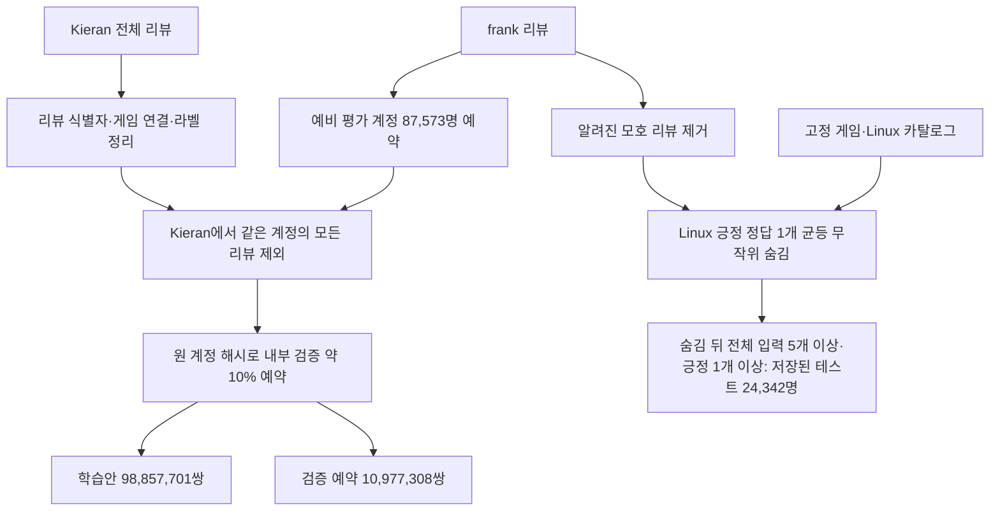

# 메인 데이터셋과 연결 원칙

2026-11-07 확정 조합은 **Kieran 원본 → frank 리뷰**입니다. 기존 A·B·C 약칭 대신 실제 데이터셋 이름과 역할을 사용합니다. 설계에 따른 최종 분할 파일 생성·전수 검증을 완료했습니다. 소개글·토큰·TF-IDF 인덱스·코사인 검색도 준비했습니다. [콘텐츠 준비 결과](../tfidf_content.md)를 참고하세요. 2026-11-08 Item-KNN 학습과 두 모델의 공통 검증·테스트도 완료했습니다. [실제 성능 보고서](../../reports/baseline_v1.md)를 참고하세요. 실제 경로·규모는 [분할 파일 안내](../modeling_splits.md)를 참고하세요.

Item-KNN의 학습 입력은 고정 리뷰 카탈로그 37,610개 게임(비Linux 포함)의 긍정 리뷰입니다. 긍정 singleton도 앱 지원 수와 코사인 정규화 계산에 포함합니다. 해당 고정 카탈로그의 긍정 78,315,268쌍은 EDA 미리보기입니다. Kieran 학습안의 모든 앱·모든 라벨 98,857,701쌍과 그중 긍정 84,791,317쌍은 더 넓은 EDA 집계로 별도 구분합니다.

TF-IDF는 A `description`을 우선하고 결측·빈 문자열·공백뿐일 때 C `short_description`으로 보충한 게임 소개글만 사용합니다. 두 모델의 취향·추천 점수는 남은 긍정 리뷰만 사용합니다. 기본 평가에서는 사용자별 적격 긍정 Linux 게임 하나를 균등 무작위로 숨깁니다. 숨김 뒤 전체 리뷰 게임 ≥5·긍정 게임 ≥1인 사용자만 공통 평가 대상이며 EDA 잠재 규모는 **24,342명**입니다. seed **20261107**과 실제 사용자·정답 manifest를 저장했으며 테스트는 24,342명, 검증 평가는 325,639명입니다.

각 모델은 해당 사용자의 긍정 입력을 동일 가중으로 집계합니다. TF-IDF는 게임별 L2 정규화 소개글 벡터 평균 후 Linux 후보와 코사인 유사도를 계산하고, Item-KNN은 후보별 긍정 입력 유사도 합을 전체 긍정 입력 수로 나눕니다. 남은 긍정·부정 입력 게임은 모두 후보에서 제외하고, 숨긴 정답은 제외 마스크에서 빼 추천 가능하게 둡니다. 두 모델은 같은 사용자·query·정답·Linux 후보 6,630개를 사용합니다. 양수 개인화 점수 후보만 최대 10개 추천하고 인기·무작위 보완 없이 나머지 자리는 비웁니다. 적격 사용자의 빈 목록도 평가 지표 분모에 유지합니다.

태그·장르 보강, 부정 신호 반영, 여러 정답 동시 숨김, 전체 입력 ≥3 평가, 대안 집계(플레이타임 가중 포함), 모델 개선 후 인기순 보완은 후속 실험입니다. 구현 세부는 [모델링 결정·백로그](../modeling_backlog.md), 정답 선택은 [숨김 방법 비교](../holdout_options.md)에서 관리합니다.

| 데이터 | 역할 | 상세 |
|---|---|---|
| Kieran Steam Reviews v2 | 학습·내부 검증 | [원본·컬럼·정리 규칙](kieran.md) |
| frank Steam Dataset 고정 commit | 외부 리뷰 테스트 | [원본·컬럼·평가 집단](frank.md) |
| 고정 게임 참조 | 입력·Linux 후보·메타데이터 연결 기준 | [참조 파일 안내](../../data/reference/README.md) |

Steam App ID는 공통 게임 연결 키입니다. 계정 ID와 원 리뷰 ID는 문자열로 읽고 손실 없는 정수로 비교합니다. 서로 다른 파일의 로컬 번호나 float64로 변환된 ID로 독립성을 판단하지 않습니다.

Kieran과 frank는 분리 전 중복 계정이 있습니다. **출처가 다른 것 자체는 독립성을 보장하지 않습니다.** 예비 평가 계정 전체를 제외한 전수 분석에서 계정·사용자–게임·원 리뷰 교집합 0을 확인했습니다. 현재 결과는 계정 분리안과 EDA이며 실제 저장된 최종 split 파일 검증은 후속 단계입니다.

현재 입력 범위는 고정 카탈로그의 리뷰 존재 게임 37,610개, 추천·정답 후보는 그중 공식 Linux 게임 6,630개입니다. 입력 ≥5 EDA 후보 24,571명 가운데 긍정 입력이 남지 않는 229명을 공통 제외한 24,342명이 실제 생성·검증된 테스트 사용자 집단입니다. 적격 사용자가 모두 빈 추천을 받아도 지표 분모에는 남습니다. 이전 A의 사용자 리뷰는 학습에 넣지 않으며, A/C에서 유래한 게임 단위 참조는 출처가 기록된 별도 자료로 관리합니다.

[메인 EDA 보고서](../../reports/kieran_frank_eda.md) · [전체 수치](../../reports/kieran_original_frank_eda_metrics.json) · [이전 데이터 사전](../../legacy/docs/datasets/README.md)
