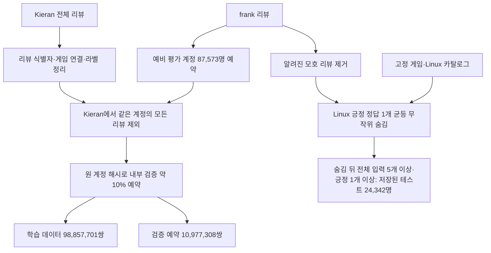

# 메인 데이터셋과 연결 원칙

2026-11-07 **Kieran 원본을 학습·내부 검증에 사용하고 frank 리뷰를 외부 평가에 사용하는 조합**을 확정했습니다. 기존 A·B·C 약칭 대신 실제 데이터셋 이름과 역할을 적습니다. 최종 데이터 분할 파일을 만들고 저장된 전체 데이터를 검증했습니다. 소개글·토큰·TF-IDF 인덱스·코사인 검색도 준비했습니다. [콘텐츠 준비 결과](../tfidf_content.md)를 참고하세요. 2026-11-08 Item-KNN을 학습하고 두 모델의 공통 검증·테스트도 완료했습니다. [실제 성능 보고서](../../reports/baseline_v1.md)를 참고하세요. 실제 경로와 규모는 [분할 파일 안내](../modeling_splits.md)에 있습니다.

Item-KNN은 고정 리뷰 카탈로그 37,610개 게임(비Linux 포함)의 긍정 리뷰로 학습합니다. 긍정 리뷰가 1개인 사용자도 게임별로 긍정 평가한 사용자 수와 코사인 정규화를 계산할 때 포함합니다. 고정 카탈로그의 긍정 78,315,268쌍은 EDA에서 확인한 수치입니다. Kieran 학습 분할의 모든 게임·긍정/부정 리뷰 98,857,701쌍과 그중 긍정 84,791,317쌍은 더 넓은 전체 데이터 집계로 따로 구분합니다.

TF-IDF는 게임 소개글만 사용합니다. A `description`을 먼저 쓰고, 결측·빈 문자열·공백만 있는 경우 C `short_description`으로 보충합니다. 두 모델 모두 남은 긍정 리뷰만 취향과 추천 점수에 사용합니다. 기본 평가에서는 사용자마다 조건을 만족하는 긍정 Linux 게임 하나를 같은 확률로 무작위 선택해 숨깁니다. 정답을 숨긴 뒤 전체 리뷰 게임이 5개 이상이고 긍정 게임이 1개 이상인 사용자를 두 모델 모두 평가합니다. EDA 잠재 규모는 **24,342명**입니다. 난수 seed **20261107**과 실제 사용자·정답 파일 목록·검증 정보(manifest)를 저장했습니다. 테스트는 24,342명, 검증 평가는 325,639명입니다.

각 모델은 사용자의 긍정 입력을 같은 비중으로 집계합니다. TF-IDF는 게임별 L2 정규화 소개글 벡터의 평균을 구한 뒤 Linux 후보와 코사인 유사도를 계산합니다. Item-KNN은 후보와 긍정 입력 게임 사이 유사도의 합을 전체 긍정 입력 수로 나눕니다. 입력에 남은 긍정·부정 게임은 모두 추천에서 제외하고, 숨긴 정답은 제외 목록에서 빼 추천할 수 있게 둡니다. 두 모델은 같은 사용자·입력 이력(`query`)·정답·Linux 후보 6,630개를 사용합니다. 점수가 양수인 후보를 최대 10개 추천하고, 인기도나 무작위 게임으로 나머지 자리를 채우지 않습니다. 조건을 만족하는 사용자의 추천 목록이 비어도 평가 지표의 분모에 남깁니다.

태그·장르 추가, 부정 리뷰 정보 반영, 여러 정답 동시 숨김, 전체 입력 ≥3 평가, 다른 입력 집계(플레이타임 가중 포함), 모델 개선 후 인기도순 빈자리 채우기는 후속 실험입니다. 구현 내용은 [모델링 결정·백로그](../modeling_backlog.md), 정답을 숨기는 방법은 [숨김 방식 비교](../holdout_options.md)에서 관리합니다.

| 데이터 | 역할 | 상세 |
|---|---|---|
| Kieran Steam Reviews v2 | 학습·내부 검증 | [원본·컬럼·정리 규칙](kieran.md) |
| frank Steam Dataset 고정 commit | 외부 리뷰 테스트 | [원본·컬럼·평가 집단](frank.md) |
| 고정 게임 참조 | 입력·Linux 후보·메타데이터 연결 기준 | [참조 파일 안내](../../data/reference/README.md) |

Steam App ID는 공통 게임 연결 키입니다. 계정 ID와 원 리뷰 ID는 문자열로 읽고 손실 없는 정수로 비교합니다. 서로 다른 파일의 로컬 번호나 float64로 변환된 ID로 독립성을 판단하지 않습니다.

분리하기 전 Kieran과 frank에는 같은 계정이 있었습니다. **데이터 출처가 다르다는 사실만으로 평가 자료가 독립적이라고 볼 수 없습니다.** 예비 평가 계정을 모두 제외한 전체 데이터 검사에서 계정·사용자–게임 조합·원 리뷰 ID가 겹치는 경우가 0건임을 확인했습니다. 현재는 계정 분리 방침과 EDA 집계를 설명합니다. 최종 분할 파일은 별도로 생성하고 검증했습니다.

입력 범위는 고정 카탈로그에 리뷰가 있는 게임 37,610개이고, 추천·정답 후보는 그중 공식 Linux 게임 6,630개입니다. 전체 입력 ≥5인 EDA 후보 24,571명 가운데 긍정 입력이 남지 않는 229명을 함께 제외했습니다. 나머지 24,342명이 실제로 생성·검증한 테스트 사용자입니다. 조건을 만족한 사용자가 모두 빈 추천 목록을 받아도 평가 지표의 분모에 남습니다. 이전 A 사용자 리뷰는 학습에 넣지 않습니다. A/C에서 가져온 게임별 참조 정보는 출처를 기록해 별도 관리합니다.

[메인 EDA 보고서](../../reports/kieran_frank_eda.md) · [전체 수치](../../reports/kieran_original_frank_eda_metrics.json) · [이전 데이터 사전](../../legacy/docs/datasets/README.md)
