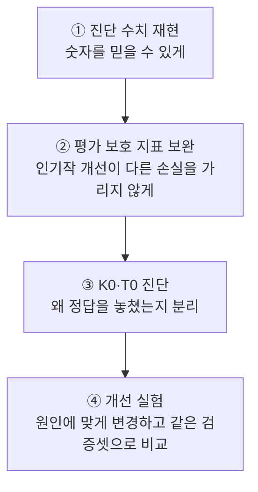
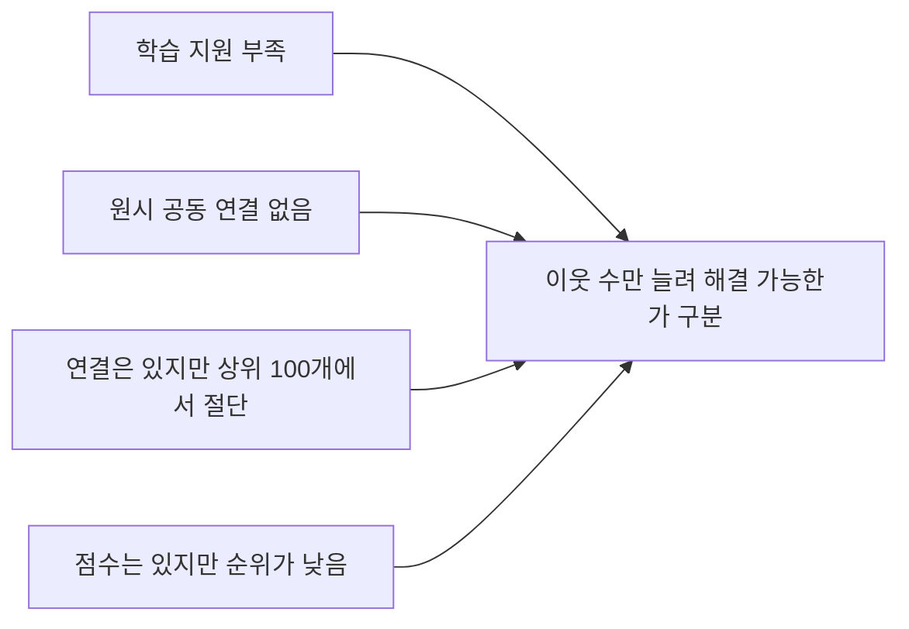

# 모델 개선 실행 절차 — v2

2026-11-08 사용자가 승인한 아래 네 단계의 문서화·실행을 **완료**했다. v1 분할·모델·평가 결과를 보존하고 별도 v2 코드·산출물로 비교했다. [실행 결과](../reports/model_improvement_v2.md)에 18개 검증 설정·보호 조건·선정·frank 참조 결과와 자동 테스트 근거를 기록한다. Item-KNN은 v1 유지, 콘텐츠는 bigram 소개글 50%+태그·장르 50%로 선정했다.

## 1. 진단 수치 재현

고정 v1 파일·코드·학습 입력 지문을 확인하고, 저장된 사용자별 결과와 추천 목록에서 검토 수치를 다시 계산한다. Item-KNN의 원시 공동 리뷰 수는 train 긍정만으로 재계산한다. 일회성 계산으로만 남아 있던 이웃 절단 손실은 재현 스크립트와 사용자별 진단을 저장한다. TF-IDF 결측, 추천 쏠림, 토큰 수의 분위수 동점, 단어 목록과 가중치 분모를 명시한다.

**해결:** 정의가 빠진 숫자를 개선 근거로 사용하는 문제. **통과:** 동일 입력·방법에서 같은 집계가 나오고 차이가 있으면 원인을 기록한다. 원래 불용어 21개 목록이 없으면 그 수치를 재현했다고 주장하지 않고, 명시한 목록의 새 진단과 구분한다.

## 2. 평가 보호 지표 보완

전체 사용자 NDCG@10 우선·Recall@10 보조 기준과 전체 분모는 유지한다. 기존 train 분위수 구간도 보존하면서 지원 수 `0 / 1–9 / 10–99 / 100–999 / 1,000–9,999 / 10,000–99,999 / 100,000–999,999 / 1,000,000+`의 로그 구간을 추가한다. 경계는 frank 정답 분포로 조절하지 않는다.

- 게임별 평균: 검증 정답으로 나타난 각 게임의 사용자 평균을 구한 뒤 게임에 동일 비중을 준다. 미관측 게임 성적을 추정하지 않는다.
- 낮은 지원 보호 구간: train 긍정 사용자 1–999명인 정답. 각 구간 사용자·게임 수, 인기도 기준선도 보고한다.
- 빈 목록·짧은 목록·후보 커버리지·추천 인기도·실행 시간·저장량을 함께 남긴다.
- 소개글 없는 정답 18,921명(5.81%)은 공식 지표에 남기고 별도 지원 진단으로 표시한다. 같은 소개글을 쓰는 단독 설정의 고정 손실이지 T1/T2 비교의 분모를 바꿀 근거가 아니다.
- 같은 사용자의 후보-v1 차이를 2,000회 paired bootstrap, seed 20261108, 95% 구간으로 표시한다. 후보 선택 편향까지 제거하는 독립 검증은 아니다.

**채택 기준:** 전체 NDCG 차이의 bootstrap 하한 >0, 전체 Recall·게임별 평균 NDCG·낮은 지원 NDCG의 점추정 손실 없음, 빈 목록 증가 없음. 하나라도 실패하면 자동 교체하지 않고 v1을 보수적 기본값으로 유지한다. 주지표 최고 후보와 보호 지표 실패는 별도로 보고한다. 비용·커버리지의 변화도 공개한다.

**해결:** 전체 평균이 일부 인기작 개선만 반영하는 문제. **통과:** 모델 성적을 보기 전에 기준·구간·후보값을 [실험 프로토콜](../data/reference/improvement_protocol_v2.json)에 고정한다.

## 3. K0·T0 진단

### Item-KNN — K0

사용자별로 ① 정답 train 지원 0 → ② 모든 긍정 입력 지원 0 → ③ 원시 공동 연결 없음 → ④ 원시 연결은 있지만 저장 연결 없음 → ⑤ 양수 점수 순위 실패 → ⑥ 적중의 순서로 정확히 한 범주에 배정한다. 원시 공동 사용자 수·원시 이웃 순위·저장 여부·입력 수를 기록한다. 여섯 범주의 합이 검증 325,639명과 같고 v1 0점·적중 수가 일치해야 한다. 이미 관측한 frank의 재현 집계는 원인 참고용으로만 구분한다.

### TF-IDF — T0

고정 seed로 성공·0점 실패·양수 순위 실패를 지원 구간·입력 수에 걸쳐 추출한다. 정답과 오추천의 `사용자 프로필 가중치 × 후보 단어 가중치`를 비교한다. 원문 출처·길이·문자계열·반복·동일 소개글·상위 추천 쏠림 사례를 확인한다. 소개글 없음과 특징 구분 실패를 분리한다. 단어의 후보 벡터 내 비중만으로 추천 쏠림 원인을 단정하지 않는다.

**해결:** 서로 다른 실패를 같은 원인으로 취급하는 문제. **통과:** K0 전수 범주 검사와 T0 실제 단어 기여 사례에서 지지·반례·미확인을 나눈다.

## 4. 개선 실험

1. **K1:** 후보 방향·원시 코사인 고정, K=100/200/500. K=100은 v1 이웃과 점수를 재현해야 한다.
2. **T1/T2:** 기존 소개글에서 sublinear TF만 변경한 모델과 unigram+bigram만 변경한 모델을 각각 v1과 비교한다.
3. **K2:** `cosine × cooc/(cooc+λ)`, λ=0/10/50. 감쇠 후 원시 연결 전체에서 이웃을 다시 선택한다. K1의 고정-K 비교와 3×3 사전 지정 교차 비교를 함께 보고한다.
4. **T3 조건부:** 실제 고빈도 단어가 오추천 점수에 기여한다는 T0 근거가 있으면 max_df=0.5를 단독 비교한다. 실행 여부를 해당 성적 조회 전에 기록한다.
5. **T4:** 선택한 소개글 모델을 고정한 뒤 A 유효 태그 우선/C 태그 보충+C 장르를 별도 채널로 구성한다. α=1/.75/.5/.25 고정 가중 결합. 결측 채널은 0이며 임의 재정규화하지 않는다. 실제 필드 구조·원문 출처·결측을 감사한다.

같은 검증 사용자·입력·정답·마스크·양수 Top10·빈자리 유지 규칙으로 비교한다. 향상이 없으면 v1을 유지하는 것도 완료 결과다. 설정 선정 후 지문을 고정한다. 후속 frank 결과는 이미 관측한 참조 평가이며 새 독립 최종 확인으로 표현하지 않는다.

선정 입력은 사전 지정 검증 후보와 정확히 일치해야 한다. 누락뿐 아니라 추가 후보도 거부한다. 최종 선택은 [선정 스냅샷](../data/reference/improvement_selection_v2.json)과 처리 경로에 동시에 동결한다. frank 실행 직전에 두 기록·runner·평가 코드·모든 검증 근거·모델 파일 지문을 다시 대조한다.

K3/K4/T5, 새 소개글 출처, 입력 가중치, 부정 신호, 인기순 채움, 정답 여러 개, 입력 ≥3, 예약 계정 보조 평가와 Kieran-only 제외 민감도는 이번 실험과 섞지 않고 기존 후속 백로그에 유지한다.

## 보관·재현

모델·추천·사용자별 진단은 Git 제외 경로 `data/processed/modeling/improvement_v2/`에, 집계·실행 설정·코드·문서는 저장소에 둔다. mutable source manifest는 시작 시 스냅샷을 보관하고 그 시점의 지문으로 명시한다. 고정 v1 생성·점수·평가 코드를 수정하지 않는다. 새 평가 코드는 v1의 마스크·분모·동점·저장 결과 검사를 재사용한다.

[실제 실행 결과](../reports/model_improvement_v2.md) · [개선 기획](model_improvement_plan.md) · [결정·백로그](modeling_backlog.md) · [v1 결과](../reports/baseline_v1.md)
