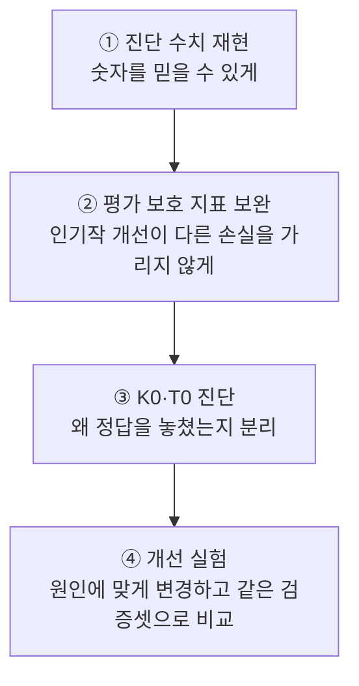
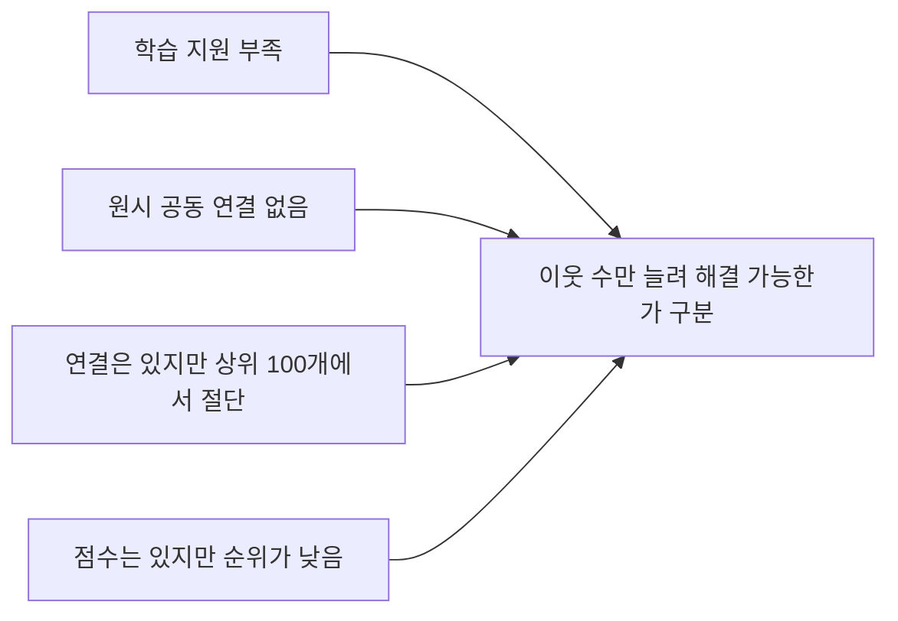

# 모델 개선 실행 절차 — v2

2026-11-08 사용자가 승인한 네 단계를 문서화하고 실행하는 작업을 **완료**했다. v1 분할·모델·평가 결과를 보존하고, 별도 v2 코드·산출물로 비교했다. [실행 결과](../reports/model_improvement_v2.md)에 18개 검증 설정, 성능 저하를 함께 확인하는 보조 지표, 최종 선정, frank 참조 평가 결과와 자동 테스트 근거를 기록한다. Item-KNN은 v1을 유지하고, 콘텐츠 모델은 bigram 소개글 50%와 태그·장르 50%를 결합해 선정했다.

아래의 K0·K1·K2는 협업 모델(Item-KNN) 실험의 이름이고, T0·T1·T2·T3·T4는 콘텐츠(TF-IDF) 실험의 이름이다. 여기서 frank 참조 평가는 이미 수집된 frank 자료를 확인하는 것이며 새 독립 테스트는 아니다.

## 1. 진단 수치 재현

고정 v1 파일·코드·학습 입력의 해시값을 확인하고, 저장된 사용자별 결과와 추천 목록으로 기존 수치를 다시 계산한다. Item-KNN에서 게임을 함께 긍정 평가한 사용자의 원래 수는 train 긍정 자료만으로 다시 계산한다. 일회성 계산으로만 남아 있던 이웃 절단에 따른 손실은 재현 스크립트와 사용자별 진단으로 남긴다. TF-IDF의 소개글 누락, 추천이 일부 게임에 몰리는 현상, 토큰 수 분위수 경계의 동점 처리, 단어 목록과 가중치의 분모를 명시한다.

**목표:** 정의가 빠진 숫자를 모델 개선의 근거로 쓰는 일을 막는다. **완료 기준:** 같은 입력과 방법으로 다시 계산했을 때 같은 집계가 나와야 하며, 차이가 있으면 원인을 기록한다. 원래 불용어 21개 목록이 없으면 이전 수치를 재현했다고 하지 않고, 목록을 새로 명시해 얻은 진단과 구분한다.

## 2. 성능 저하를 함께 확인하는 보조 지표 추가

전체 사용자 NDCG@10(정답 순위가 높을수록 점수가 큰 지표)을 우선하고, Recall@10(상위 10개 추천 안에서 정답을 찾은 비율)을 보조 기준으로 삼는다. 전체 평가 사용자를 분모에 유지한다. 기존 train 인기도 분위수 구간에 더해, 학습에서 해당 게임을 긍정 평가한 사용자 수 `0 / 1–9 / 10–99 / 100–999 / 1,000–9,999 / 10,000–99,999 / 100,000–999,999 / 1,000,000+`를 로그 단위 구간으로 나눠 기록한다. 구간 경계는 frank 정답 분포에 맞추지 않는다.

- 게임별 평균: 검증 정답으로 나타난 각 게임의 사용자 평균을 구한 뒤 게임에 동일 비중을 준다. 미관측 게임 성적을 추정하지 않는다.
- 낮은 학습 지원 구간: train에서 해당 게임을 긍정 평가한 사용자가 1–999명인 정답. 각 구간의 평가 사용자 수·정답 게임 수와 인기도 기준선도 보고한다.
- 빈 목록·짧은 목록·후보 커버리지·추천 인기도·실행 시간·저장량을 함께 남긴다.
- 소개글 없는 정답 18,921명(5.81%)은 공식 지표에 남기고 별도 지원 진단으로 표시한다. 같은 소개글을 쓰는 단독 설정의 고정 손실이지 T1/T2 비교의 분모를 바꿀 근거가 아니다.
- 같은 사용자별로 후보와 v1 점수 차이를 짝지어 표본을 복원 추출하는 paired bootstrap 방식으로 2,000회 계산하고, seed 20261108과 95% 구간을 기록한다. 여러 후보를 선택한 데 따른 편향까지 제거하는 독립 검증은 아니다.

**채택 기준:** 전체 NDCG 차이의 bootstrap 구간 하한 >0이고, 전체 Recall·게임별 평균 NDCG·낮은 학습 지원 게임의 NDCG가 점추정치 기준으로 낮아지지 않아야 하며, 빈 목록 사용자도 늘지 않아야 한다. 조건 중 하나라도 충족하지 못하면 모델을 자동으로 바꾸지 않고 v1을 기본값으로 유지한다. 전체 NDCG가 가장 높은 후보와 보조 지표를 통과하지 못한 후보를 따로 보고한다. 계산 비용과 후보를 지원하는 비율의 변화도 공개한다.

**목표:** 전체 평균이 일부 인기 게임의 개선만 반영하는 문제를 확인한다. **완료 기준:** 모델 성적을 보기 전에 평가 기준·구간·실험 후보를 [실험 규칙](../data/reference/improvement_protocol_v2.json)에 확정한다.

## 3. K0·T0 진단

### Item-KNN에서 연결 실패 원인 분류 — K0

각 사용자 결과를 다음 여섯 범주 중 정확히 하나로 분류한다. ① 정답 게임을 학습에서 긍정 평가한 사용자가 없음, ② 긍정 입력 게임을 학습에서 긍정 평가한 사용자가 모두 없음, ③ 원래 함께 긍정 평가한 사용자가 없음, ④ 원래 연결은 있지만 저장된 이웃에는 없음, ⑤ 점수는 양수지만 추천 순위가 낮아 적중하지 못함, ⑥ 정답을 추천해 적중함. 원래 함께 긍정 평가한 사용자 수·원래 이웃 순위·연결 저장 여부·입력 수를 기록한다. 여섯 범주의 합이 검증 사용자 325,639명과 같고 v1의 점수 0 사용자 수와 적중 수가 일치해야 한다. 이미 관측한 frank 자료의 재계산 결과는 원인 참고용으로만 구분한다.

### TF-IDF — T0

고정 seed로 정답 적중, 점수 0으로 실패, 점수는 양수지만 순위가 낮아 실패한 사례를 학습 지원 구간과 입력 수별로 추출한다. 정답과 잘못 추천한 게임에서 `사용자 프로필 가중치 × 후보 단어 가중치`의 기여를 비교한다. 원문 출처·길이·문자 종류·반복·같은 소개글·상위 추천 쏠림 사례를 확인한다. 소개글 누락과 특징으로 게임을 구분하지 못한 사례를 나눠 본다. 특정 단어가 후보 벡터에서 차지하는 비중만으로 추천 쏠림의 원인을 단정하지 않는다.

**목표:** 서로 다른 실패를 같은 원인으로 취급하지 않도록 한다. **완료 기준:** K0에서 모든 사용자를 한 범주씩 분류하고, T0에서 실제 단어 기여 사례를 원인을 뒷받침하는 근거·반례·판단할 근거가 부족한 경우로 나눈다.

## 4. 개선 실험

1. **K1:** 후보 방향·원시 코사인 고정, K=100/200/500. K=100은 v1 이웃과 점수를 재현해야 한다.
2. **T1/T2:** 기존 소개글 모델에서 단어 빈도를 로그 형태로 조정하는 sublinear TF만 바꾼 설정과, 단어 1개·2개 묶음(unigram+bigram)을 쓰는 설정을 각각 v1과 비교한다.
3. **K2:** `cosine × cooc/(cooc+λ)`, λ=0/10/50. 연결이 약할수록 유사도를 낮춘 뒤, 처음 계산된 모든 연결에서 이웃을 다시 고른다. K1에서 이웃 수 K를 고정해 비교한 결과와 사전에 정한 3×3 조합 비교를 함께 보고한다.
4. **T3 조건부:** 실제로 자주 나오는 단어가 잘못 추천한 게임의 점수에 기여한다는 T0 근거가 있으면 max_df=0.5 설정을 따로 비교한다. 실행 여부는 해당 설정의 점수를 확인하기 전에 기록한다.
5. **T4:** 선택한 소개글 모델을 고정한 뒤 A 유효 태그 우선/C 태그 보충+C 장르를 별도 채널로 구성한다. α=1/.75/.5/.25 고정 가중 결합. 결측 채널은 0이며 임의 재정규화하지 않는다. 실제 필드 구조·원문 출처·결측을 감사한다.

같은 검증 사용자·입력 이력·정답·제외 목록·양수 점수 상위 10개·빈자리 유지 규칙으로 비교한다. 성능이 좋아지지 않아 v1을 유지하는 것도 유효한 완료 결과다. 설정을 고른 뒤 데이터와 파일의 해시값을 고정한다. 이후 frank 결과는 이미 관측한 자료의 참조 평가이며 새 독립 최종 확인이라고 부르지 않는다.

선택 목록은 사전에 정한 검증 후보와 정확히 같아야 한다. 빠진 후보뿐 아니라 추가 후보도 허용하지 않는다. 최종 설정은 [모델 선택 기록](../data/reference/improvement_selection_v2.json)과 처리 경로 양쪽에 확정해 둔다. frank 평가 직전에 두 기록·실행 프로그램·평가 코드·검증 근거 전체·모델 파일 해시값을 다시 대조한다.

후속 실험 식별자 K3/K4/T5, 새 소개글 출처, 입력 가중치, 부정 신호, 인기도순 빈자리 채움, 여러 정답 숨김, 입력 ≥3, 예약 계정 보조 평가와 Kieran-only 자료 추가 제외 민감도는 이번 실험과 섞지 않고 기존 백로그에 남긴다.

## 보관·재현

모델·추천·사용자별 진단은 Git 제외 경로 `data/processed/modeling/improvement_v2/`에, 집계·실행 설정·코드·문서는 저장소에 둔다. 변경될 수 있는 원본 파일 목록·검증 정보(manifest)는 실행을 시작할 때 복사해 보관하고, 그 시점의 파일 해시값을 기록한다. 고정된 v1 생성·점수 계산·평가 코드는 수정하지 않는다. 새 평가 코드는 v1의 제외 목록·지표 분모·동점 처리·저장 결과 검사를 재사용한다.

[실제 실행 결과](../reports/model_improvement_v2.md) · [개선 기획](model_improvement_plan.md) · [결정·백로그](modeling_backlog.md) · [v1 결과](../reports/baseline_v1.md)
