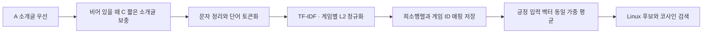

# TF-IDF 소개글과 코사인 검색 — v1

**2026-11-08 준비 완료.** 확정한 A `description` 우선·C `short_description` 결측 보충으로 원문·정리된 소개글·토큰·TF-IDF 벡터를 저장했다. 게임 ID로 긍정 입력을 받아 동일 가중 평균 후 Linux 후보를 코사인 유사도로 검색하는 코드도 구현·검증했다. 이후 2026-11-08 Item-KNN 학습과 두 모델의 공통 검증·frank 테스트도 완료했다. 소개글 설정은 바꾸지 않았으며 [실제 성능](../reports/baseline_v1.md)은 준비·지원 감사와 별도 보고한다.



## 저장 결과

경로는 `EDA/data/processed/modeling/tfidf_content_v1/`이며 대용량 파일은 Git에서 제외한다. 원문은 보존하고 별도 열에 정리된 텍스트를 저장했다.

| 항목 | 전체 입력 게임 | Linux 후보 |
|---|---:|---:|
| 카탈로그 유지 | 37,610 | 6,630 |
| A 소개글 사용 | 36,993 | 6,507 |
| C 짧은 소개글로 보충 | 538 | 106 |
| 원문 확보 | 37,531 | 6,613 |
| 유효 TF-IDF 벡터 | **37,527** | **6,613** |
| 원문 결측 | 79 | 17 |
| 원문은 있으나 토큰 없음 | 4 | 0 |

어휘는 **48,011개**, 행렬은 **37,610 × 48,011**, 0이 아닌 값은 **1,060,845개**다. 행렬 파일은 5,666,382바이트이며, 원문·토큰 등 6개 산출물은 총 26,294,400바이트다. 전체 게임 쌍의 유사도 행렬은 만들지 않는다.

| 파일 | 내용 |
|---|---|
| `descriptions.parquet` | App ID·Linux 표시, A/C 원문, 선택 출처, 선택 원문, 정리된 텍스트, 토큰, 지문, 결측·문자계열·반복·중복 진단 |
| `game_rows.parquet` | 행 번호 ↔ App ID, Linux 표시, 벡터 지원 상태 |
| `tfidf_csr.npz` | L2 정규화한 float32 CSR 희소행렬 |
| `vocabulary_idf.parquet` | 특징 열 번호 ↔ 단어, IDF |
| `duplicate_text_groups.parquet` | 정리 후 동일 소개글 그룹. 게임 자체는 합치지 않음 |
| `parameters.json` | 문자 정리·토큰화·TF-IDF 설정 |
| `manifest.json` | 출처·분할·코드·파일 SHA256, 스키마, 런타임, 검사 결과 |

## 정리·토큰화 규칙

A가 null·빈 문자열·Unicode 공백뿐일 때만 C의 짧은 소개글을 사용한다. A를 정리한 뒤 토큰이 없다는 이유로 C나 긴 소개글로 다시 교체하지 않는다. 태그·장르·평점·리뷰 본문·사용자 이력도 소개글에 섞지 않는다.

NFKC 정규화, HTML 엔티티 해제, 알려진 HTML/BBCode 표시·URL·제어 문자 정리, 공백 통합을 적용한다. 원문 감사에서 HTML 태그는 없었지만 엔티티 24건·URL 10건과 일부 BBCode·특수 공백이 확인됐다. `A**`처럼 의미 있는 표현과 일반 괄호를 일괄 삭제하지 않았다. 요구사항 블록은 발견되지 않았고, 구매·무료 플레이·홍보 문구도 게임 특성일 수 있어 넓은 키워드 규칙으로 제거하지 않았다.

토큰은 소문자 변환 후 Unicode 단어 정규식 `(?u)\b\w\w+\b`로 나눈다. 2자 이상 단어·숫자를 보존하고 불용어 제거·어간 추출은 하지 않는다. TF-IDF는 단어 unigram, `min_df=1`, `max_df=1.0`, 어휘 수 제한 없음, 원래 빈도 TF, smoothed IDF, 게임별 L2 정규화다. 이 설정은 **성능 튜닝 전 초기 기준**이며 검증·테스트 순위 지표를 보고 고르지 않았다.

어휘·IDF 계산 범위는 빈 문서를 포함한 고정 입력 37,610개 게임의 공개 메타데이터다. 비Linux 입력도 같은 특징 공간을 사용한다. 이 과정은 리뷰 분할의 사용자·라벨을 읽지 않는다. 파일별 원본 지문을 고정 참조와 대조했고, 기존 train/validation/test 파일은 그대로 사용한다.

## 품질과 지원 한계

정리 후 동일 소개글은 136그룹·342개 게임에서 나타난다. 원문 기준 135그룹·340개보다 조금 늘었으며 Unicode·공백 정규화에 따른 차이다. 별개 게임 행을 보존하고 동점은 App ID 오름차순으로 정렬한다. 높은 반복률을 보인 한 소개글도 의도적인 `BLAH BLAH` 표현이어서 자동 삭제하지 않았다.

원문이 있으나 영벡터인 4개는 `-`, 이모지·기호만 있는 소개글이다. 네 게임 모두 비Linux다. 이들을 포함한 전체 영벡터 83개와 Linux 원문 결측 17개를 카탈로그에서 제거하지 않는다. 출처 우선순위·원문 존재·정리 후 빈 문자열·토큰화 후 영벡터를 구분해 저장했다.

자동 언어 판별은 적용하지 않았다. Unicode 문자계열만 기록하며 중국어·일본어·러시아어 등의 문서도 유지했다. 기본 단어 토큰화는 공백 없는 CJK 문장을 충분히 분절하지 못하므로 해당 언어의 유사도 품질 한계가 있다. 언어별 분절·문자 n-gram은 후속 실험이다.

실제 고정 평가 파일과 연결한 [지원 감사](../reports/tfidf_content_v1_support.json)는 다음과 같다. **지원 규모만 확인한 결과이며 Recall/NDCG나 추천 성공률이 아니다.** 사용자·정답을 제거하거나 특징 설정을 바꾸는 데 사용하지 않았다.

| 항목 | 내부 검증 | frank 테스트 |
|---|---:|---:|
| 평가 사용자 | 325,639 | 24,342 |
| 긍정 입력 전부가 영벡터인 사용자 | 48 | 2 |
| 영벡터인 숨긴 정답 | 18,921 (**5.81%**) | 34 (**0.14%**) |
| 텍스트 카탈로그 밖 입력·정답 | 0 | 0 |

17개 결측 Linux 게임에는 Left 4 Dead 2, Portal 2, Civilization V, Portal, Inscryption 등이 있어 내부 검증에서 영향이 더 크다. 해당 정답은 소개글 TF-IDF로 양수 점수를 받을 수 없지만 평가에 남는다. 원문을 추가 보충하려면 별도 출처·버전과 규칙 변경으로 다뤄야 한다.

## 검색과 검증

현재는 **전용 벡터DB 대신 CSR 행렬·게임 ID 매핑 파일**을 사용한다. TF-IDF는 차원이 높고 대부분 0인 희소 벡터이며, Linux 후보 6,630개에는 정확한 희소 내적으로 충분하다. L2 정규화 벡터의 내적은 코사인 유사도다. 별도 서버·근사 최근접 검색 없이 파일을 다시 읽어 같은 인덱스를 사용한다.

사용자 취향은 남은 긍정 게임 벡터의 동일 가중 평균 후 L2 정규화한다. `exclude_app_ids`에는 남은 긍정·부정 관측 게임을 모두 전달하며 숨긴 정답은 넣지 않는다. 양수 개인화 점수 후보만 최대 10개 반환하고 부족한 자리는 비운다. 영벡터 프로필이면 빈 목록을 반환하며 평가 분모에는 사용자를 유지해야 한다.

14개 동작 테스트와 저장 파일 17개 위반 검사 모두 통과했다. 저장한 텍스트에서 단어 빈도·`log((1+n)/(1+df))+1` IDF·L2 벡터를 독립적으로 재구성해 비교했고, 로드 후 코사인 검색도 확인했다. [생성 결과](../reports/tfidf_content_v1.json)에 지문과 집계를 기록했다.

```powershell
# 재생성은 별도 출력 경로 사용
EDA/.venv/Scripts/python EDA/scripts/build_tfidf_content.py --output EDA/data/processed/modeling/tfidf_content_v1_rebuild
EDA/.venv/Scripts/python EDA/scripts/verify_tfidf_content.py
EDA/.venv/Scripts/python EDA/scripts/audit_tfidf_support.py
EDA/.venv/Scripts/python EDA/scripts/tfidf_content.py --positive-apps 10 --exclude-apps 10 240 --top-k 10
EDA/.venv/Scripts/python -m unittest discover -s EDA/scripts -p test_tfidf_content.py -v
```

게임 ID 목록을 사용하는 검색 예시는 성능 평가가 아니다. 이후 모델 비교에서는 저장된 동일 query·target·제외 목록을 두 모델이 읽고, TF-IDF 설정 변경도 내부 검증으로만 선택한다.
