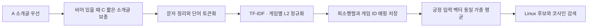

# TF-IDF 소개글과 코사인 검색 — v1

**2026-11-08 준비 완료.** A `description`을 우선하고 비어 있을 때 C `short_description`으로 보충하는 방식으로 원문·정리한 소개글·토큰·TF-IDF 벡터를 저장했다. 게임 ID를 사용해 긍정 입력 벡터의 평균을 내고, Linux 후보를 코사인 유사도로 검색하는 코드도 만들고 확인했다. 이후 2026-11-08 Item-KNN 학습과 두 모델의 공통 검증·frank 테스트도 완료했다. 소개글 설정은 바꾸지 않았다. [실제 성능](../reports/baseline_v1.md)은 자료 준비 및 지원 범위 점검과 별도로 보고한다.



## 저장 결과

파일은 `EDA/data/processed/modeling/tfidf_content_v1/`에 저장했으며 대용량 파일은 Git에서 제외한다. 원문은 그대로 보존하고 별도 열에 정리된 텍스트를 넣었다.

| 항목 | 전체 입력 게임 | Linux 후보 |
|---|---:|---:|
| 카탈로그 유지 | 37,610 | 6,630 |
| A 소개글 사용 | 36,993 | 6,507 |
| C 짧은 소개글로 보충 | 538 | 106 |
| 원문 확보 | 37,531 | 6,613 |
| 유효 TF-IDF 벡터 | **37,527** | **6,613** |
| 원문 결측 | 79 | 17 |
| 원문은 있으나 토큰 없음 | 4 | 0 |

벡터에 쓰인 단어는 **48,011개**다. 단어 행렬은 게임 37,610개 × 단어 48,011개이며, 0이 아닌 값은 **1,060,845개**다. 행렬 파일은 5,666,382바이트, 원문·토큰 등 다른 6개 파일은 총 26,294,400바이트다. 모든 게임 쌍의 유사도를 한꺼번에 저장하는 행렬은 만들지 않는다.

| 파일 | 내용 |
|---|---|
| `descriptions.parquet` | App ID·Linux 표시, A/C 원문, 선택 출처, 선택 원문, 정리된 텍스트, 토큰, 해시값, 결측·문자 종류·반복·중복 진단 |
| `game_rows.parquet` | 행 번호 ↔ App ID, Linux 표시, 특징 벡터를 만들 수 있는지 여부 |
| `tfidf_csr.npz` | L2 정규화된 float32 CSR(압축 행 형식) 희소행렬 |
| `vocabulary_idf.parquet` | 특징 열 번호 ↔ 단어, 역문서 빈도(IDF) |
| `duplicate_text_groups.parquet` | 정리 후 동일 소개글 그룹. 게임 자체는 합치지 않음 |
| `parameters.json` | 문자 정리·토큰화·TF-IDF 설정 |
| `manifest.json` | 출처·분할·코드·파일 SHA256, 열 구조, 실행 환경, 검사 결과 |

## 정리·토큰화 규칙

A가 null·빈 문자열이거나 Unicode 공백만 있을 때 C의 짧은 소개글을 사용한다. A 소개글을 정리한 뒤 토큰이 없다는 이유로 C나 긴 소개글로 다시 바꾸지는 않는다. 태그·장르·평점·리뷰 본문·사용자 이력도 소개글 텍스트에 합치지 않는다.

Unicode 글자를 호환되는 형태로 정리하는 NFKC 정규화, HTML 엔티티 해제, 알려진 HTML/BBCode 표시·URL·제어 문자 제거, 공백 통합을 적용한다. 원문을 확인했을 때 HTML 태그는 없었지만 엔티티 24건·URL 10건과 일부 BBCode·특수 공백이 있었다. `A**` 같은 의미 있는 표현과 일반 괄호는 일괄 삭제하지 않았다. 요구사항 블록은 없었다. 구매·무료 플레이·홍보 문구도 게임의 특성일 수 있으므로 단어 몇 개를 기준으로 넓게 제거하지 않았다.

텍스트를 소문자로 바꾼 뒤 Unicode 단어 정규식 `(?u)\b\w\w+\b`로 나눈 조각을 토큰이라고 한다. 2자 이상 단어와 숫자를 남기고 불용어 제거·어간 추출은 하지 않는다. TF-IDF는 단어 하나씩(unigram)을 쓰며, `min_df=1`, `max_df=1.0`, 어휘 수 제한 없음, 원래 단어 빈도(TF), 평활화한 역문서 빈도(IDF), 게임별 L2 정규화를 적용한다. 이 설정은 **성능을 조정하기 전 초기 기준**이며 검증·테스트 순위 지표를 보고 고른 값이 아니다.

단어 목록과 IDF는 내용이 없는 소개글도 포함한 고정 입력 37,610개 게임의 공개 메타데이터로 계산한다. 비Linux 입력 게임도 같은 단어 목록과 가중치를 쓴다. 이 계산에서는 리뷰 분할에 있는 사용자나 긍정·부정 라벨을 읽지 않는다. 각 파일의 원본 해시값을 고정 참조와 대조했고 기존 train/validation/test 파일은 그대로 사용한다.

## 품질과 지원 한계

정리 후 같은 소개글을 가진 항목은 136개 그룹·342개 게임이다. 원문 기준인 135개 그룹·340개보다 조금 늘었으며 Unicode 문자와 공백을 정리한 데 따른 차이다. 서로 다른 게임 행은 합치지 않고, 동점이면 App ID 오름차순으로 정렬한다. 반복이 많았던 소개글 하나는 의도적으로 `BLAH BLAH`라고 쓴 경우라 자동으로 삭제하지 않았다.

원문은 있지만 특징 벡터가 비어 있는 4개 게임의 소개글은 `-`, 이모지, 기호만으로 이루어져 있다. 네 게임 모두 비Linux다. 이 항목들을 포함해 특징 벡터가 비어 있는 전체 83개 게임과 Linux 원문이 없는 17개 게임을 카탈로그에서 빼지 않는다. 어느 출처를 우선했는지, 원문이 있었는지, 정리 후 빈 문자열이 됐는지, 토큰화 뒤 벡터가 비었는지를 구분해 저장했다.

자동으로 언어를 판별하지 않았다. 어떤 종류의 Unicode 문자가 있는지만 기록하고 중국어·일본어·러시아어 문서도 그대로 유지했다. 기본 단어 나누기는 공백이 없는 중국어·일본어·한국어(CJK) 문장을 충분히 나누지 못해 해당 언어의 유사도를 낮게 계산할 수 있다. 언어별 단어 나누기와 문자 n-gram은 후속 실험이다.

실제 고정 평가 파일과 연결해 조사한 [모델 적용 범위](../reports/tfidf_content_v1_support.json)는 다음과 같다. **표는 모델이 점수를 계산할 수 있는 규모를 보여줄 뿐 Recall/NDCG나 추천 성공률을 나타내지 않는다.** 이 결과로 사용자를 평가에서 빼거나 특징 설정을 바꾸지 않았다.

| 항목 | 내부 검증 | frank 테스트 |
|---|---:|---:|
| 평가 사용자 | 325,639 | 24,342 |
| 긍정 입력 전부가 영벡터인 사용자 | 48 | 2 |
| 영벡터인 숨긴 정답 | 18,921 (**5.81%**) | 34 (**0.14%**) |
| 텍스트 카탈로그 밖 입력·정답 | 0 | 0 |

17개 결측 Linux 게임에는 Left 4 Dead 2, Portal 2, Civilization V, Portal, Inscryption 등이 있어 내부 검증에서 영향이 더 크다. 해당 정답은 소개글 TF-IDF로 양수 점수를 받을 수 없지만 평가에 남는다. 원문을 추가 보충하려면 별도 출처·버전과 규칙 변경으로 다뤄야 한다.

## 검색과 검증

현재는 **전용 벡터 데이터베이스 대신 CSR 형식 희소 행렬·게임 ID 매핑 파일**을 사용한다. TF-IDF 벡터는 단어가 많고 대부분 값이 0인 희소 벡터다. Linux 후보 6,630개에는 희소 벡터의 정확한 내적을 계산하는 방식으로 충분하다. L2 정규화된 두 벡터의 내적은 코사인 유사도와 같다. 별도 서버나 근사 검색 방식 없이 파일을 읽어 같은 ID 매핑을 사용한다.

사용자 취향 벡터는 남은 긍정 게임 벡터를 같은 비중으로 평균하고 L2 정규화해 만든다. `exclude_app_ids`에는 입력에 남은 긍정·부정 게임을 모두 넣고 숨긴 정답은 넣지 않는다. 점수가 양수인 후보만 최대 10개 반환하고 남은 자리는 비워 둔다. 사용자 취향 벡터가 비어 있으면 추천 목록도 비지만, 그 사용자는 평가 분모에 남겨야 한다.

동작 확인 14개와 저장 파일의 오류 검사 17개를 모두 통과했다. 저장한 텍스트에서 단어 빈도·`log((1+n)/(1+df))+1` IDF·L2 벡터를 별도로 다시 계산해 비교했고, 파일을 다시 읽은 뒤 코사인 검색 결과도 확인했다. [생성 결과](../reports/tfidf_content_v1.json)에 파일 해시값과 집계가 있다.

```powershell
# 재생성은 별도 출력 경로 사용
EDA/.venv/Scripts/python EDA/scripts/build_tfidf_content.py --output EDA/data/processed/modeling/tfidf_content_v1_rebuild
EDA/.venv/Scripts/python EDA/scripts/verify_tfidf_content.py
EDA/.venv/Scripts/python EDA/scripts/audit_tfidf_support.py
EDA/.venv/Scripts/python EDA/scripts/tfidf_content.py --positive-apps 10 --exclude-apps 10 240 --top-k 10
EDA/.venv/Scripts/python -m unittest discover -s EDA/scripts -p test_tfidf_content.py -v
```

게임 ID 목록으로 검색하는 예시는 모델 성능 평가가 아니다. 이후 모델 비교에서는 두 모델이 같은 저장 입력 이력(`query`)·정답(`target`)·제외 목록을 읽는다. TF-IDF 설정은 내부 검증 결과만 보고 선택한다.
