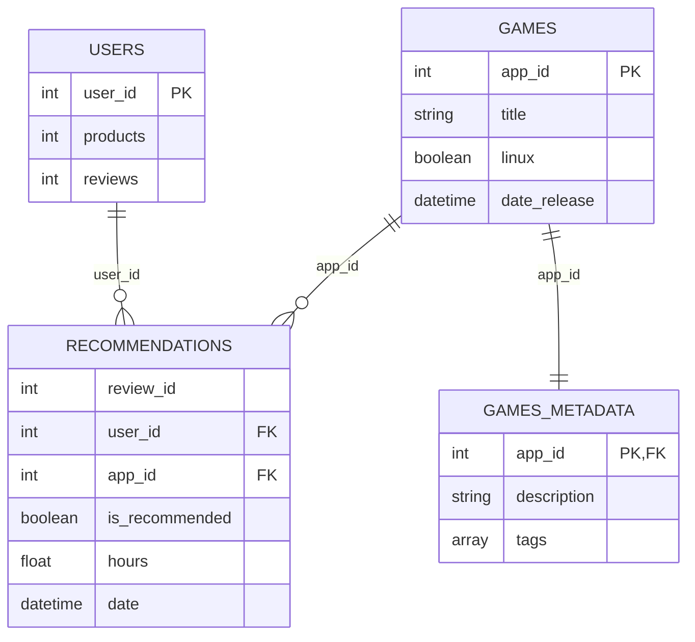
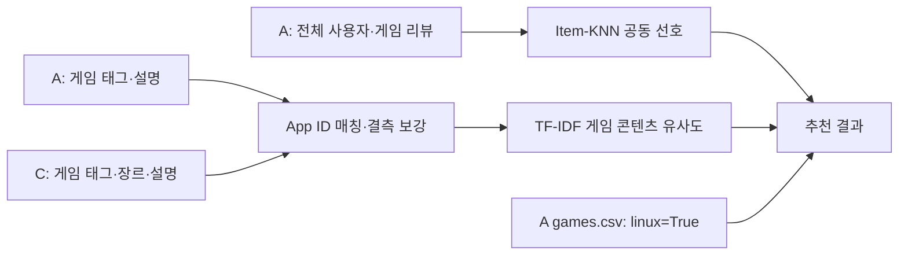

# 데이터셋 A — 파일 구성 및 데이터 간 관계

**Game Recommendations on Steam (v28)** · [Kaggle 원본](https://www.kaggle.com/datasets/antonkozyriev/game-recommendations-on-steam)

> **데이터 출처:** 본 문서의 데이터셋 A는 프로젝트 [`main` README의 ‘A · 학습’](https://github.com/jinSeong-P/ML-game-recommendation/blob/main/README.md)에 명시된 **동일 데이터셋**이다. EDA에서는 해당 데이터셋의 v28을 사용하였다.

## 1. 파일 구성 및 주요 정보

| 파일 | 한 행의 의미 | 핵심 내용 | EDA에서 확인한 행 수 |
|---|---|---|---:|
| [`recommendations.csv`](A_recommendations.csv.md) | **사용자의 게임 리뷰 1건** | 사용자 ID, 게임 ID, 긍정·부정 추천 여부, 플레이 시간, 리뷰 날짜 | 41,154,794 |
| [`games.csv`](A_games.csv.md) | **게임 1개** | 게임 제목, 출시일, 가격, Windows/macOS/Linux 지원 여부, 평가 정보 | 50,872 |
| [`users.csv`](A_users.csv.md) | **사용자 1명** | 사용자 ID, 보유 **제품 수**, 작성한 리뷰 수 | 14,306,064 |
| [`games_metadata.json`](A_games_metadata.json.md) | **게임 1개** | 게임 ID, 설명, 태그 | 50,872 |

## 2. 파일 간 연결 관계 (ER 다이어그램)

*PK는 기본 키, FK는 외래 키에 해당하는 **논리적 연결 관계**를 나타낸다. 원본은 CSV·JSON 파일로 구성되어 있으므로 실제 데이터베이스의 키 제약조건이 적용된 것은 아니다. 다이어그램에는 주요 필드만 표시하였다.*

| 관계 | 연결 컬럼 | 의미 |
|---|---|---|
| `users` → `recommendations` | `user_id` | **1:N**. 사용자 1명에 0건 이상의 리뷰가 대응 |
| `games` → `recommendations` | `app_id` | **1:N**. 게임 1개에 0건 이상의 리뷰가 대응 |
| `games` ↔ `games_metadata` | `app_id` | **1:1**. 동일 App ID를 기준으로 기본 정보와 상세 정보가 일대일 대응 |

**사용자와 게임은 `recommendations.csv`의 리뷰 기록을 통해 연결된다.** `users.csv`의 `products`는 보유 제품의 **목록이 아닌 개수**를 나타낸다.

## 3. 연결 키의 정합성 검증 결과

- `recommendations.csv`에 등장하는 **모든 `user_id`가 `users.csv`에 존재함**을 확인하였다.
- `recommendations.csv`에 등장하는 **모든 `app_id`가 `games.csv`에 존재함**을 확인하였다.
- `games.csv`와 `games_metadata.json`의 **App ID 집합이 일치한다**. 두 파일은 각각 50,872행으로 구성되며, 파일 내부의 App ID 중복은 확인되지 않았다.
- `recommendations.csv`에서는 **동일한 (`user_id`, `app_id`) 조합의 중복 행 21건**이 확인되었다. 따라서 두 컬럼의 조합을 고유 기본 키로 간주할 수 없으며, `review_id`의 고유성 역시 현재 EDA 결과만으로는 확정할 수 없다.

**근거:** [EDA 구조·중복 집계](../../reports/tables/01_structure.csv), [원본·키 정합성 결과](../../reports/eda_metrics.json), [원본 파일·버전 기록](../../data/raw/manifest.json)

## 4. A+C 학습 데이터 연결 및 범위 (설계 방향)

- **학습에 사용하는 리뷰·게임은 Linux 지원 여부와 관계없이 전체를 대상으로 한다.** 사용자 취향을 나타내는 비Linux 게임도 제외하지 않는다.
- A `recommendations.csv`에서 사용자 선호 신호를 학습한다. **공동 긍정 기록을 이용한 Item-KNN은 초기 기준선**이며, 부정 리뷰를 반영하는 규칙은 별도 실험 사항이다.
- 콘텐츠 기반 TF-IDF는 A `games_metadata.json`을 우선 사용하고, **같은 App ID**의 C 설명·태그·장르로 누락 정보를 보완한다. C에는 사용자별 긍정·부정 기록이 없다.
- **추천 출력과 숨김 정답**은 A `games.csv`의 `linux=True` 게임으로 제한한다. 실제 후보를 전체 9,041개로 할지 리뷰가 존재하는 6,630개로 할지는 실험 전에 확정해야 한다.
- 신규 사용자 평가의 정확한 입력·정답 분할과 부정 리뷰 가중치는 **아직 미확정**이다. 위 흐름은 현재 구현된 학습 모델이 아니다.

**참고:** [C 메타데이터의 보완 효과](C_games_march2025_cleaned.csv.md) · [A 리뷰 특성](A_recommendations.csv.md) · [기존 EDA 요약](../../reports/eda_sufficiency_summary.md)

> **문서 범위:** 기존 EDA에서 확인된 데이터 구조 및 연결 관계를 요약하였다. 추가 분석, 전처리 정책 결정 및 모델 학습셋 확정은 이 문서의 범위에 포함되지 않는다.
