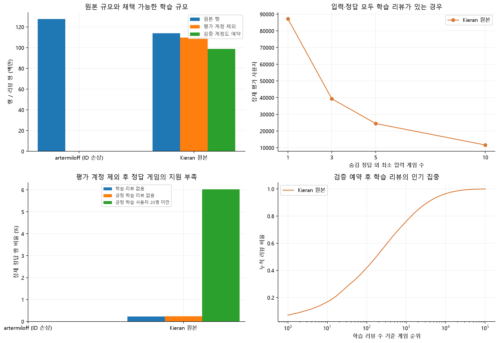
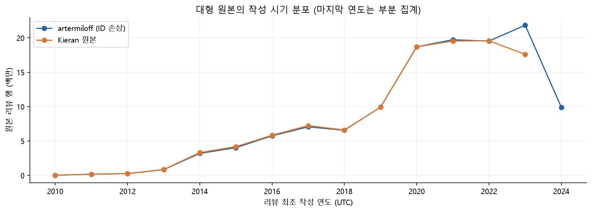

# 대형 원본 → frank 리뷰: 전수 EDA와 최종 판정

분석일: **2026-11-07 (Asia/Seoul)**. artermiloff v1 **127,572,881행**, Kieran v2 **113,883,717행**을 원본 ZIP 전체에서 읽었다. 제한 표본이 아니라 전체 행·필요 열을 집계했다. 모델 학습·최종 분할 파일 생성·자료 채택은 수행하지 않았다.

## 1. 결론

**이전 artermiloff 우선 추천을 수정한다.** artermiloff 원본 CSV의 정수처럼 보이는 Steam ID에도 float64 반올림과 일치하는 정밀도 손실이 확인됐다. 실제 계정 단위 분리가 안 되고 서로 다른 계정의 이력이 합쳐지므로 **현재 원본 조합은 사용 제외**다.

**Kieran 원본 → frank를 권장한다.** 모호한 리뷰–게임 연결과 라벨 충돌을 격리하고 frank 평가 후보 87,573계정을 모든 학습 게임에서 제외했다. 약 10% 검증 계정도 예약한 뒤 **학습 98,857,701쌍·34,014,115계정**이 남는다. 사용자·사용자–게임·원 리뷰 ID 교집합은 모두 **0**이다.

frank의 알려진 게임 연결 모호성을 제거하면 **입력 ≥5 평가 후보 24,571명**이며, 정답 하나를 숨긴 뒤 다른 긍정 입력도 남는 사용자는 **24,342명**이다. 입력은 기존 A 리뷰 게임, 정답은 그중 A의 공식 Linux 게임으로 고정했다. A의 익명 상호작용을 새 학습에 섞지 않았다.

| 조합 | 판정 |
|---|---|
| artermiloff 원본 → frank | **제외: 원본 계정 ID 정밀도 손상·실제 평가 계정 리뷰 잔존** |
| Kieran 원본 → frank | **구성 가능: 원 계정 제외 검증 완료·큰 학습 규모** |

## 2. artermiloff — 정수 모양의 원본 ID도 손상돼 있었다

- 형식·범위를 통과한 **127,572,734행 전부 Steam ID가 16의 배수**였다.
- 공통 원 리뷰 ID **1,270,339개** 중 **1,190,538개(93.72%)**의 작성자 ID가 정확한 frank와 달랐다.
- 중복 포함 공통 리뷰 **1,270,474행 전부**가 `정확한 Steam ID → float64 → integer` 결과와 일치했다. 차이는 -8~+8이었다. 이 변환은 진단에만 사용했고 ID 복원·학습에는 쓰지 않았다.
- 원 ZIP의 CSV **3개·공통 리뷰 197행**을 직접 다시 읽었다. 원문 토큰과 로컬 투영의 차이는 **0행**, 정확한 frank ID와의 차이는 **181행**이었다. 수집 스크립트가 float로 변환해 생긴 문제가 아니다.
- frank와 매칭된 일부만으로도 **7,556개 저장 ID에 실제 15,232계정이 합쳐짐**을 확인했다. 표본에서 한 저장 ID당 최대 4계정이었다.

### 명목상 교집합 0이어도 실제 누수가 남는다

손상된 문자열로 계정을 제외하면 SQL 교집합은 0처럼 보인다. 그러나 원 리뷰 ID를 **정확한 Kieran 원본의 소유자 매핑**과 연결하면 명목상 평가 제외 후에도 실제 평가 계정 **73,847명의 리뷰 2,602,610개**가 남는다. 검증 예약 후에도 **2,344,585개**가 남는다. 이는 매핑 가능한 부분에서 확인한 누수이며 전체 누수의 상한이 아니다.

문자열 변환으로 잃어버린 비트를 복원할 수 없다. 반올림 버킷을 통째로 제외해도 여러 계정이 합쳐진 학습 이력 문제는 남는다. 신뢰할 수 있는 원 리뷰 ID→계정 매핑이 있는 행만 별도로 재구축하는 경로는 가능하지만 현재 원본 전체의 복원은 완료되지 않았다. 이번에는 정확한 Kieran 자체를 사용한다.

artermiloff JSON·게임별 CSV의 사용자/분할/지원 수는 **손상된 저장 ID로 계산한 진단값**이다. 실제 사용자 수나 안전한 학습 규모로 인용하지 않는다. 한 저장 ID가 여러 계정이므로 사용자 이력 길이·공동 출현도 왜곡된다.

## 3. Kieran 원본의 전체 규모·분포·품질

| 지표 | 실측값 |
| --- | --- |
| 원본 행 | 113,883,717 |
| 정리 후 리뷰 쌍 | 113,195,034 |
| 원 Steam 계정 | 37,875,512 |
| App ID | 105,838 |
| 긍정 비율 | 85.60% |
| 사용자별 게임 수 중앙값 / p90 / p99 | 1 / 6 / 25 |
| 한 게임만 리뷰한 사용자 | 20,900,389 |
| 평가 제외 후 상위 50게임 리뷰 비중 | 33.10% |
| 최초 작성 시각 | 2010-10-15 22:24:52 UTC ~ 2023-11-03 16:16:25 UTC |


ID는 CSV부터 문자열로 읽고 형식·범위를 확인한 뒤 손실 없는 64비트 정수로 비교했다. ID·App ID·라벨 형식/결측 격리 행은 **0개**다. 동일 원 리뷰 ID의 내부 소유자 충돌은 **0개**, frank와 공유한 원 리뷰 **1,089,913개**의 계정 불일치도 **0개**다.

반면 동일 원 리뷰 ID **332,865개·686,161행**이 여러 App ID에 연결돼 있었다. 원인을 임의로 확정하거나 어느 게임이 맞는지 추측하지 않고 해당 ID 전체를 격리했다. frank 대조로 추가 발견한 **3개 ID**도 제외했다. 같은 라벨 반복 **2,375행**과 긍정·부정 충돌 **72쌍**도 정리했다.

갱신이 작성보다 이른 시각은 2행, 비어 있는 플레이 시간은 8건이다. `weighted_score_above_08.csv`는 도움됨 점수로 필터한 부분집합이므로 주 리뷰에 섞지 않았다. 게임 종류·지역판 등을 정규화한 자료는 아니므로 정답은 고정 Linux 카탈로그로 제한한다.

## 4. Kieran → frank의 실제 중복·계정 전체 제외

| 지표 | 실측값 |
| --- | --- |
| 정리 후 공통 Steam 계정 | 1,045,364 |
| 공통 원 리뷰 라벨 변경 | 12,600 |
| 정리 전 / 후 공통 리뷰의 App ID 불일치 | 185 / 0 |
| 평가 후보 87,573명 중 실제 제외한 학습 계정 | 79,879 |
| 제외한 학습 리뷰 쌍 | 3,360,025 |
| 평가 계정 제외 후 리뷰 쌍 | 109,835,009 |
| 검증 예약 후 학습 쌍 / 계정 | 98,857,701 / 34,014,115 |
| 제외 후 사용자 / 사용자–게임 / 원 리뷰 교집합 | 0 / 0 / 0 |


정답 리뷰만 지우지 않고 같은 계정의 **모든 게임 리뷰**를 제외했다. 남은 계정의 `steam-eda-validation-v1:<원 Steam ID>` MD5 앞 15자리 값 modulo 10이 0인 계정을 검증용으로 예약했다. 검증 예약 후 긍정 게임 ≥2 사용자는 **13,581,659명**, ≥5는 **4,052,994명**이다.

## 5. frank 평가 후보의 게임 연결 모호성 제거

두 원본에서 확인한 **리뷰–App ID 모호성**의 합집합을 frank에서도 제거했다. **artermiloff의 계정 ID 손상을 frank 계정 오류로 처리하지 않았다.** 실제 App ID가 다르거나 한 리뷰가 여러 게임에 연결된 경우만 사용했다.

frank 전체에 해당하는 원 리뷰 ID는 **296개**다. 기존 평가 명단의 입력 범위에서는 **77쌍·77명**에 영향을 주며 잠재 Linux 긍정 정답은 **38쌍**이다. 이를 제외한 규모는 다음과 같다.

| 숨김 외 최소 입력 | 잠재 사용자 | 다른 긍정 입력도 남는 사용자 | 부정 입력만 남는 사용자 | 가능한 정답 쌍 |
| --- | --- | --- | --- | --- |
| 1 | 87,557 | 78,228 | 9,329 | 184,082 |
| 3 | 39,450 | 38,549 | 901 | 125,593 |
| 5 | 24,571 | 24,342 | 229 | 102,602 |
| 10 | 11,647 | 11,609 | 38 | 76,056 |


새 후보는 기존 87,573계정의 부분집합이다. Kieran 학습에서 상위 집합을 계속 제외하므로 후보 정리 후에도 비중복이 유지된다. 최소 입력 ≥5에서 입력·정답에 Kieran 학습 리뷰가 모두 존재해야 한다면 **24,479명**, 긍정 학습 사용자 ≥5 조건이면 **24,339명**이다. 지원 조건은 진단값이다. 모델마다 지원이 적은 평가 사용자를 임의로 지우지 않는다.

입력은 긍정·부정 리뷰를 모두 센다. 긍정 이웃 기반 Item-KNN에서 부정 입력만 남는 사용자까지 평가하려면 공통 대체 추천 규칙이 필요하다. 긍정 입력 사용자만 평가하려면 모든 모델에 같은 평가 집단을 먼저 고정한다.

## 6. Kieran 학습 근거·메타데이터 연결

| 지표 | 실측값 |
| --- | --- |
| 검증 예약 후 리뷰가 남는 공식 Linux 게임 | 6,603 / 6,630 |
| 평가 제외 후 학습 리뷰가 없는 잠재 정답 | 423 |
| 검증 예약 후 긍정 학습 리뷰가 없는 잠재 정답 | 447 |
| 평가 제외 후 긍정 학습 사용자 20명 미만 정답 | 11,100 |
| A+C 메타데이터가 없는 원본 App ID | 28,867 |
| 설명 / 태그 미연결 학습 리뷰 비중 | 5.60% / 5.56% |


지원 부족 정답 집계는 비교 연속성을 위해 원 명단의 잠재 정답 184,125쌍을 기준으로 한다. 최종 평가 후보 수는 모호 리뷰 제거 결과를 사용한다. 리뷰/긍정 사용자 수는 아이템 학습 근거이며 공동 긍정 이웃이나 Item-KNN 성능이 아니다. 태그·설명 연결은 비어 있지 않은 값의 존재이며 최종 토큰 품질 인증이 아니다. C의 평판·인기도 집계는 학습하지 않았다.





## 7. 최종 구성 조건과 한계

1. Kieran 원본을 기준으로 구성한다. float64 미러·이미 반올림된 artermiloff 원본은 섞지 않는다. 익명 A도 원 계정 비중복을 보장하며 섞을 수 없다. A+C의 고정 카탈로그·설명·태그는 별도 정책으로 쓴다.
2. 모호 리뷰를 제거하고 최소 입력·긍정 입력 조건·숨길 수를 먼저 정한다. 이 EDA는 **긍정 정답 하나를 숨기며 다른 긍정 게임은 입력으로 남을 수 있는 조건**이다. 여러 정답 동시 숨김 결과가 아니다.
3. 분리 단위는 원 Steam 계정이다. 게임 카탈로그는 공유하며 같은 게임의 다른 사용자 리뷰는 학습에 사용할 수 있다. 테스트/검증 계정의 소유·플레이·그래프·캐시도 함께 제외한다. 인기도·k-core·이웃·가중치는 학습에서만 계산하고 설정 선택은 검증셋에서 한다.
4. 실제 저장 파일에서 사용자·사용자–게임·원 리뷰 교집합 0, 입력–정답 교집합 0, Linux 긍정 정답 조건을 다시 확인한다. 현재 산출물은 EDA와 분할안이며 최종 학습/테스트 파일은 아니다.
5. frank는 앱당 최대 100리뷰이며 짧은 이력이 많다. 입력 ≥5는 활동적인 리뷰어 평가다. 보유 목록 기반 평가와 별도이며 입력 시각이 정답보다 앞선지 확인하지 않았으므로 시간순 미래 예측 실험이 아니다. 원본의 플레이 시간도 리뷰 작성자 스냅샷이며 전체 보유 목록은 아니다.

## 8. 산출물·재현

- [실행 노트북](../notebooks/03_large_review_train_test_eda.ipynb), [노트북 소스](../notebooks/03_large_review_train_test_eda.py).
- [원본 ID 정밀도·실제 누수 증거](original_identity_precision_metrics.json).
- [Kieran 전수 집계](kieran_original_frank_eda_metrics.json), [artermiloff 손상 ID 진단](artermiloff_2024_frank_eda_metrics.json), [평가 후보·지원 범위](large_original_frank_comparison_metrics.json).
- [Kieran 게임별 지원 수](tables/16_kieran_original_app_support.csv), [artermiloff 진단값](tables/16_artermiloff_2024_app_support.csv), [규모·판정](tables/16_large_original_comparison.csv).

Kaggle 버전·ZIP SHA256·전체 CSV CRC·Parquet 지문·frank commit·A/C 참조 지문은 JSON에 기록했다. SHA256는 수집 바이트의 고정 지문이며 게시자의 독립 SHA256와 대조했다는 뜻은 아니다. artermiloff는 Windows 마지막 Parquet 핸들 잠금 오류를 수정한 뒤 원 CSV 전체를 다시 읽어 보존 Parquet의 행 수·스키마와 일치를 재확인했다.

저장소 루트 PowerShell. 두 수집/변환 명령은 최초 실행용이며, 완료된 로컬 투영이 있으면 해당 두 단계를 생략하고 EDA부터 실행한다:

```powershell
EDA/.venv/Scripts/python -m pip install -r EDA/requirements.txt
EDA/.venv/Scripts/python EDA/scripts/ingest_artermiloff_original.py
EDA/.venv/Scripts/python EDA/scripts/ingest_kieran_original.py
EDA/.venv/Scripts/python EDA/scripts/eda_large_review_frank.py artermiloff_2024
EDA/.venv/Scripts/python EDA/scripts/eda_large_review_frank.py kieran_original
EDA/.venv/Scripts/python EDA/scripts/audit_original_identity_precision.py
EDA/.venv/Scripts/python EDA/scripts/compare_large_review_frank.py
EDA/.venv/Scripts/python EDA/scripts/build_notebook.py 03_large_review_train_test_eda
EDA/.venv/Scripts/python EDA/scripts/write_large_review_frank_report.py
```

완료 집계 재사용 시에도 투영·카탈로그·frank·분석 코드·결과표 지문을 확인한다. 원본과 사용자별 중간 자료는 Git에서 제외하고 공개 결과에는 집계만 저장한다.

주요 출처: [artermiloff 원본](https://www.kaggle.com/datasets/artermiloff/steam-games-reviews-2024), [Kieran 원본](https://www.kaggle.com/datasets/kieranpoc/steam-reviews), [frank 고정 commit](https://huggingface.co/datasets/frankjc2022/steam-dataset/tree/75694cc07a6cdc69f48f9c316ca1e3e38a3f0f89).
