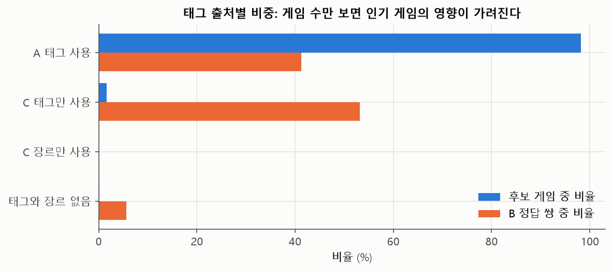
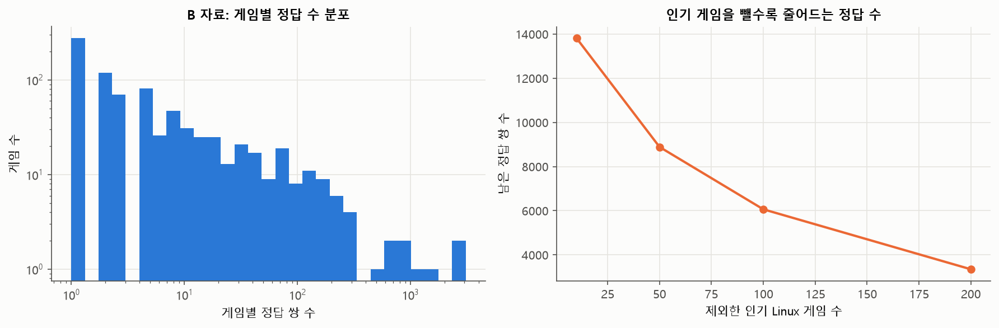
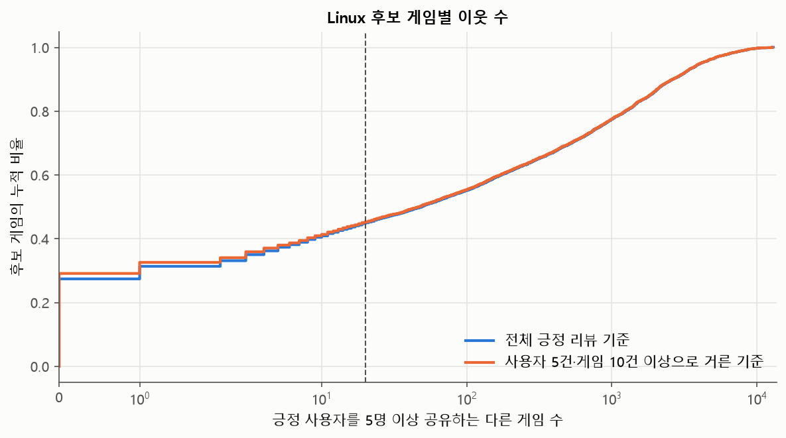
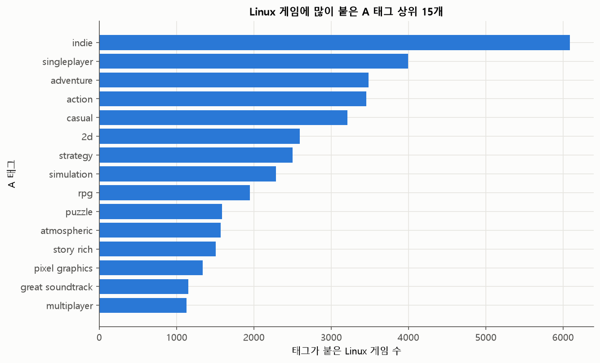
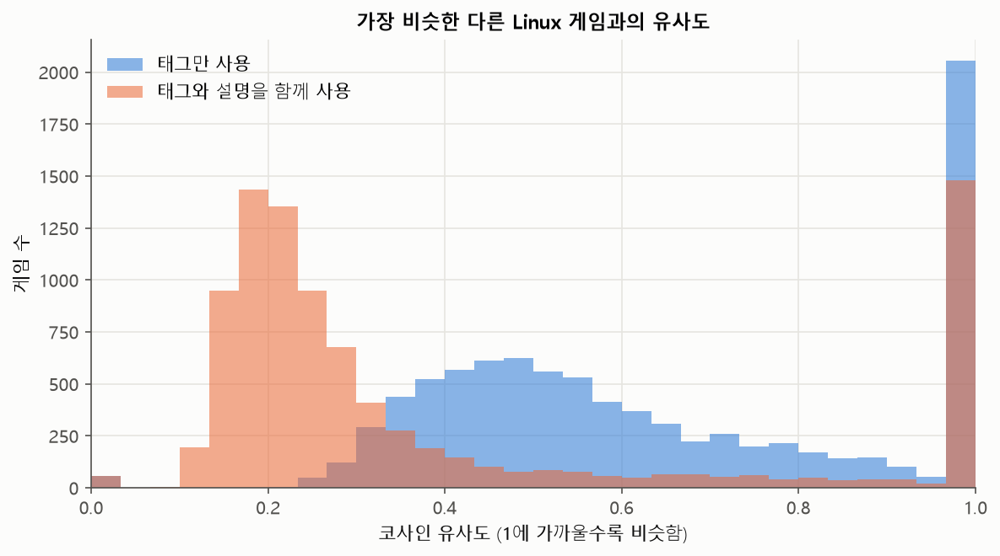
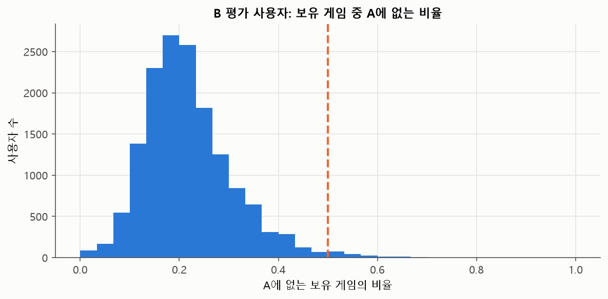

# 현재 데이터로 Linux 게임 추천 실험을 할 수 있는가?

작성: 2026-11-06 (Asia/Seoul). 원본 파일이 기록된 내용과 일치하는지 확인한 뒤 계산했다. 이 보고서는 현재 데이터로 추천 실험을 시작할 수 있는지 살펴본 결과다. 추천 모델의 성능 비교는 아직 하지 않았다. 해석·권고는 *(추정)*으로 표시하며, 추가 데이터 후보의 용량·버전은 공개 문서에 적힌 값이다.

## 읽기 전에

- **학습 데이터(A)**: 사용자들의 추천 여부와 게임 정보를 담은 자료다. 추천 규칙을 만드는 데 쓴다.
- **평가 데이터(B)**: 다른 자료에서 모은 사용자 보유 게임과 리뷰다. 추천 규칙을 만든 뒤 별도로 확인하는 데 쓴다.
- **게임 정보(C)**: A에 없는 태그·장르·설명을 보충하는 자료다.
- **추천 후보**: 추천 결과에 넣을 수 있는 게임이다. 여기서는 A에 리뷰가 있는 공식 Linux 지원 게임 6,630개를 기본 후보로 삼는다.
- **입력 기록**: 사용자 취향을 알아내기 위해 제공하는 보유 게임 목록이다. 평가에 쓸 리뷰 게임은 미리 뺀다.
- **평가용 긍정 기록(정답, 정답 쌍)**: 추천이 맞았는지 확인할 사용자와 게임의 조합이다. 한 사용자가 서로 다른 두 게임을 좋아했다면 2건(2쌍)으로 센다.
- **라벨**: 사용자가 그 게임을 좋아했는지 알려 주는 기록이다. 라벨이 없는 게임은 싫어하는 게임이 아니라 확인할 수 없는 게임이다.
- **메타데이터(게임 정보)**: 제목·태그·장르·설명처럼 게임 자체를 설명하는 정보다.
- **이웃(연결)**: 같은 사용자가 함께 긍정 평가한 다른 게임이다. 함께 좋아한 게임을 바탕으로 추천하는 방식(Item-KNN)에 필요하다.
- **TF-IDF와 영벡터**: TF-IDF는 단어의 중요도를 계산해 태그·설명을 숫자로 바꾸는 방법이다. 비교에 쓸 단어가 하나도 없어 숫자가 모두 0인 경우를 영벡터라 한다.
- **k-core**: 사용자별·게임별 최소 긍정 리뷰 수 기준을 반복 적용해 활동이 적은 기록을 걷어 낸 자료다.
- **인기순 기준선**: 개인 취향을 고려하지 않고 인기 게임부터 추천했을 때의 비교 기준이다.
- **정답 회수율(Recall@10)**: 사용자가 좋아한 게임 중 추천 10개 안에 들어간 비율이다. **순위 점수(NDCG@10)**는 좋아한 게임을 더 위에 추천할수록 높다. 둘 다 클수록 좋다.
- **신뢰구간(CI)**: 평가에 포함된 사용자가 달라질 때 평균 점수가 얼마나 흔들릴 수 있는지 나타내는 범위다. 모델 간 우열을 바로 보장하지는 않는다.
- **백분위수**: p50은 중앙값, p90은 자료의 90%가 그 이하인 값, p99는 99%가 그 이하인 값이다.

표의 원본 CSV 열 이름은 [결과표 읽는 법](tables/README.md)에서 확인할 수 있다. 아래 표의 %는 비율, %p는 두 비율의 차이를 뜻한다.

## 분석 전에 정한 확인 기준

- 한 게임과 다른 게임을 **함께 좋아한 사용자가 5명 이상**인 경우를 연결 하나로 센다. 이런 다른 게임이 **20개 이상**이면 연결 자료가 충분한 것으로 분류한다.
- 게임별 성적은 **평가용 긍정 기록이 5건 이상**인 게임부터 살펴본다.
- 사용자가 가진 게임의 **50% 이상**이 학습 데이터에 없으면, 취향을 알아낼 자료가 많이 빠진 것으로 본다.
- 사용자를 복원추출해 평균을 다시 계산하는 방법(부트스트랩)을 **1,000회** 수행해 **95% 신뢰구간**을 구한다. 같은 결과를 얻을 수 있도록 난수의 시작값을 **42**로 고정한다.
- 태그·설명 비교에는 미리 고른 게임 10개를 쓴다. 긍정 리뷰 수로 게임을 5개 구간으로 나누고, 각 구간에서 게임 번호(App ID)가 작은 2개를 고른다. 게임마다 비슷하다고 나온 5개를 직접 살펴본다.

이 기준들은 자료를 점검하기 위한 기준이다. 추천 정확도가 충분하거나 모델 간 작은 차이도 구별할 수 있다는 보장은 아니다 *(추정)*.

## 질문별 결론

| 검토 질문 | 판단 | 판단이 적용되는 범위 |
|---|---|---|
| 1. 태그·설명으로 비슷한 게임을 추천할 수 있는가? | 조건부 | C 태그가 필수이며 A 단독으로는 부족하다. A 태그 없는 117개 게임이 B 정답 쌍의 58.8%이고, 텍스트가 전혀 없는 게임이 평가용 긍정 기록의 5.6%다. 게임 정보를 보충하고, 그래도 비교 정보가 없을 때 쓸 대체 추천 방법을 정해야 한다 *(추정)* |
| 2. 함께 좋아한 게임을 바탕으로 추천할 수 있는가? | 조건부 | B 정답 기준으로는 충분하다(이웃 부족 게임은 정답 쌍의 0.16%). 다만 후보의 44.8%는 함께 좋아한 게임의 연결이 부족해 대체 추천 방법이 필요하고, 그 품질은 B로 평가할 수 없다 *(추정)* |
| 3. 평가 자료로 모델 간 성능 차이를 알 수 있는가? | 미확정 | 인기순 추천의 신뢰구간만으로 어느 정도의 모델 차이를 구별할 수 있는지 알 수 없다. 모델별 사용자 점수 차이를 구하고, 우연한 차이를 잘못 인정할 허용 수준과 실제 차이를 찾아낼 목표 확률을 정한 뒤 판단한다. 결과 범위는 관측된 B 집합이며 전체 Linux 후보로 일반화할 수 없다 *(추정)* |
| 4. 추가 데이터를 먼저 구해야 하는가? | 조건부 | 학습 데이터(A)의 일부 기록을 따로 남겨 평가하면 프로젝트를 진행할 수 있다. 최근 게임과 더 넓은 게임 범위를 별도 자료로 검증하려면 추가 데이터가 필요하다 *(추정)* |

**빠진 게임의 개수뿐 아니라, 그 게임을 평가한 사용자 수까지 봐야 한다.** 후보 중 A 태그가 없는 게임은 **117개**뿐이지만 인기 상위 50개 중 **39개**가 여기에 속하고 B 정답 쌍의 **58.8%**를 차지한다. 자세한 내용은 7절을 본다.

태그와 설명을 보충한 뒤에도 비교에 쓸 단어가 없는 게임은 두 방식 모두 **56/9,041개**다. 함께 좋아한 게임의 연결 수가 기준보다 적은 후보는 전체 긍정 리뷰에서 **2,968개 (44.77%)**, 리뷰 수가 적은 사용자·게임을 제거한 자료에서 **2,989개 (45.08%)**다. 평가 데이터(B)에 긍정 기록이 없는 후보는 **5,801/6,630개 (87.50%)**이며, 긍정 기록이 5건 이상인 게임은 **313개**다.

## 1. 추천 결과를 확인할 긍정 리뷰가 충분한가?

| 대상 묶음 | 게임 수 | 2016년 이후 출시된 게임 수 | 2016년 이후 출시된 게임 비율(대상 게임 중, %) | 출시 연도 중앙값 | 게임별 A 긍정 리뷰 수 중앙값 |
|---|---|---|---|---|---|
| 정답 기록이 있는 후보 게임 | 829 | 168 | 20.2654 | 2014 | 1,063 |
| 정답 기록이 없는 후보 게임 | 5,801 | 4,941 | 85.1750 | 2018 | 36 |

정답 1쌍 게임은 **277개**, 5쌍 이상은 **313개**, 10쌍 이상은 **207개**다. 5쌍 이상 게임도 후보의 **4.72%**에 그치므로 게임마다 같은 비중을 주어 평균 정답 회수율을 계산할 때는, 평가할 수 있었던 게임 범위를 함께 밝혀야 한다 *(추정)*. 정답 없는 후보는 최근 출시와 낮은 인기도에 치우친다 *(추정)*. 출시 연도·인기 구간·주요 장르별 전체 비교는 [07_candidate_target_comparison.csv](tables/07_candidate_target_comparison.csv)에 있으며 복수 장르는 중복 집계된다.

| 범주 | 후보 수 | 정답 게임 수 | 정답 라벨이 없는 게임 비율(후보 게임 중, %) |
|---|---|---|---|
| 액션 | 2,416 | 417 | 82.7401 |
| 캐주얼 | 2,287 | 194 | 91.5173 |
| 앞서 해보기 | 318 | 15 | 95.2830 |
| 레이싱 | 199 | 16 | 91.9598 |
| 미분류 | 413 | 4 | 99.0315 |

인기 구간별 후보와 정답 범위:

| 범주 | 후보 수 | 정답 게임 수 | 정답 라벨이 없는 게임 비율(후보 게임 중, %) |
|---|---|---|---|
| 0건 | 12 | 0 | 100 |
| 1~9건 | 1,121 | 1 | 99.9108 |
| 10~49건 | 2,198 | 34 | 98.4531 |
| 1,000건 이상 | 843 | 427 | 49.3476 |
| 200~999건 | 1,039 | 266 | 74.3985 |
| 50~199건 | 1,417 | 101 | 92.8723 |

인기 게임을 몇 개까지 제외하느냐에 따라 남는 평가 자료:

| 제외한 인기 상위 게임 수 | 사용자 수 | 정답 사용자-게임 쌍 수 | 정답 게임 수 |
|---|---|---|---|
| 10 | 9,285 | 13,814 | 820 |
| 50 | 6,533 | 8,885 | 786 |
| 100 | 4,737 | 6,062 | 752 |
| 200 | 2,783 | 3,346 | 688 |

인기순 추천 결과와 95% 신뢰구간(사용자를 다시 뽑아 평균 점수의 흔들림을 확인한 범위):

| 평가 대상 범위 | 사용자 수 | 평가 지표 | 추정값 | 신뢰구간 하한 | 신뢰구간 상한 | 신뢰구간 너비 |
|---|---|---|---|---|---|---|
| 전체 대상 | 15,294 | Recall@10(상위 10개 재현율) | 0.5386 | 0.5321 | 0.5455 | 0.0134 |
| 전체 대상 | 15,294 | NDCG@10(상위 10개 순위 품질) | 0.3731 | 0.3679 | 0.3785 | 0.0107 |
| 인기 상위 50개를 정답에서 뺀 평가(후보는 전체) | 6,533 | Recall@10(상위 10개 재현율) | 0 | 0 | 0 | 0 |
| 인기 상위 50개를 정답에서 뺀 평가(후보는 전체) | 6,533 | NDCG@10(상위 10개 순위 품질) | 0 | 0 | 0 | 0 |
| 인기 상위 50개를 정답과 후보에서 뺀 평가 | 6,533 | Recall@10(상위 10개 재현율) | 0.0320 | 0.0282 | 0.0360 | 0.0078 |
| 인기 상위 50개를 정답과 후보에서 뺀 평가 | 6,533 | NDCG@10(상위 10개 순위 품질) | 0.0143 | 0.0127 | 0.0161 | 0.0034 |

전체 정답 회수율의 신뢰구간 폭은 **1.34%p**, 그 절반은 **0.67%p**다. 이는 인기순 추천의 평균 점수가 얼마나 흔들리는지만 보여 준다. 두 모델의 차이가 이보다 크다고 해서 우열이 확실하다고 말할 수는 없다. 실제 비교에서는 같은 사용자를 대상으로 두 모델의 점수 차이를 구하고, 어느 정도의 차이를 얼마나 확실하게 찾아낼지 미리 정해야 한다 *(추정)*. 인기 상위 게임을 정답에서 제외했을 때 신뢰구간이 0–0인 것은 인기순 추천이 정답을 하나도 맞히지 못했다는 뜻이지, 작은 성능 차이까지 잘 찾아낸다는 뜻이 아니다.

시간 분할은 기준일 전 기록으로 학습하고 기준일 이후 기록으로 평가하는 방식이다. 아래 표는 기준일 전 긍정 리뷰가 5건 이상이고 기준일 이후 Linux 게임 긍정 리뷰가 있는 사용자를 센다. 같은 사용자-게임은 한 쌍으로 세고, 신규 게임은 기준일 이전 리뷰가 긍정·부정을 통틀어 하나도 없는 정답 게임이다.

| 시간 분할 기준일 | 사용자 수 | 정답 사용자-게임 쌍 수 | 정답 게임 수 | 신규 정답 게임 수 | 신규 정답 게임 비율(정답 게임 중, %) | 신규 정답 사용자-게임 쌍 수 | 신규 정답 쌍 비율(정답 쌍 중, %) | 기준일 전 필요한 최소 긍정 리뷰 수 |
|---|---|---|---|---|---|---|---|---|
| 2021-01-01 | 282,107 | 670,438 | 5,752 | 1,234 | 21.4534 | 133,608 | 19.9285 | 5 |
| 2022-01-01 | 241,563 | 442,336 | 5,214 | 638 | 12.2363 | 53,821 | 12.1674 | 5 |

리뷰가 충분한 사용자·게임만 남긴 뒤, 사용자별 긍정 리뷰 일부를 숨겨 평가할 수 있는 사용자는 **1,075,039명**, 잠재 정답 게임은 **5,195개**다. 분할·학습 없이 가능한 규모만 센 값이다. 학습 데이터 안에서 이렇게 평가하면 추천 설정을 조정하고 문제를 찾는 데 사용할 수 있다 *(추정)*.

학습 데이터(A)를 2015-12-31까지로 제한하고 사용자·게임별 최소 긍정 리뷰 수를 바꿨을 때 남는 자료:

| 사용자별 최소 긍정 리뷰 수 기준 | 게임별 최소 긍정 리뷰 수 기준 | 사용자 수 | 게임 수 | 사용자-게임 상호작용 수 | Linux 게임 수 | Linux 사용자-게임 상호작용 수 |
|---|---|---|---|---|---|---|
| 1 | 1 | 1,347,743 | 5,689 | 2,729,130 | 1,649 | 1,299,646 |
| 2 | 5 | 412,530 | 4,770 | 1,791,803 | 1,465 | 830,079 |
| 3 | 10 | 217,021 | 3,934 | 1,395,443 | 1,273 | 640,099 |
| 5 | 10 | 96,424 | 3,737 | 990,328 | 1,219 | 447,550 |
| 5 | 20 | 95,573 | 2,958 | 976,234 | 1,001 | 443,169 |
| 10 | 20 | 28,762 | 2,543 | 546,382 | 884 | 242,130 |

B 외부 정답 24,704쌍 중 날짜 미상은 **3,360쌍(13.60%)**, 날짜가 있고 2015-12-31 이하인 정답은 **21,344쌍**이다. A 학습 리뷰를 2015년까지 제한해도 이 정답들보다 뒤의 리뷰가 학습에 들어갈 수 있다. B 보유 이력에는 취득 시점도 없으므로 이 변형은 **학습에 사용할 기간을 바꿔 보는 실험이며, 과거 정보만으로 미래를 예측한 평가는 아니다**. 시간순 성능은 A 내부 시간 분할에서 따로 평가한다.

## 2. 같은 사용자가 좋아한 게임끼리 연결할 수 있는가?

| 비교 기준 또는 출처 | 후보 게임 수 | 필요한 이웃 수에 못 미치는 게임 수 | 이웃이 부족한 게임 비율(후보 게임 중, %) | 긍정 사용자 5명 이상을 공유하는 이웃 수 중앙값 |
|---|---|---|---|---|
| 전체 긍정 리뷰 기준 | 6,630 | 2,968 | 44.7662 | 49 |
| 사용자 5건·게임 10건 이상으로 거른 기준 | 6,630 | 2,989 | 45.0830 | 47 |

각 게임을 다른 게임과 함께 좋아한 사람이 1명·5명·10명·20명 이상일 때의 연결 수는 [08_positive_cooccurrence_neighbors.csv](tables/08_positive_cooccurrence_neighbors.csv)에 있다. 인기별 결과는 [08_positive_cooccurrence_by_popularity.csv](tables/08_positive_cooccurrence_by_popularity.csv)에 있다. 같은 사람의 같은 게임 기록은 한 번만 세고, 자기 자신과의 연결은 뺐다. 메모리 사용을 줄이기 위해 Linux 게임 128개씩 계산했다. 리뷰 수 기준으로 제외된 게임도 연결 0개로 남겨 전체 후보 수를 유지했다.

| 비교 기준 또는 출처 | 평가 대상 범위 | 사용자 수 | 정답 사용자-게임 쌍 수 | 연결 경로가 있는 정답 사용자-게임 쌍 수 | 연결 경로가 있는 정답 쌍 비율(정답 쌍 중, %) |
|---|---|---|---|---|---|
| 전체 긍정 리뷰 기준 | 전체 대상 | 15,294 | 24,704 | 24,689 | 99.9393 |
| 전체 긍정 리뷰 기준 | 인기 상위 50개를 정답에서 뺀 평가 | 6,533 | 8,885 | 8,870 | 99.8312 |
| 사용자 5건·게임 10건 이상으로 거른 기준 | 전체 대상 | 15,294 | 24,704 | 24,686 | 99.9271 |
| 사용자 5건·게임 10건 이상으로 거른 기준 | 인기 상위 50개를 정답에서 뺀 평가 | 6,533 | 8,885 | 8,867 | 99.7974 |

사용자의 보유 게임과 정답 게임 사이에 연결이 있어도, 실제 추천 10개 안에 정답이 들어간다는 보장은 없다. 인기 게임에 기록이 집중된 평가 자료만 보면, 덜 알려진 게임의 어려움을 놓칠 수 있다 *(추정)*.

아래는 학습에 필요한 게임별 최소 긍정 리뷰 수를 바꿨을 때 남는 게임·입력·정답의 비율이다.

| 게임에 필요한 최소 긍정 리뷰 수 | Linux 후보 게임 수 | Linux 후보 비율(전체 Linux 후보 중, %) | B 입력 쌍 비율(B 입력 쌍 중, %) | B 정답 쌍 비율(B 정답 쌍 중, %) | 입력 5개 이상과 정답 1개 이상을 모두 충족하는 사용자 수 |
|---|---|---|---|---|---|
| 5 | 6,197 | 93.4691 | 99.8726 | 99.9919 | 15,294 |
| 10 | 5,497 | 82.9110 | 99.5925 | 99.9919 | 15,294 |
| 20 | 4,526 | 68.2655 | 98.8954 | 99.9838 | 15,292 |
| 50 | 3,299 | 49.7587 | 97.0349 | 99.8421 | 15,281 |

이 표를 보고 추천 설정을 고르지는 않았다. 드물게 등장하는 게임을 빼면 평가 자료는 거의 그대로 남아도 추천할 수 있는 게임의 다양성이 줄어든다. 두 추천 방식을 같은 후보 목록에서 비교하고, 연결 자료가 부족한 게임에는 태그·설명 기반 추천 등 대체 방법을 정해야 한다 *(추정)*.

## 3. 태그와 설명으로 게임을 비교할 수 있는가?

| 분석 대상 묶음 | 게임 수 | 서로 다른 태그 수 | 태그가 있는 게임 비율(해당 대상 묶음의 게임 중, %) | 게임당 태그 수 중앙값 | 5개 미만 게임에만 있는 희귀 태그 비율(전체 태그 중, %) |
|---|---|---|---|---|---|
| 전체 Linux 게임 | 9,041 | 432 | 97.9648 | 12 | 5.5556 |
| A 리뷰가 하나 이상 있는 Linux 게임 | 6,630 | 429 | 98.2353 | 16 | 5.1282 |
| A 자료에서 Linux를 지원하지 않는 게임 | 41,831 | 441 | 97.4660 | 11 | 0.9070 |
| Linux 게임 중 긍정 리뷰 수 상위 20% | 1,809 | 406 | 93.7535 | 20 | 13.3005 |
| Linux 게임 중 긍정 리뷰 수 20~40% 구간 | 1,808 | 413 | 99.8341 | 14 | 18.6441 |
| Linux 게임 중 긍정 리뷰 수 40~60% 구간 | 1,808 | 412 | 100 | 12 | 18.4466 |
| Linux 게임 중 긍정 리뷰 수 60~80% 구간 | 1,808 | 420 | 99.6128 | 7 | 23.3333 |
| Linux 게임 중 긍정 리뷰 수 하위 20% | 1,808 | 388 | 96.6261 | 4 | 29.1237 |

많이 쓰인 태그 20개와 각 태그가 붙은 게임 수는 [10_C_A_tag_top20.csv](tables/10_C_A_tag_top20.csv), [10_C_A_tag_summary.csv](tables/10_C_A_tag_summary.csv)에 있다. 아래는 같은 게임에 대해 A와 C가 가진 태그가 얼마나 겹치는지 비교한 표다. 겹침 점수(Jaccard)는 두 자료의 전체 태그 중 공통 태그의 비율이며, 1이면 완전히 같다. 양쪽 모두 태그가 없으면 점수를 계산하지 않고 따로 센다.

| 분석 대상 묶음 | 비교 대상 | 두 자료에 공통으로 있는 게임 수 | 두 태그 집합이 모두 비어 Jaccard 값을 계산할 수 없는 게임 수 | 합집합이 비어 있지 않은 게임들의 Jaccard 평균 |
|---|---|---|---|---|
| A와 C에 공통으로 있는 전체 게임 ID | A 태그와 C 태그 비교 | 35,876 | 30 | 0.8588 |
| A와 C에 공통으로 있는 전체 게임 ID | A 태그와 C 태그·장르 비교 | 35,876 | 4 | 0.8615 |
| A와 C에 공통으로 있는 Linux 게임 ID | A 태그와 C 태그 비교 | 6,440 | 2 | 0.8731 |
| A와 C에 공통으로 있는 Linux 게임 ID | A 태그와 C 태그·장르 비교 | 6,440 | 0 | 0.8733 |

| 분석 대상 묶음 | A 설명이 없는 게임 수 | 결측 비율(대상 행 중, %) | 비어 있지 않은 설명 글자 수 중앙값 | C 자료로 보완할 수 있는 게임 수 | A 또는 C 설명을 쓸 수 있는 비율(대상 게임 중, %) | 완전히 같은 설명 묶음에 포함된 게임 수 |
|---|---|---|---|---|---|---|
| 전체 Linux 게임 | 2,112 | 23.3602 | 212 | 126 | 78.0334 | 82 |
| A 리뷰가 하나 이상 있는 Linux 게임 | 123 | 1.8552 | 211 | 106 | 99.7436 | 65 |

완전히 같은 설명과 반복 5단어 구절은 각각 [10_C_A_exact_duplicate_descriptions.csv](tables/10_C_A_exact_duplicate_descriptions.csv), [11_C_repeated_phrases.csv](tables/11_C_repeated_phrases.csv)에 있다.

| 분석 대상 묶음 | 설명이 비어 있지 않은 게임 수 | 영문·ASCII 비율 판정 기준 | ASCII 문자 비율이 기준보다 낮은 설명 수 | 영어가 아닐 가능성이 있는 설명 비율(ASCII 기준 추정, %) | 5개 이상 게임에 반복된 다섯 단어 구절 수 |
|---|---|---|---|---|---|
| 전체 Linux 게임 | 6,929 | 0.9000 | 17 | 0.2453 | 211 |
| A 리뷰가 하나 이상 있는 Linux 게임 | 6,507 | 0.9000 | 14 | 0.2152 | 190 |

기본 영문 문자·숫자·기호(ASCII)의 비중이 90% 미만인 설명을 비영어일 가능성이 있는 사례로 셌다 *(추정)*. 실제 언어를 판별한 결과는 아니다. 영문 설명에도 상표 기호가 들어갈 수 있고, 로마자로 쓴 다른 언어는 이 방법으로 찾지 못한다.

| 텍스트 입력 방식 | 텍스트 분석에 사용한 단어 수 | 행렬 희소도(%, 값이 없는 칸) | 전체 후보 중 텍스트 벡터가 비어 있는 게임 수 | 리뷰가 있는 후보 중 텍스트 벡터가 비어 있는 게임 수 | 가장 가까운 게임 유사도의 중앙값 |
|---|---|---|---|---|---|
| 태그만 사용 | 6,460 | 99.5338 | 56 | 10 | 0.5762 |
| 태그와 설명을 함께 사용 | 44,213 | 99.8387 | 56 | 10 | 0.2503 |

**사용자의 보유 게임 중 글 정보로 비교할 수 있는 비율:** 기존 TF-IDF 분포는 Linux 후보만 대상으로 한다. B 평가 입력 1,339,528쌍 중 비Linux 입력은 **790,900쌍(59.04%)**다. 아래는 학습 데이터(A)에 리뷰가 있는 보유 게임 전체를, 앞서 정한 단어 목록과 단어별 중요도로 변환한 결과다. 평가 데이터(B)를 보고 단어나 추천 설정을 다시 고르지 않았다. 게임 정보가 없는 입력 0개도 전체 수에 포함했다.

| 텍스트 입력 방식 | 중복을 제외한 입력 게임 수 | 텍스트 벡터를 만들 수 있는 입력 게임 수 | 텍스트 벡터가 비어 있는 입력 게임 수 | 입력 사용자-게임 쌍 수 | 텍스트 벡터를 만들 수 있는 입력 쌍 수 | 텍스트 벡터를 만들 수 있는 입력 쌍 비율(전체 입력 쌍 중, %) | 사용자 수 | 사용 가능한 입력이 하나도 없는 사용자 수 | 사용 가능한 입력이 5개 미만인 사용자 수 |
|---|---|---|---|---|---|---|---|---|---|
| 태그만 사용 | 7,392 | 7,374 | 18 | 1,339,528 | 1,295,506 | 96.7136 | 15,294 | 0 | 30 |
| 태그와 설명을 함께 사용 | 7,392 | 7,374 | 18 | 1,339,528 | 1,295,506 | 96.7136 | 15,294 | 0 | 30 |

게임 설명을 숫자로 바꿀 수 있다는 것은 취향 비교의 재료가 있다는 뜻이며, 추천이 정확하다는 뜻은 아니다. Linux 조건은 최종 추천 목록에 적용한다. 사용자가 가진 비Linux 게임도 취향 파악에 활용한다. 비교 정보가 없는 게임(영벡터)을 제외할지 다른 자료로 보충할지, 사용자의 정보가 모두 비는 경우 무엇을 추천할지는 따로 정해야 한다 *(추정)*.

태그는 A 자료를 먼저 쓰고, 비어 있으면 C 태그, 그마저 없으면 C 장르로 채웠다. 설명도 A를 먼저 쓰고 없으면 C로 채웠다. 단어의 등장 횟수와 희소성을 이용해 글을 숫자로 바꾸는 방법(TF-IDF)을 사용했다. 단어를 나누는 방식과 설정값은 지표 파일의 `C_tfidf_vectorizer_settings`에 기록했다.

각 게임과 가장 비슷한 다른 Linux 게임의 점수를 계산할 때 자기 자신은 뺐다. 유사도는 보통 0~1이며, 숫자 저장 과정의 반올림 때문에 1을 아주 조금 넘을 수 있다. 태그만 쓴 점수와 설명까지 쓴 점수는 계산에 쓰는 정보가 달라 숫자 크기만으로 성능을 비교할 수 없다.

미리 고른 게임마다 비슷하게 나온 5개와 직접 살펴본 의견 *(추정)*:

| 질의 게임 ID(App ID) | 질의 게임 제목 | 질의 결과에 대한 사람의 검토 의견 | 태그만 사용했을 때 가장 가까운 게임 5개 | 태그와 설명을 함께 사용했을 때 가장 가까운 게임 5개 |
|---|---|---|---|---|
| 10 | Counter-Strike | Counter-Strike 계열이 두 표현에 모두 나타난다. 태그만에서는 다른 FPS도 섞인다. *(추정)* | Counter-Strike: Condition Zero; Counter-Strike: Source; Splitgate; Redneck Rampage Rides Again; Counter-Strike: Global Offensive | Counter-Strike: Source; Insurgency; Counter-Strike: Condition Zero; Day of Defeat; Team Fortress Classic |
| 20 | Team Fortress Classic | 멀티플레이 FPS가 주로 연결된다. 설명 추가 시 Team Fortress 2가 첫 이웃이지만 정확도 향상 근거는 아니다. *(추정)* | Painkiller Hell & Damnation; Deathmatch Classic; Day of Defeat; Half-Life 2: Deathmatch; Team Fortress 2 | Team Fortress 2; Painkiller Hell & Damnation; The Undisputables : Online Multiplayer Shooter; Day of Defeat: Source; Day of Defeat |
| 2810 | X3: Reunion | X 시리즈·우주 시뮬레이션이 이어지지만 X4 확장팩도 포함되어 상품 유형 필터가 필요하다. *(추정)* | X4: Kingdom End; X3: Terran Conflict; Helium Rain; X4: Split Vendetta; X Rebirth | X4: Kingdom End; X3: Terran Conflict; X Rebirth; X4: Split Vendetta; X3: Farnham's Legacy |
| 15400 | Harvest: Massive Encounter | 태그에서는 방어·전략 게임이 연결된다. 설명에서는 DLC와 다른 장르가 섞여 별도 정제가 필요하다. *(추정)* | Anomaly Warzone Earth Mobile Campaign; Anomaly Defenders; Space Run; Defense Zone 2; War in a Box: Paper Tanks | Sanctum 2: The Last Stand; Out There: Ω Edition; Revenge of the Titans; Space Panic Defense; Sanctum 2: Britech Skin Pack |
| 38480 | Earthworm Jim | 속편이 첫 이웃이지만 설명 쪽에는 비주얼노벨도 섞인다. 공통 단어가 관련성을 보장하지 않는다. *(추정)* | Earthworm Jim 2; Titus the Fox; Robotex; Spy Fox in 'Dry Cereal'; Super Cucho | Earthworm Jim 2; UnEpic; Super Cucho; Langoth; Sentimental Trickster: Yaoi BL Gay Visual Novel |
| 38490 | Earthworm Jim 2 | 전작은 일관되게 연결되나 설명 쪽 퍼즐·수족관 게임은 검토가 필요하다. *(추정)* | Earthworm Jim; Robotex; Switch - Or Die Trying; Super Chibi Knight; Prehistorik | Earthworm Jim; Cat's Puzzle  /ᐠ｡ꞈ｡ᐟ\; Megaquarium; Lizard; Super Cucho |
| 360 | Half-Life Deathmatch: Source | A 긍정 리뷰가 없어도 태그나 설명이 비슷한 게임을 만들 수 있다. 설명에서는 Half-Life 계열이 두드러진다. *(추정)* | Quake II RTX; Black Mesa; Half-Life: Source; Metro: Last Light Redux; MadSpace: To Hell and Beyond | Half-Life: Source; Half-Life 2: Deathmatch; Half-Life 2: Lost Coast; Black Mesa; Synergy |
| 1230 | Mare Nostrum | 전쟁 관련 게임·확장팩이 섞인다. 실제 게임 유형과 DLC를 구분해야 한다. *(추정)* | Darkest Hour: Europe '44-'45; Block Heads: Instakill; World War II GI; Company of Heroes 2 - Case Blue Mission Pack; Company of Heroes 2 - Victory at Stalingrad Mission Pack | Red Orchestra: Ostfront 41-45; Darkest Hour: Europe '44-'45; Battle of Empires : 1914-1918; Company of Heroes 2 - Case Blue Mission Pack; Company of Heroes 2 - Victory at Stalingrad Mission Pack |
| 415680 | Europa Universalis IV: Sabaton Soundtrack | 비교 대상으로 고른 항목 자체가 사운드트랙이며 확장팩과 유사도 1의 동률이 발생한다. 게임 후보와 중복 텍스트 점검이 필요하다. *(추정)* | Expansion - Europa Universalis IV: Wealth of Nations; Expansion - Europa Universalis IV: El Dorado; Expansion - Europa Universalis IV: Rights of Man; Expansion - Europa Universalis IV: Cradle of Civilization; Immersion Pack - Europa Universalis IV: Origins | Expansion - Europa Universalis IV: Wealth of Nations; Expansion - Europa Universalis IV: El Dorado; Expansion - Europa Universalis IV: Rights of Man; Expansion - Europa Universalis IV: Cradle of Civilization; Immersion Pack - Europa Universalis IV: Origins |
| 416690 | Oh...Sir! Prototype | 유머·파티 게임 외에 설명 쪽은 음원·보이스팩·에뮬레이터 코어가 섞인다. 비교에 쓸 공통 정보가 부족한 경우의 연결에 주의한다. *(추정)* | Max Gentlemen; Overruled!; Totemori; Paparazzi; Humanity Must Perish | Max Gentlemen; Nekojishi Original Soundtrack; Nekojishi Voice Pack - Chinese; RetroArch - Mesen; RetroArch - Beetle PSX |

확장팩이나 음원 상품이 유사도 1로 연결되기도 했다. 내용이 정말 관련 있어서일 수도 있지만, 같은 문구를 쓰거나 비교할 정보가 적어서일 수도 있다. 장르·시리즈가 맞는 사례도 확인했으나, 이 점검만으로 어느 방식의 추천 정확도가 더 높은지는 판단하지 않았다 *(추정)*.

## 4. 사용자 보유 게임 중 분석에서 빠지는 것은 얼마나 되는가?

| 분류 결과 | 게임 수 | 보유 기록 행 수 | 기존 기타 항목의 전체 보유 기록 중 비율(%) |
|---|---|---|---|
| 메타데이터에 DLC로 표시된 항목 | 23 | 1,548 | 0.1686 |
| 이름으로 DLC·묶음 상품으로 추정한 항목 | 11 | 5,507 | 0.5999 |
| 게임 메타데이터가 있으나 A 누락 사유는 확인되지 않은 항목 | 1,353 | 407,111 | 44.3476 |
| 메타데이터는 있으나 유형이 확인되지 않은 항목 | 133 | 3,530 | 0.3845 |
| 이름으로 서버·개발 도구로 추정한 항목 | 1 | 1,283 | 0.1398 |
| 메타데이터로 소프트웨어·도구로 추정한 항목 | 38 | 3,844 | 0.4187 |
| 이름으로 사운드트랙·영상으로 추정한 항목 | 2 | 17 | 0.0019 |
| 이름으로 테스트·베타·체험판으로 추정한 항목 | 1 | 1 | 0.0001 |
| 게임 메타데이터가 없어 유형이 확인되지 않은 항목 | 1,312 | 495,160 | 53.9389 |

앞선 분석에서 원인을 모르는 항목으로 남긴 게임을 이름과 B·C의 게임 정보로 다시 분류했다. 이름만으로 분류한 결과는 추정이다. 게임 정보가 있다는 사실만으로 학습 데이터에서 빠진 이유를 알 수는 없으므로, 판매 중단이나 판본 교체라고 단정하지 않았다.

많이 보유한 항목부터 확인하면 전체 누락 기록 중 얼마나 설명할 수 있는지 아래에 정리했다.

| 보유자 수 상위 게임 수 | 보유 기록 행 수 | 기존 기타 항목의 전체 보유 기록 중 비율(%) | B 또는 C 메타데이터가 있는 게임 수 |
|---|---|---|---|
| 10 | 143,862 | 15.6712 | 4 |
| 30 | 303,513 | 33.0624 | 14 |
| 50 | 409,199 | 44.5750 | 25 |
| 100 | 552,312 | 60.1646 | 47 |
| 200 | 680,944 | 74.1768 | 95 |
| 500 | 827,994 | 90.1953 | 191 |
| 1,000 | 894,695 | 97.4612 | 440 |
| 2,874 | 918,001 | 100 | 1,562 |

평가 사용자 **15,294명**이 가진 게임 중 A의 게임 목록에 없는 비율은 중앙값 **20.43%**, 90백분위수 **33.33%**다. 보유 게임의 절반 이상이 빠진 사용자는 **178명 (1.16%)**이다. A에 게임 정보만 있는 것으로는 부족하다고 보고 실제 리뷰까지 있는 게임만 허용하면, 빠지는 비율의 중앙값은 **21.80%**, 절반 이상 빠지는 사용자는 **219명**이다. 평가용 리뷰 게임을 먼저 제외한 상태의 누락률도 지표 파일에 따로 저장했다.

B에는 긍정 리뷰가 있지만 A에는 없는 게임 중, C에서 Linux 지원으로 표시한 것은 **114건·15게임**이다. 현재 평가 사용자에 한정하면 **66건·10게임**이며, 이 기록까지 넣으면 정답은 **24,770건**이 된다. 다만 이 게임에는 학습용 사용자 기록이 없어 두 추천 방식을 같은 조건으로 비교할 수 없다. 기존 공통 평가에 합치기보다, 사용자 기록이 없는 게임도 글 정보만으로 추천할 수 있는지 별도로 평가해야 한다 *(추정)*.

## 5. 아직 사용하지 않은 정보는 어디에 쓸 수 있는가?

리뷰에 달린 반응 수 `helpful`를 보면 **78.88%**가 0이고, 99백분위수는 **49**, 최대는 **36,212**다. `helpful`은 도움이 된다는 반응, `funny`는 재미있다는 반응이다. 게시된 기간이나 노출량의 영향을 받을 수 있으므로 사용자가 그 게임을 좋아하는지의 정답으로 쓰지는 않는다 *(추정)*.

리뷰에 달린 반응 수 `funny`를 보면 **93.67%**가 0이고, 99백분위수는 **13**, 최대는 **28,109**다. `helpful`은 도움이 된다는 반응, `funny`는 재미있다는 반응이다. 게시된 기간이나 노출량의 영향을 받을 수 있으므로 사용자가 그 게임을 좋아하는지의 정답으로 쓰지는 않는다 *(추정)*.

공식 Linux 지원 표시와 Steam Deck 지원 표시를 함께 센 결과:

| Linux 지원 여부 | Steam Deck 지원 여부 | 게임 수 |
|---|---|---|
| 아니요 | 아니요 | 2 |
| 아니요 | 예 | 41,829 |
| 예 | 예 | 9,041 |

이 자료에서는 Steam Deck 지원 값이 대부분 참(True)이다. 이것만으로 실제 Deck 호환성을 구분하기 어렵고, 공식 Linux 지원 여부를 대신할 수 없다 *(추정)*. 가격·긍정 비율·리뷰 수는 [13_game_metadata_distributions.csv](tables/13_game_metadata_distributions.csv)에 있으며, 가격은 사용자가 추천 조건을 고르는 데 활용할 수 있다.

A에 수집된 리뷰 수를 상점에 표시된 리뷰 수로 나눈 비율은 중앙값 **0.4821**다. 전체 수집 리뷰 수를 전체 상점 리뷰 수로 나누면 **0.4434**다. 비율이 1을 넘는 게임도 **4,993개**이므로, 전체 리뷰 중 정확히 몇 %를 모았는지를 뜻하지는 않는다. 자료를 모은 시점과 방법이 다를 수 있다 *(추정)*. 묶음 판매 상품 중 Linux 게임을 포함한 것은 **247/615개 (40.16%)**다. 함께 판매된다는 이유만으로 사용자가 두 게임을 함께 좋아한다고 볼 수는 없다.

## 6. 추가 데이터가 필요한가?

지금 범위의 프로젝트를 진행하는 데는 추가 자료가 꼭 필요하지 않다. 다만 최근 게임까지 포함한 전체 Linux 게임을 별도 자료로 검증했다고 말하려면 사용자 선호 기록이 담긴 자료가 더 필요하다 *(추정)*.

현재 프로젝트는 학습 데이터(A)의 일부 기록을 따로 남겨 평가하는 방식으로 진행할 수 있다. 추가 자료를 먼저 구해야만 시작할 수 있는 것은 아니다 *(추정)*. 다만 평가 데이터(B)에 부족한 최근 게임이나 덜 알려진 게임까지 검증하려면 아래 자료를 검토할 수 있다. 용량·이용 조건·수집 기간은 **공개 문서에 적힌 정보**이며, 실제 파일을 내려받아 게임 겹침이나 사용자별 긍정 기록 수를 확인하지는 않았다.

| 데이터 후보 이름 | 보완하려는 데이터 공백 | 이용 허가 조건 | 버전 또는 자료 수집 기간 | Steam 게임 ID(App ID) | 사용자별 긍정 평가 라벨 제공 여부 | 공개 자료에 표시된 크기 | 확인해야 할 위험과 한계 | 비교 기준 또는 출처 | 자료 구조 정보의 출처 |
|---|---|---|---|---|---|---|---|---|---|
| Steam Dataset 2025 (VintageDon) | 최신 외부 긍정 라벨·App 유형 정보; B보다 넓은 시점의 검증 후보 | CC BY 4.0 (data); MIT (code) | v1.0.0, 2025-10 공개; 카탈로그 1997-2025, 수집 2025-08~09; 리뷰 자체의 정확한 최저·최고 날짜는 미검증 | appid 있음 | author_steamid(text), voted_up(boolean) 스키마 확인 | CSV 약 500 MB / SQL 압축 4.2 GB; 문서 기재값, 미다운로드 | 영어 리뷰 표집; 문서별 규모·DOI 표기가 상충하므로 고정 아카이브 및 Linux 교집합·다중 리뷰 사용자 수 확인 필요 | https://github.com/vintagedon/steam-dataset-2025/blob/main/steam-dataset-2025-v1/README.md | https://github.com/vintagedon/steam-dataset-2025/blob/main/steam-dataset-2025-v1/DATA_DICTIONARY.md |
| Mendeley Steam app/player data (Luiz Fernando) | 외부 사용자 긍정 라벨, 보유 이력, game/DLC 유형 구분 | CC BY 4.0 | v1, 2024-09-24 공개; 정확한 수집 기간·리뷰 날짜 범위는 공개 설명에서 미확인 | JSON 키에 App ID 있음 | 익명 steamid + voted_up, timestamp_created 있음 | steam_reviews.json 2 GB; 메타데이터 20.7 MB + 41.4 MB, player_details 37.3 MB (페이지 기재값) | 익명 사용자 매핑이 앱 전체에서 일관적인지, Linux 및 사용자별 긍정 분포를 확인해야 함 | https://data.mendeley.com/datasets/89yxn7hmpt/1 | https://data.mendeley.com/datasets/89yxn7hmpt/1 |
| 100 Million+ Steam Reviews (kieranpoc / adde023 mirror) | 대규모 외부 리뷰·긍정 공동 출현 및 시점 보완 후보 | CC BY-NC 4.0 (미러 카드 기재; 원본과 대조 필요) | HF main, 고정 릴리스·전체 기간 미명시; 공개 뷰어에 2023년 샘플 있음 | appid 있음 | author_steamid, voted_up 있음; 미러 ID는 float64로 표시됨 | Parquet 미러 23.5 GB (페이지 기재값) | 큰 Steam ID의 float64 저장은 정밀도 손실 가능성 *(추정)*. 정수/문자열 원본 보존과 중복·A와의 시점/라벨 중복을 검증하기 전 사용자 단위 분석에 채택하지 않음 | https://huggingface.co/datasets/adde023/steam-reviews | https://www.kaggle.com/datasets/kieranpoc/steam-reviews |

추가 자료를 쓰더라도 사용자 번호는 자료마다 별개로 취급하고 게임만 Steam App ID로 연결한다. 평가 자료를 보며 추천 설정을 조정하지 않는다. 리뷰 날짜와 중복 기록을 확인하고, 이미 학습 데이터에 들어간 리뷰가 평가에 다시 포함되지 않도록 점검한다 *(추정)*.

## 7. 빠진 정보가 실제 평가에 미치는 영향

앞에서는 게임 수를 기준으로 비율을 봤다. 여기서는 각 게임에 B 정답 쌍과 입력 쌍이 얼마나 걸려 있는지까지 함께 본다. 기준이 되는 후보는 리뷰가 있는 Linux 게임 6,630개다.

### 7-1. 태그가 없는 게임에는 인기 게임이 많다

| 사용한 태그·장르 정보의 출처 | 게임 수 | 리뷰가 있는 Linux 후보 게임 중 비율(%) | 이웃 부족 게임이 차지하는 A 긍정 리뷰 비율(전체 A 긍정 리뷰 중, %) | 정답 사용자-게임 쌍 수 | 정답 쌍 비율(비교 대상 전체 정답 쌍 중, %) | Linux 입력 쌍 비율(입력 쌍 중, %) |
|---|---|---|---|---|---|---|
| A 태그 사용 | 6,513 | 98.2353 | 52.5461 | 10,188 | 41.2403 | 78.1511 |
| C 태그만 사용 | 107 | 1.6139 | 42.3930 | 13,124 | 53.1250 | 16.7427 |
| C 장르만 사용 | 0 | 0 | 0 | 0 | 0 | 0 |
| 태그와 장르 없음 | 10 | 0.1508 | 5.0609 | 1,392 | 5.6347 | 5.1062 |

A 태그 없는 **117개** 게임이 정답 쌍의 **58.8%**, Linux 입력 쌍의 **21.8%**를 차지하고, 인기 상위 50개 중 **39개**가 여기에 속한다. 따라서 C 태그는 있으면 좋은 정보가 아니라 꼭 필요한 정보다 *(추정)*. 목록은 [15_candidates_without_A_tags.csv](tables/15_candidates_without_A_tags.csv)에 있다.

A·C 어디에도 태그, 장르, 설명이 없는 후보는 **10개**이며, 이 중 **5개**가 정답 **1,392쌍(5.63%)**을 차지한다. TF-IDF로는 이 게임을 표현하거나 추천할 수 없다. B `steam_games`에 태그나 장르가 있는 게임은 그중 **4개(정답 1,335쌍)**다. 게임 정보는 사용자의 선호를 알려 주는 기록이 아니므로 보충 자료로 쓸 수 있다. 다만 평가 자료인 B의 게임 정보를 쓸지는 실험 전에 규칙으로 정해야 한다 *(추정)*.

### 7-2. 긍정 리뷰는 있는데 보유 기록은 없는 게임

정답 게임 중 **6개**는 B 보유자가 0명이고 정답 쌍의 **17.7%**를 차지한다. Team Fortress 2와 Dota 2만으로 **4,315쌍(17.5%)**이다. 원인은 확인하지 못했다. 다른 무료 게임은 보유 기록이 있으므로 무료 여부만으로는 설명되지 않는다. 이 게임은 입력으로 쓰이지 않고 추천 목록에서 제외되지도 않는다.

인기순 기준선의 정답을 맞힌 경우 중 **35.1%**가 이 게임에서 나왔다. 정답과 후보에서 모두 빼면 Recall@10은 **0.5386 → 0.4529**(95% 신뢰구간 0.4448~0.4610, 12,958명)이다. 관련 항목은 [15_target_games_absent_from_B_ownership.csv](tables/15_target_games_absent_from_B_ownership.csv), [15_B_team_fortress_dota_entries.csv](tables/15_B_team_fortress_dota_entries.csv)에 있다.

### 7-3. 출시일만으로 게임을 제외하면 평가 자료가 줄어든다

A 출시일이 2016년 이후인 정답 게임은 **168개, 2,660쌍(10.8%)**이다. 이 필터를 쓰면 **2,422명**의 정답이 줄고 **1,013명**은 정답이 모두 사라진다. B 리뷰 시점보다 A 출시일이 늦은 것은 앞서 해보기 뒤 정식 출시한 게임 때문으로 보인다 *(추정)*. 목록은 [15_target_games_released_after_2015.csv](tables/15_target_games_released_after_2015.csv)에 있다.

### 7-4. 함께 좋아한 게임이 부족한 경우는 얼마나 되는가?

| 비교 기준 또는 출처 | 필요한 이웃 수에 못 미치는 게임 수 | 이웃이 부족한 게임 비율(후보 게임 중, %) | 이웃이 부족한 게임의 A 긍정 리뷰 비율(전체 A 긍정 리뷰 중, %) | 이웃이 부족한 정답 사용자-게임 쌍 수 | 이웃이 부족한 정답 쌍 비율(정답 쌍 중, %) | 긍정 이웃이 없는 게임 수 | 긍정 이웃이 없는 게임 비율(후보 게임 중, %) | 긍정 이웃이 없는 게임의 A 긍정 리뷰 최대값 |
|---|---|---|---|---|---|---|---|---|
| 전체 긍정 리뷰 기준 | 2,968 | 44.7662 | 0.5067 | 39 | 0.1579 | 1,817 | 27.4057 | 44 |
| 사용자 5건·게임 10건 이상으로 거른 기준 | 2,989 | 45.0830 | 0.5165 | 39 | 0.1579 | 1,930 | 29.1101 | 76 |

함께 좋아한 게임의 연결이 부족한 후보는 많지만, 평가용 긍정 기록에서 차지하는 비율은 작다. 그래서 B에서 계산한 평균 점수만으로는 이 게임들을 잘 추천하는지 판단하기 어렵다 *(추정)*.

### 7-5. 게임 본편과 추가 상품이 섞여 있는가?

| 분석 대상 묶음 | 게임 수 | 제목 패턴에 해당하는 게임 수 | 제목 패턴에 해당하는 비율(대상 게임 중, %) | 태그와 장르가 모두 없는 게임 수 |
|---|---|---|---|---|
| 리뷰가 있는 후보 게임 | 6,630 | 2 | 0.0302 | 10 |
| A 리뷰가 없는 Linux 게임 항목 | 2,411 | 362 | 15.0145 | 46 |

제목 패턴에 의한 대략적인 하한이다. DLC·음원 문제는 A 리뷰 없는 항목에 몰려 있어, 후보를 리뷰 있는 게임으로 한정하면 대부분 사라진다 *(추정)*.

### 7-6. 어느 정도의 성능 차이까지 판단할 수 있는가?

| 평가 대상 범위 | 사용자 수 | 인기순 기준선 재현율 | 기준선 재현율 신뢰구간 반폭(퍼센트포인트) |
|---|---|---|---|
| 전체 대상 | 15,294 | 0.5386 | 0.6698 |
| 인기 상위 50개를 정답과 후보에서 뺀 평가 | 6,533 | 0.0320 | 0.3884 |

표의 반폭은 인기순 추천 신뢰구간 폭의 절반이다. 이 값에 √2를 곱해도 두 모델 사이에서 구별할 수 있는 최소 차이가 되지 않는다. 두 모델이 사용자마다 얼마나 다르게 맞히는지 아직 모르기 때문이다. 모델을 만든 뒤 같은 사용자의 점수 차이를 비교하고, 우연한 차이를 잘못 인정할 허용 수준(유의수준)과 실제 차이를 찾아낼 목표 확률(검정력)을 먼저 정해야 한다. 평균 정답 회수율이 높아진다고 점수의 흔들림도 반드시 커지는 것은 아니다 *(추정)*.

## 다음 실험에서 지킬 사항

1. 학습 데이터(A) 안에서 과거·미래 기록을 나누거나 사용자별 기록 일부를 숨겨 추천 설정을 조정한다. 평가 데이터(B)는 설정을 고정한 뒤 확인한다.
2. 전체 점수와 인기 상위 게임을 제외한 점수를 함께 보고한다. 어떤 게임에 평가 기록이 있었는지도 밝히고, 같은 사용자의 모델별 점수 차이에 신뢰구간을 붙인다.
3. 두 추천 방식은 같은 Linux 게임 목록에서 비교한다. 사용자 기록이나 글 정보가 부족할 때 쓸 대체 추천 방법을 정한다.
4. 태그·설명으로 추천할 때는 C의 태그를 보충한다. 그래도 글 정보가 없는 게임은 별도로 표시하고 보충할 자료를 정한다.
5. B에 긍정 리뷰만 있고 보유 기록은 없는 게임을 포함했을 때와 제외했을 때의 결과를 함께 본다.
6. 출시일만으로 후보를 거르지 않는다. A의 리뷰 기간을 제한하는 실험은 기간을 바꿨을 때 결과가 달라지는지 보는 용도로 설명한다. B의 날짜 미상 리뷰와 취득 시점 없는 보유 목록 때문에 엄격한 미래 예측 평가가 되지는 않는다.
7. 리뷰가 없는 항목까지 추천하려면 게임 본편·확장팩·음원을 구분한다. 설명을 더 넣으면 추천이 반드시 좋아진다고 가정하지 않는다.

위 사항은 이번 자료 점검에 근거한 권고 *(추정)*이며, 모델의 우열은 후속 실험으로 확인해야 한다.

## 실행 결과를 다시 확인한 기록

| 확인한 문제 | 처리 방법 | 처리 결과 |
|---|---|---|
| 처음 쓴 다운로드 스크립트가 Kaggle 자료 정보를 받지 못함(HTTP 404) | 별도 환경에 설치한 공식 Kaggle 명령줄 도구를 사용함 | 파일 9개 확인 |
| `bundle_data.json`을 명령줄 도구로 받을 때 JSON 해석 오류 | 자료 전체 ZIP을 받아 이 파일만 꺼냄 | 파일 크기와 내용 식별값(SHA256) 일치 |
| C 자료 분석 초안에서 태그 형식, 자기 자신 제외, 값 범위 제한 코드 오류 | 태그를 목록으로 바꾸고, 자기 자신을 전체 기준으로 제외하고, 값 범위 제한 코드를 고침 | 기존 수치 자동 확인과 노트북 실행 통과. 판단 기준과 기대값은 바꾸지 않음 |

기존 분석과 같은 수치가 나오는지 자동 확인했다. 학습 자료 규모, 리뷰 수 기준을 적용한 자료, 평가 사용자·정답 수, 인기순 점수가 모두 일치했다.

| A 리뷰 수 | A 리뷰 작성 사용자 수 | A 리뷰가 있는 게임 수 | Linux 게임 수 | 리뷰가 있는 Linux 게임 수 | k-core에 남은 사용자 수 | k-core에 남은 게임 수 | k-core에 남은 사용자-게임 상호작용 수 | k-core에 남은 Linux 게임 수 | 평가 사용자 수 | 정답 사용자-게임 쌍 수 | 정답 게임 수 | 인기순 기준선 Recall@10 | 인기순 기준선 NDCG@10 | 재현 확인 항목 통과 여부 |
|---|---|---|---|---|---|---|---|---|---|---|---|---|---|---|
| 41,154,794 | 13,781,059 | 37,610 | 9,041 | 6,630 | 1,621,480 | 26,064 | 17,986,052 | 5,195 | 15,294 | 24,704 | 829 | 0.5386 | 0.3731 | 예 |

원본 9개 파일의 크기와 내용 식별값(SHA256)이 기록 파일(`manifest.json`)과 일치했다. 다운로드용 임시 폴더는 제거했으며, 분석에 쓰지 않는 대용량 `steam_new.json`은 압축 해제하지 않았다.

분석은 임시 작업 파일 없이 원본 변환 결과에서 다시 실행할 수 있다. `build_notebook.py`는 실행이 성공했을 때만 결과 노트북을 교체한다. 이번에는 자료 점검까지 수행했고 추천 모델 학습·설정 조정·성능 비교와 추가 데이터 다운로드는 수행하지 않았다.

개별 사용자 번호가 공개되지 않도록 입력 손실 표는 구간별 사용자 수만 저장한다([12_B_input_loss_distribution.csv](tables/12_B_input_loss_distribution.csv)). 계산용 JSON에는 결과표를 중복 저장하지 않고 CSV 위치와 행 수를 기록한다.

이번 분석의 결과물은 노트북(`notebooks/02_eda_data_sufficiency.py`, `.ipynb`), 이 보고서, 계산 값을 담은 `eda_sufficiency_metrics.json`, 표(`tables/06_cli_file_verification.csv`, `07_`~`15_`), 그림(`fig07_`~`fig12_`)이다.

## 핵심 그림

