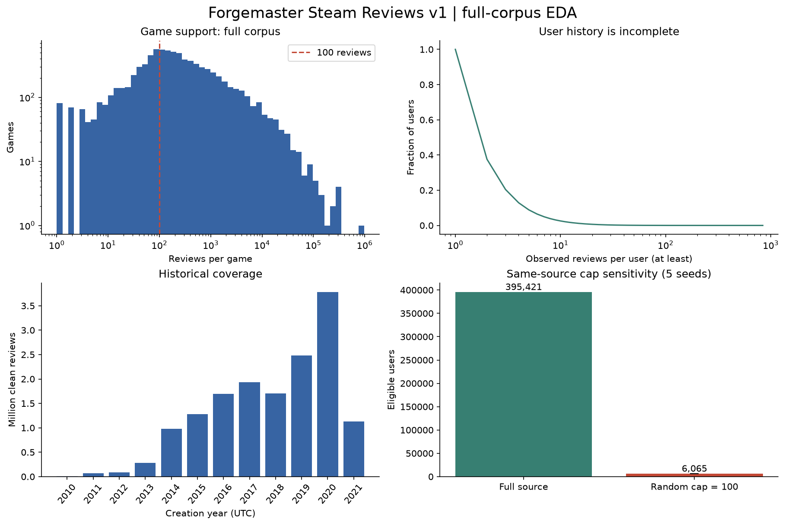
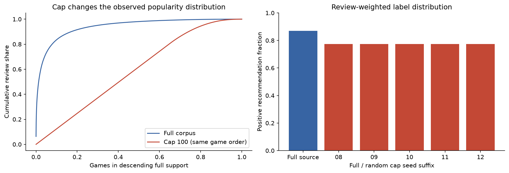

# Forgemaster Steam Reviews 데이터 분석

검토일: 2026-11-08 (KST). [Kaggle 원본](https://www.kaggle.com/datasets/forgemaster/steam-reviews-dataset), **버전 1**, 2021-04-27 배포, CC0. 기존 Kieran·frank 실험의 데이터 분할과 모델 평가 수치는 보존했다.

**후속 모델 평가 완료:** Kieran 원본을 복원하고 평가 계정을 학습에서 제외해 다시 학습했다. 결과는 [모델 평가 보고서](forgemaster_model_evaluation.md)에서 확인할 수 있다. 이 문서의 모델 파일 부재와 학습·평가 계정 중복 미검사는 그 이전 EDA 단계의 상태다.

## 분석 결론

**게임당 리뷰를 최대 100개로 줄였을 때의 영향을 확인할 수 있는 데이터다.** 학습·평가 계정 중복을 확인하기 전의 분석이며, 이후 계정 분리와 모델 평가 결과는 위 후속 보고서에 정리했다.

- CSV 11개 전체, **5,318,015,798바이트(5.318GB)**를 내려받아 파일별 크기와 SHA256을 확인했다. Forgemaster는 모든 행과 열을 검사했다. frank는 지정한 버전에서 비교에 필요한 6개 열의 모든 행을 읽었다.
- 원본 **15,437,471리뷰·6,976,390계정·8,183게임**이다. 5,288개 게임에 100개 초과 리뷰가 있고, 최다는 **976,130개**다. 모든 게임에 일률적인 100개 상한이 걸린 데이터는 아니다.
- 현재 입력·정답 조건을 만족하는 사용자는 **395,421명**이다. 같은 데이터에 게임별 무작위 최대 100개 제한을 적용하면 난수 시드 5개로 만든 표본에서 **5,969–6,130명**, 평균 **6,065명**만 남는다. 평균 **98.47% 감소**다. 제한이 사용자 이력과 평가 집단을 크게 바꾸는 현상을 이 데이터에서 직접 확인했다.
- 지정한 Linux 추천 후보 6,630개 중 **2,210개(33.33%)**만 관측된다. 리뷰가 많아도 최신 게임·전체 후보를 대표하지 않는다.
- 기존 frank와 **594,342계정·149,113사용자–게임 쌍**이 겹친다. 이 EDA를 수행할 당시에는 Kieran 사용자별 학습·검증 파일이 없어 **학습·평가 계정 중복을 검사하지 못했다.** 후속 모델 평가에서는 계정을 분리하고 다시 학습했다.

## 1. 다운로드·파싱 검증

원본: `EDA/data/raw/forgemaster_v1/`. Kaggle 버전 1의 파일별 URL을 지정했다. 다운로드가 ZIP으로 반환되는 파일은 전체 멤버를 읽어 CRC를 확인한 뒤 CSV를 보존했다. 11개 파일의 열은 모두 다음 13개다.

`steamid`, `appid`, `voted_up`, `votes_up`, `votes_funny`, `weighted_vote_score`, `playtime_forever`, `playtime_at_review`, `num_games_owned`, `num_reviews`, `review`, `unix_timestamp_created`, `unix_timestamp_updated`.

`steamid`는 전 과정 문자열로 처리해 17자리 ID 정밀도를 보존했다. DuckDB의 strict 모드가 일부 파일에서 파서 오류를 냈으므로 열·구분자·따옴표를 명시하고 `strict_mode=false`, `ignore_errors=false`로 읽었다. **행을 버리거나 대체하지 않았다.** 별도로 Python CSV 파서로 11개 파일의 모든 레코드가 13열인지 확인했으며, strict 파싱 실패 파일은 **0개**다. Python과 DuckDB의 전체·파일별 행 수가 일치한다. 따라서 DuckDB strict 실패 자체를 원본 CSV 손상으로 해석하지 않는다.

원본 행·계정·게임 수는 배포자가 적은 15,437,471 / 6,976,390 / 8,183과 모두 일치한다.

## 2. 결측·중복·이상값

- 사용자–게임 반복 쌍: **395개**, 중복으로 추가된 행 **693개**.
- 긍정/부정 라벨이 충돌한 사용자–게임: **8쌍**, 해당 원본 행 **22개**. 임의로 마지막 라벨을 선택하지 않고 충돌 쌍 전체를 제외했다. 동일 라벨 반복은 한 쌍으로 합쳤다.
- 정리 후 **15,436,770쌍·6,976,389계정·8,183게임**이다. 이는 같은 사용자와 게임이 반복되는지 검사한 결과다. 모든 열이 완전히 같은 행을 센 값과는 다르다.
- 열별 결측·공백 및 숫자/불리언 변환 실패는 [열별 품질 검사표](tables/forgemaster/02_schema_quality.csv)에서 전체 행을 집계했다. 텍스트 결측·플레이타임 이상값 때문에 선호 라벨을 임의로 바꾸지 않았다.
- 리뷰 본문이 결측·공백인 행은 **24,323개(0.16%)**다. ID·게임·추천 라벨 결측과 모든 숫자/불리언 변환 실패는 0개다.

| 검사 | 행 수 |
|---|---|
| Steam 계정 ID 형식 오류 | 0 |
| 게임 App ID 형식 오류 | 0 |
| 긍정·부정 라벨 결측 | 0 |
| 플레이 시간이 음수 | 0 |
| 리뷰 작성 당시 플레이 시간이 수집 시점 누적값보다 큼 | 7,155 |
| 갱신 시각이 작성 시각보다 빠름 | 0 |
| 작성 시각이 배포 시점 범위 밖 | 0 |
| 사용자 메타데이터가 음수 | 0 |
| 리뷰 투표 수가 음수 | 0 |
| 리뷰 유용성 점수가 유효 범위 밖 | 0 |
| ASCII 이외 문자가 포함된 리뷰 | 437,139 |

시간은 UTC로 해석했다. 작성 시각은 **2010-10-15T22:27:49+00:00–2021-04-23T04:35:33+00:00**다. **갱신 시각이 배포 시각 이후인 행 1개**, 분석일 이후인 행 1개가 있으며 최대 갱신 시각은 **2042-06-04T08:20:08+00:00**다. 이 미래 갱신 시각은 시간순 분할에 그대로 사용하면 안 된다. 평가 조건과 라벨 집계에는 갱신 시각을 사용하지 않았다. `playtime_*`는 Steam API 수치를 보존했고 Steam API의 분 단위로 분석했다. 배포 카드의 hours 표기를 그대로 가중치에 쓰면 단위 오류가 생길 수 있다. 현재 추천 점수와 평가 사용자 집계에는 플레이타임을 사용하지 않는다. `weighted_vote_score`는 리뷰 유용성 점수이며 게임의 선호 점수가 아니다. 선호 라벨은 `voted_up`이다.

## 3. 게임별 분포와 100개 상한

게임별 리뷰 수의 평균 **1,886.4**, 중앙값 **179**, P90 **2,598**, P99 **28,556**, 최대 **976,130**이다. 100개 이하 2,895게임, 정확히 100개 37게임, 100개 초과 5,288게임이다. 전체 리뷰의 **20.93%**가 상위 10개 게임에 몰려 있다.

리뷰마다 같은 가중치를 준 긍정 비율은 **86.96%**, 게임별 긍정률의 단순 평균은 **75.03%**다. 게임을 같은 비중으로 보는지 리뷰를 같은 비중으로 보는지에 따라 수치가 달라진다. 전체 Steam 모집단의 평점으로 해석하지 않는다.

| App ID | 게임 | 리뷰 쌍 | 긍정 비율 | 지정한 Linux 추천 후보 |
|---|---|---|---|---|
| 730 | Counter-Strike: Global Offensive | 976,130 | 88.00% | 예 |
| 359550 | Tom Clancy's Rainbow Six® Siege | 338,197 | 90.15% | 아니오 |
| 105600 | Terraria | 322,227 | 98.15% | 예 |
| 4000 | Garry's Mod | 297,044 | 96.74% | 예 |
| 271590 | Grand Theft Auto V | 294,087 | 76.18% | 아니오 |
| 252490 | Rust | 251,886 | 87.67% | 아니오 |
| 578080 | PUBG: BATTLEGROUNDS | 245,674 | 61.31% | 아니오 |
| 252950 | 고정 게임명 자료 없음 | 193,048 | 89.56% | 아니오 |
| 413150 | Stardew Valley | 157,864 | 98.89% | 예 |
| 346110 | ARK: Survival Evolved | 154,335 | 76.90% | 아니오 |

## 4. 사용자 이력·시간 범위

사용자별 관측 리뷰 수: 평균 **2.21**, 중앙값 **1**, P90 **4**, P99 **16**, 최대 **840**다. 한 게임만 관측된 사용자는 **4,354,616명(62.42%)**으로 기본 추천 평가에는 쓸 수 없다.

`num_reviews`보다 관측한 사용자–게임 수가 작은 계정은 **3,643,665명**이다. 이 필드는 사용자 리뷰 수의 수집 당시의 값이며 서로 다른 게임을 수집한 시각도 다를 수 있다. 따라서 이 비율은 불완전 이력의 참고 지표이며, 사용자 전체 이력을 완전히 수집했다는 보장은 없다. 값이 반대로 큰 계정도 별도 기록했다.

리뷰 작성 연도는 **2010–2021년**이다. 2021년 이후 신규 게임·최근 사용자 행동 검증에는 사용할 수 없다. 2021년 자료를 더 뒤 시점의 Kieran으로 학습한 모델에 넣으면 시간상 미래 예측 검증이 되지 않는다. 같은 Steam 계정이 학습에 있는지도 별도로 확인해야 한다.

## 5. 현재 모델로 평가할 수 있는 범위

게임은 원 Steam App ID로만 연결했다. 공통 입력 게임 목록 37,610개 중 **7,460개**, 지정한 Linux 추천 후보 6,630개 중 **2,210개**가 이 데이터에 있다. Linux 판정은 기존 고정 참조를 따르며 현재 지원 상태를 새로 수집한 것은 아니다. Kieran 집계표와 겹치는 게임은 **7,643개**지만, 게임 중복은 학습·평가 사용자 중복 검사와 다르다.

입력은 고정 카탈로그 안의 긍정·부정 리뷰를 보존한다. 사용자당 관측된 긍정 Linux 게임 하나를 균등 무작위로 숨긴다고 가정하고, 남은 전체 입력 ≥5·긍정 입력 ≥1을 기본 조건으로 삼았다. 아래는 **EDA 단계에서 계산한 평가 가능 규모**다. 이 절의 수치는 추천 성능이 아니며 실제 정답 파일과 모델 평가는 후속 보고서에서 확인할 수 있다.

| 정답을 숨긴 뒤 최소 리뷰 게임 수 | 리뷰 수 조건과 Linux 정답 조건 만족 | 긍정 입력 1개 이상 조건도 만족 | 선택 가능한 사용자–정답 쌍 |
|---|---|---|---|
| 1 | 1,808,495 | 1,715,810 | 3,744,836 |
| 3 | 745,862 | 741,465 | 2,367,624 |
| 5 | 396,238 | 395,421 | 1,679,068 |
| 10 | 135,440 | 135,381 | 920,815 |

기본 평가 조건을 만족한 사용자에게 숨기기 전 선택 가능한 정답은 **1,679,068쌍**이다. 이를 전부 동시에 숨기는 실험이 아니다. 정답 한 개를 숨긴 후 평균 입력 수는 **10.62개**, 중앙값 **7개**다.

## 6. 게임당 리뷰 100개 제한의 영향

정리한 사용자–게임 쌍에서 게임별 최대 100개를 균등 무작위로 남긴다. `hash(steamid, app_id, seed)` 순서와 문자열 ID 동률 처리로 재현하며, DuckDB 버전은 JSON에 기록했다. 게임 선택·연도·라벨·후보 조건을 고정하고 난수 시드 5개의 결과를 비교했다. **frank의 실제 API 정렬·리뷰어 선별을 복원한 실험은 아니다.**

| 난수 시드 | 남은 리뷰 쌍 | 평가 가능한 사용자 | 제한 전 대비 평가 사용자 비율 | 긍정 비율 | 100개 초과 게임의 긍정률 평균 절대오차 |
|---|---|---|---|---|---|
| 20261108 | 660,671 | 6,130 | 1.55% | 77.45% | 2.27%p |
| 20261109 | 660,671 | 6,062 | 1.53% | 77.35% | 2.29%p |
| 20261110 | 660,671 | 6,086 | 1.54% | 77.37% | 2.25%p |
| 20261111 | 660,671 | 6,077 | 1.54% | 77.37% | 2.23%p |
| 20261112 | 660,671 | 5,969 | 1.51% | 77.38% | 2.26%p |

리뷰는 15,436,770쌍에서 매번 **660,671쌍(4.28% 유지)**으로 줄었다. 평가 가능한 사용자 수는 평균 395,421→6,065명으로 **1.53%만 유지**됐다. 여러 게임의 리뷰가 제한 표본에 함께 남은 사용자로 평가 대상이 바뀐다.

100개 초과 게임의 전체 관측 긍정률을 기준으로 제한 표본의 게임별 긍정률 절대오차를 계산했다. 표의 MAE는 **추천 Recall/NDCG나 모델 점수의 오차가 아니다.** 리뷰 가중 전체 긍정률과 인기 분포도 바뀐다. 따라서 frank와 다른 데이터의 평가 점수를 바로 비교해 모델 개선·악화를 판단하면 데이터 선택 효과와 모델 효과가 섞인다. 샘플링을 제거한다고 특정 모델의 점수가 반드시 상승하는 것은 아니다.





## 7. frank와의 중복과 EDA 당시 검사 범위

frank는 기존 지정한 커밋 `75694cc07a6cdc69f48f9c316ca1e3e38a3f0f89`의 전체 2,631,430행에서 식별 정보·라벨·시간 열 6개를 추출했다. 기존 추출 파일의 SHA256과 같은 **`93674b9e0294016d0365e1e2ed07be7883e0f6d77b61b1033294e1c0590155f6`**이다. frank 본문이나 읽지 않은 원본 바이트까지 검증했다는 뜻은 아니다. 기존의 충돌 리뷰 제외 규칙을 적용한 frank 평가 가능 사용자는 **24,342명**으로 기존 보고된 24,342명과 대조한다.

| 항목 | Forgemaster 전체 데이터 | frank 전체 데이터 |
|---|---|---|
| 정리 후 리뷰 쌍 | 15,436,770 | 2,631,416 |
| 원 Steam 계정 | 6,976,389 | 1,336,109 |
| 게임 | 8,183 | 44,517 |
| 게임당 최대 리뷰 | 976,130 | 100 |
| 긍정 비율 | 86.96% | 74.88% |
| 같은 기본 조건의 평가 사용자 | 395,421 | 24,342 |

- 전체 계정 교집합 **594,342명**; 사용자–게임 교집합 **149,113쌍**; 같은 쌍에서 긍정/부정 불일치 **3,629쌍**. 불일치는 시점별 평가 수정이나 수집 차이일 수 있어 임의로 합치지 않는다.
- 두 자료에서 모두 기본 평가 조건을 만족한 사용자는 **13,016명**이다. Forgemaster 평가 가능 사용자 중 frank 전체 계정에도 있는 사람은 **148,210명**이다. 출처가 다르다는 사실은 독립성을 보장하지 않는다.
- forgemaster에는 `recommendationid`가 없다. 사용자–게임은 검사할 수 있지만 원 리뷰 ID 중복과 기존 296개 모호 리뷰 ID의 제외 규칙을 같은 방식으로 적용할 수 없다.
- **이 EDA 당시에는 Kieran 사용자·데이터 분할·모델 파일이 없었다.** 게임별 학습 사용자 수 CSV만으로는 계정 중복을 확인할 수 없었다. 따라서 이 분석만으로 Kieran과 사용자가 겹치지 않는다고 판단하지 않았다. 이후 원본 복원과 중복 계정 제외 재학습을 완료했다.

## 8. 권장 사용 방법

1. **보조 평가:** 기존 6,630개 Linux 후보와 입력·제외·정답 조건을 유지하고 forgemaster용 평가 계정·정답 목록과 검증 정보를 별도 파일에 저장해 고정한다. 관측되지 않은 후보도 원 후보 집합에서 없애지 않는다. 해당 데이터에서 정답으로 관측된 2,210개 게임 범위의 성능임을 밝힌다.
2. **독립성 확보:** Kieran 원 계정/검증·학습 분할을 복구해 정확한 SteamID로 대조한다. 새 테스트 계정이 기존 학습/검증에 있으면 계정 전체를 제외하고 필요한 학습·모델 선택을 다시 수행한다. 이미 쓴 frank와의 중복 계정은 별도 집단으로 보고한다.
3. **100개 제한 영향 비교:** 학습한 모델을 그대로 사용해 같은 데이터의 리뷰 수 제한 전후 비교, 같은 사용자 집단의 입력 축소 비교, 공통 게임·연도·긍정 학습 사용자 수 구간별 결과를 나눠 본다. 실제 frank의 수집 방식 차이는 별도 한계로 둔다. EDA에서 관측한 적격 사용자 감소만으로 Recall 하락 폭을 추정하지 않는다.
4. **지표 보고:** Recall@10/NDCG@10과 함께 평가 사용자 수, 입력 길이, 정답 인기 구간, 게임별 평균 지표, 추천 없음 비율을 보고한다. 이 EDA 보고서는 추천 성능을 계산하기 전의 분석이다. 모델 지표는 후속 보고서에 있다.

## 결과 파일과 재현 방법

- [전체 수치·출처·검증 JSON](forgemaster_eda_metrics.json)
- [실행 결과가 포함된 노트북](../notebooks/02_forgemaster_eda.ipynb)
- 집계표: `reports/tables/forgemaster/`, 그래프: `figures/forgemaster/`
- 원본 CSV·다운로드·검증 기록: `data/raw/forgemaster_v1/`
- 정리한 사용자–게임 쌍·평가 가능 계정·작업 DB: `data/processed/forgemaster_v1/` (계정 ID 포함 파일은 로컬 Git 제외 경로에만 저장)
- frank 비교용 추출 파일·검증 정보: `data/processed/forgemaster_eda/`

저장소 루트 PowerShell에서 실행한다. 기존 분할과 모델을 갱신하지 않는다.

```powershell
.venv/Scripts/python -m pip install duckdb==1.4.3 pandas numpy matplotlib pyarrow nbformat nbclient ipykernel
.venv/Scripts/python EDA/scripts/download_forgemaster.py
.venv/Scripts/python EDA/scripts/fetch_frank_review_comparison.py
.venv/Scripts/python EDA/scripts/verify_forgemaster_csv.py
.venv/Scripts/python EDA/scripts/eda_forgemaster.py
.venv/Scripts/python EDA/scripts/audit_forgemaster_results.py
.venv/Scripts/python EDA/scripts/build_forgemaster_report.py
```

전체 행 수, 파서별 파일 행 수, 게임·사용자·연도별 합계, 사용자–게임 쌍의 중복 여부와 5개 제한 표본의 행 수가 같은지 확인했다. 상세 통과 여부와 모든 원본 파일 SHA256은 JSON에 보존했다.
