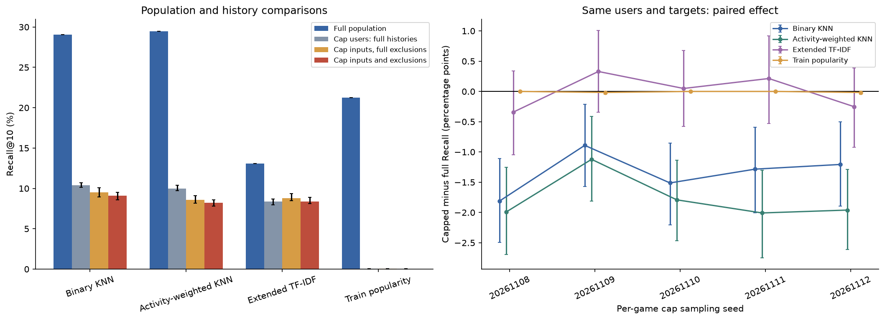

# Forgemaster 모델 평가와 리뷰 수 제한의 영향

2026-11-08 (KST). [실험 전에 정한 평가 방법](../data/reference/forgemaster_cap_protocol_v1.json) · [데이터 품질과 분포 분석](forgemaster_eda.md) · [용어 설명](../docs/terminology.md)

Kieran 리뷰로 학습한 추천 모델을 Forgemaster 리뷰로 평가했다. **게임당 리뷰 수를 제한하지 않은 전체 평가를 중심으로 성능을 설명한다.** 최대 100개 제한을 적용한 평가는 사용자 이력과 평가 대상이 달라질 때 결과가 어떻게 변하는지 확인한다.

## 100개 제한 없는 전체 평가

평가 조건을 만족한 **395,421명** 모두를 평가했다. 각 사용자가 긍정 평가한 Linux 게임 하나를 무작위로 숨기고, 나머지 관측 이력으로 그 게임을 추천하는지 확인했다. 여기서 전체 이력은 이 데이터셋에 수집된 리뷰 전체를 뜻한다.

| 모델 | 평가 사용자 | Recall@10 | NDCG@10 | 추천 없음 비율 | 게임별 평균 Recall |
|---|---|---|---|---|---|
| Item-KNN K=100 | 395,421 | 29.05% | 0.17003 | 0.01% | 7.46% |
| 활동량 보정 Item-KNN | 395,421 | 29.49% | 0.17218 | 0.01% | 7.21% |
| 확장 메타데이터 TF-IDF | 395,421 | 13.09% | 0.07338 | 0.02% | 6.67% |
| 학습 데이터의 인기순 추천 | 395,421 | 21.24% | 0.12993 | 0.00% | 0.51% |

Recall@10은 정답을 추천 10개 안에서 찾은 사용자의 비율이다. NDCG@10은 정답을 더 높은 순위로 추천할수록 높다. 게임별 평균 Recall은 게임마다 Recall을 구한 뒤 같은 가중치로 평균한 값이다. 추천이 없는 사용자도 전체 지표 계산에 포함했다.

## 100개 제한의 영향: 같은 사용자와 정답 비교

Forgemaster의 정리된 리뷰에서 게임별로 최대 100개를 무작위로 남겼다. 난수 시드 5개로 표본을 만들었고, 각 표본의 평가 가능 사용자는 5,969–6,130명이었다. 이 사용자의 제한된 이력에서 정답 하나를 선택한 뒤 다음 세 조건에서 같은 정답을 사용했다.

1. **원래 입력과 전체 제외 목록:** 리뷰를 제한하기 전의 긍정 입력을 사용한다. 이미 리뷰한 모든 게임은 추천에서 제외한다.
2. **제한 입력과 전체 제외 목록:** 점수 계산에 쓰는 긍정 입력만 줄인다. 추천 제외 목록은 유지한다. 1번과 비교하면 입력 손실의 영향을 알 수 있다.
3. **제한 입력과 제한 제외 목록:** 입력과 제외 목록을 모두 수집된 제한 이력에 맞춰 줄인다. 2번과 비교하면 수집에서 빠진 기평가 게임이 다시 추천 후보에 들어오는 영향을 알 수 있다.

다음은 5개 표본의 단순 평균이다. 원래 입력 열도 제한 후 평가 가능한 약 6천 명을 대상으로 한다. 따라서 위의 전체 395,421명 결과와 평가 대상과 정답 구성이 다르다.

| 모델 | 원래 입력 Recall | 제한 입력 Recall | 차이 (%p) | 원래 입력 NDCG | 제한 입력 NDCG | NDCG 차이 |
|---|---|---|---|---|---|---|
| Item-KNN K=100 | 10.42% | 9.08% | -1.34 | 0.06609 | 0.05663 | -0.00946 |
| 활동량 보정 Item-KNN | 10.00% | 8.22% | -1.77 | 0.06354 | 0.04893 | -0.01460 |
| 확장 메타데이터 TF-IDF | 8.37% | 8.37% | -0.00 | 0.05052 | 0.04914 | -0.00137 |
| 학습 데이터의 인기순 추천 | 0.03% | 0.02% | -0.01 | 0.00013 | 0.00009 | -0.00004 |

차이는 3번에서 1번을 뺀 값이다. 겹치는 사용자가 있는 5개 표본을 독립 표본으로 합산하지 않았다.

- **Item-KNN K=100:** 같은 사용자와 정답에서 제한 후 Recall 차이는 **-1.81–-0.89%p**다. 5개 표본 중 **5개**는 차이의 95% 신뢰구간 전체가 0보다 낮았다.
- **활동량 보정 Item-KNN:** 같은 사용자와 정답에서 제한 후 Recall 차이는 **-2.01–-1.12%p**다. 5개 표본 중 **5개**는 차이의 95% 신뢰구간 전체가 0보다 낮았다.
- **확장 메타데이터 TF-IDF:** 같은 사용자와 정답에서 제한 후 Recall 차이는 **-0.34–+0.33%p**다. 5개 표본 중 **0개**는 차이의 95% 신뢰구간 전체가 0보다 낮았다.
- **학습 데이터의 인기순 추천:** 같은 사용자와 정답에서 제한 후 Recall 차이는 **-0.02–+0.00%p**다. 5개 표본 중 **0개**는 차이의 95% 신뢰구간 전체가 0보다 낮았다.

각 표본에서 사용자를 복원 추출해 두 조건의 점수 차이를 2,000회 계산하는 짝지은 부트스트랩(paired bootstrap)으로 95% 신뢰구간을 구했다. 부트스트랩 난수 시드는 20261108로 고정했다. 아래는 표본별 결과다.

| 모델 | 난수 시드 | 평가 사용자 | 원래 입력 Recall | 제한 입력·전체 제외 목록 Recall | 제한 입력·제한 제외 목록 Recall | 차이 (%p, 95% 신뢰구간) |
|---|---|---|---|---|---|---|
| Item-KNN K=100 | 20261108 | 6,130 | 10.55% | 9.25% | 8.74% | -1.81 [-2.50, -1.11] |
| Item-KNN K=100 | 20261109 | 6,062 | 10.11% | 9.75% | 9.22% | -0.89 [-1.57, -0.21] |
| Item-KNN K=100 | 20261110 | 6,086 | 10.12% | 8.92% | 8.61% | -1.51 [-2.20, -0.85] |
| Item-KNN K=100 | 20261111 | 6,077 | 10.60% | 9.68% | 9.31% | -1.28 [-2.01, -0.59] |
| Item-KNN K=100 | 20261112 | 5,969 | 10.71% | 10.07% | 9.50% | -1.21 [-1.89, -0.50] |
| 활동량 보정 Item-KNN | 20261108 | 6,130 | 9.82% | 8.17% | 7.83% | -1.99 [-2.69, -1.26] |
| 활동량 보정 Item-KNN | 20261109 | 6,062 | 9.72% | 9.09% | 8.59% | -1.12 [-1.81, -0.41] |
| 활동량 보정 Item-KNN | 20261110 | 6,086 | 9.73% | 8.18% | 7.94% | -1.79 [-2.46, -1.13] |
| 활동량 보정 Item-KNN | 20261111 | 6,077 | 10.42% | 8.75% | 8.41% | -2.01 [-2.75, -1.30] |
| 활동량 보정 Item-KNN | 20261112 | 5,969 | 10.30% | 8.59% | 8.34% | -1.96 [-2.61, -1.29] |
| 확장 메타데이터 TF-IDF | 20261108 | 6,130 | 8.61% | 8.78% | 8.27% | -0.34 [-1.04, +0.34] |
| 확장 메타데이터 TF-IDF | 20261109 | 6,062 | 7.98% | 8.78% | 8.31% | +0.33 [-0.35, +1.01] |
| 확장 메타데이터 TF-IDF | 20261110 | 6,086 | 8.07% | 8.48% | 8.12% | +0.05 [-0.58, +0.67] |
| 확장 메타데이터 TF-IDF | 20261111 | 6,077 | 8.70% | 9.35% | 8.92% | +0.21 [-0.53, +0.92] |
| 확장 메타데이터 TF-IDF | 20261112 | 5,969 | 8.46% | 8.59% | 8.21% | -0.25 [-0.92, +0.39] |
| 학습 데이터의 인기순 추천 | 20261108 | 6,130 | 0.02% | 0.02% | 0.02% | +0.00 [+0.00, +0.00] |
| 학습 데이터의 인기순 추천 | 20261109 | 6,062 | 0.07% | 0.07% | 0.05% | -0.02 [-0.05, +0.00] |
| 학습 데이터의 인기순 추천 | 20261110 | 6,086 | 0.03% | 0.03% | 0.03% | +0.00 [+0.00, +0.00] |
| 학습 데이터의 인기순 추천 | 20261111 | 6,077 | 0.00% | 0.00% | 0.00% | +0.00 [+0.00, +0.00] |
| 학습 데이터의 인기순 추천 | 20261112 | 5,969 | 0.03% | 0.03% | 0.02% | -0.02 [-0.05, +0.00] |



왼쪽의 전체 집단과 제한 후 집단은 사용자가 다르다. 오른쪽은 같은 사용자와 정답을 비교한다. 왼쪽 오차 막대는 5개 표본의 최소–최대, 오른쪽은 표본별 95% 신뢰구간이다.

## 점수 변화의 요인

전체 평가에서 제한 후에도 평가 가능한 사용자만 추리고, 이후 정답 선택·입력·제외 목록을 차례로 바꿨다. 각 단계의 Recall 차이를 5개 표본에 걸쳐 평균한 결과다. 네 단계 차이의 합이 전체 점수 차이와 일치하는지 확인했다.

| 모델 | 평가자 선택 (%p) | 정답 변경 (%p) | 입력 축소 (%p) | 제외 목록 축소 (%p) |
|---|---|---|---|---|
| Item-KNN K=100 | -12.33 | -6.30 | -0.89 | -0.46 |
| 활동량 보정 Item-KNN | -12.68 | -6.81 | -1.44 | -0.34 |
| 확장 메타데이터 TF-IDF | -3.56 | -1.17 | +0.43 | -0.43 |
| 학습 데이터의 인기순 추천 | -17.09 | -4.11 | +0.00 | -0.01 |

앞의 두 열은 평가 사용자와 정답 구성이 달라지는 영향이다. 뒤의 두 열은 같은 사용자와 정답에서 입력과 추천 제외 목록이 달라지는 영향이다. 정답 변경에는 무작위 추출에 따른 변동도 포함된다. [단계별 Recall·NDCG 계산표](tables/forgemaster_models/03_population_target_profile_mask_decomposition.csv)에 전체 수치를 저장했다.

## 학습 데이터 분리와 모델 재학습

기존 저장소에는 과거 모델의 학습 파일과 `split_v1` 데이터 분할이 없었다. Kieran 원본 버전 2 ZIP **17,241,297,932바이트**를 다시 받고 식별 정보가 있는 열을 변환했다. 파일 SHA256은 기존 기록 `ec3234d1ff0831f5a20752059df1c85dfe66ab0efde95b886c7cc3a11d0430b7`와 일치했다. 압축 파일의 모든 멤버 CRC와 원본 113,883,717행을 검사했다. 리뷰 ID 충돌과 라벨 충돌을 기존 규칙으로 제외한 113,195,034쌍에서 새 학습 데이터를 만들었다.

- Forgemaster 평가 가능 **395,421계정**과 기존 frank 평가용 **87,573계정**을 합친 **451,959계정**의 리뷰를 학습에서 미리 제외했다.
- Forgemaster 평가 계정 중 Kieran에도 있는 계정은 **391,495명**이었다. 이들의 Kieran 리뷰 **11,106,960쌍**을 모두 제외했다.
- 과거 분할 방법으로 복원한 긍정 학습 데이터는 **78,315,268쌍**으로 기존 기록과 같았다. 이 분할에는 Forgemaster 평가자 **323,966명**이 포함될 수 있었다. 이번 학습에서는 이 계정을 제외했다.
- 기존 검증 계정 분리 방법(MD5 계정 해시 기준)도 유지했다. 새 학습 데이터는 지정한 게임 목록 안의 긍정 **72,292,011쌍·29,513,014계정**이다. 긍정 리뷰가 한 개뿐인 사용자도 게임별 학습 사용자 수와 코사인 정규화 계산에 포함했다.
- 학습 데이터와 사전에 분리한 평가 계정의 교집합은 **0**, 검증 계정 교집합은 **0**, 중복 학습 쌍은 **0**이다.

새 평가자를 학습에서 제외했으므로 과거 모델과 가중치가 완전히 같지는 않다. 기존에 선택한 알고리즘, 이웃 수 K=100, 콘텐츠 결합 비중 50:50을 유지해 별도 학습했다. 과거 실험의 분할·보고서·모델 선택 기록은 보존했다. Forgemaster 점수를 보고 설정을 다시 고르지 않았다.

## 공통 평가 방법

Steam 계정 ID는 정밀도 손실 없는 정수 또는 문자열로 읽었다. 입력 게임 37,610개와 Linux 추천 후보 6,630개를 공통으로 사용했다. 학습 리뷰가 없는 후보도 목록에 남겼다.

사용자별 긍정 Linux 게임 하나를 동일한 확률로 골라 정답으로 숨겼다. 숨긴 뒤 남은 리뷰 게임이 5개 이상이고 그중 긍정 게임이 1개 이상인 사용자를 평가했다. 점수에는 남은 긍정 리뷰만 사용하고, 남은 긍정·부정 리뷰 게임은 모두 추천에서 제외했다. 숨긴 정답은 추천 제외 목록에서 뺐다.

양수 점수를 받은 게임을 최대 10개 추천하고 점수가 같으면 App ID 오름차순으로 정렬했다. 추천이 부족해도 다른 방법으로 채우지 않았다. 인기순 추천은 별도의 비교 모델이다. 정답이 한 개이므로 적중 시 NDCG는 `1/log2(정답 순위+1)`이며 계산에는 float64를 사용했다.

기본 Item-KNN은 두 게임을 함께 긍정 평가한 사용자 수로 코사인 유사도를 구하고, 각 추천 후보에 유사한 입력 게임 100개를 저장한다. 활동량 보정 모델은 사용자의 긍정 게임 수 역수를 공동 기여도와 게임별 가중 사용자 수에 적용한다. **이웃 수 K=100은 게임당 리뷰 100개 제한과 다른 설정이다.**

콘텐츠 모델은 `Game Recommendations on Steam`의 소개글을 우선 쓰고, 없으면 `Steam Games 2025`의 짧은 소개글로 보충한다. 설명의 단어·연속 두 단어 TF-IDF 유사도 50%와 태그·장르·범주·개발사·배급사 TF-IDF 유사도 50%를 합친다. 두 채널의 사용자 벡터를 각각 정규화하며 공개 게임 정보만으로 학습한다.

## 해석 범위와 사용 방법

**리뷰 수 제한이 없는 결과를 중심으로 보고하고, 100개 제한 결과는 제한의 영향을 설명하는 데 사용한다.** 협업 모델의 하락은 확인됐지만 기존 Kieran·frank 점수 차이 전체가 100개 제한 때문이라고 단정할 수는 없다. 이번 무작위 표본 추출은 실제 frank API의 정렬과 리뷰어 선택을 재현하지 않는다.

데이터는 2021년 4월까지의 이력이며 Linux 후보 중 2,210개만 관측한다. Kieran 학습 자료와 고정 게임 정보는 더 뒤 시점의 자료도 포함하므로 미래 예측 성능을 측정한 실험이 아니다. 수집 시점과 게임 선택의 편향도 남아 있다.

Forgemaster에는 원 리뷰 ID인 `recommendationid`가 없다. 과거 실험의 리뷰 ID 충돌 제외 방법을 똑같이 적용할 수 없어 사용자–게임 라벨 충돌을 제외하고 평가 계정 전체를 학습에서 차단했다. 이번 모델의 학습·평가 사용자 중복은 해소했다. 다만 모델 설정은 과거 내부 검증에서 고른 값을 사용했으며 그때의 선택 과정을 새 계정 분리 기준으로 다시 수행한 것은 아니다. 따라서 모든 과거 개발 과정에서 독립된 최종 테스트로 해석하지 않는다.

## 검증과 재현 방법

작은 수치 예제로 자기 이웃 제외, 동점 처리, 학습 자료가 없는 긍정 입력의 분모 유지, 두 콘텐츠 채널의 개별 정규화, 빈 추천의 분모 유지, 정확한 Steam ID와 적중 순위·NDCG를 검사했다. 실제 저장 파일에서는 정답이 입력에 없는지, 추천에 제외 대상·중복·잘못된 순위와 점수가 없는지 확인했다. 사용자별 지표와 추천을 저장하고 파일 해시값을 기록했다. 독립 검산은 저장된 적중 순위에서 Recall·NDCG를 다시 계산하고 추천 순서도 확인한다.

- [평가 수치·신뢰구간·학습 정보 JSON](forgemaster_model_evaluation.json)
- [모든 조건의 평가 지표 CSV](tables/forgemaster_models/01_model_metrics.csv)
- [같은 사용자·정답의 점수 차이와 신뢰구간 CSV](tables/forgemaster_models/02_paired_differences.csv)
- [저장 결과 검산 로그](forgemaster_model_evaluation_audit.txt)
- 모델·학습 데이터·사용자별 결과: `data/processed/modeling/forgemaster_cap_study_v1/` (Git 제외)

저장소 루트의 PowerShell에서 실행한다.

```powershell
.venv/Scripts/python EDA/scripts/ingest_kieran_original.py
.venv/Scripts/python EDA/scripts/forgemaster_model_study.py prepare
.venv/Scripts/python EDA/scripts/forgemaster_model_study.py content
.venv/Scripts/python EDA/scripts/forgemaster_model_study.py source
.venv/Scripts/python EDA/scripts/forgemaster_model_study.py fit
.venv/Scripts/python -m unittest discover -s EDA/scripts -p test_forgemaster_model_study.py -v
.venv/Scripts/python EDA/scripts/forgemaster_model_study.py evaluate
.venv/Scripts/python EDA/scripts/summarize_forgemaster_model_study.py
.venv/Scripts/python EDA/scripts/audit_forgemaster_model_evaluation.py
```
