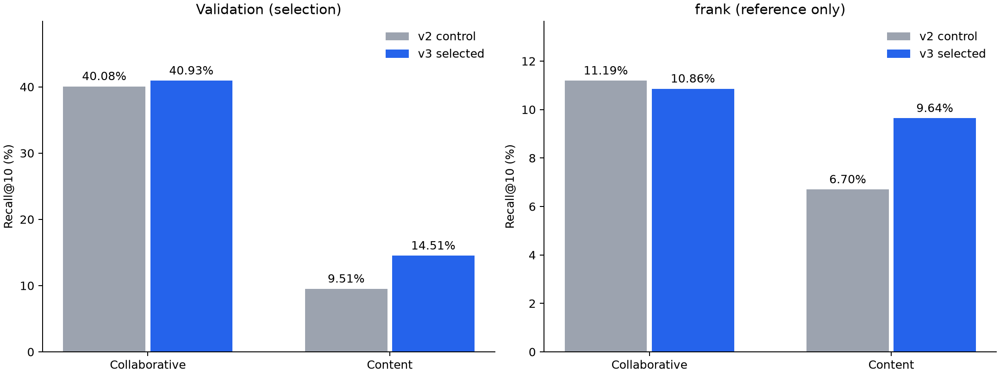

# 추천 모델 개선 실험 v3

사전에 등록한 모델·입력·정책 설정 **83개**를 같은 내부 검증에서 비교했다. 기본·보조 평가 경로에 저장한 실행은 **123개**이며, 시간 경계를 두고 다시 학습한 별도 실험 1개도 수행했다. v1/v2 데이터·모델·결과는 보존하고 새 산출물은 별도 경로에 저장했다.

Recall@10은 숨긴 긍정 게임을 추천 10개 안에서 찾은 사용자 비율이다. 추천 10개 전체의 정확도나 구매 전환율이 아니다. 주 검증은 같은 325,639명·정답 1개·Linux 후보 6,630개를 사용한다.

## 선택한 모델과 실제 성능

| 계열 | 검증 선택 | 검증 Recall@10 | 검증 NDCG@10 | 기존 frank 평가 Recall@10 | 기존 frank 평가 NDCG@10 |
|---|---|---:|---:|---:|---:|
| 협업 필터링 | Activity-weighted Item-KNN (1/degree) | 40.9285% | 0.251506 | 10.8578% | 0.070161 |
| 콘텐츠 기반 | Descriptions + extended metadata | 14.5075% | 0.083372 | 9.6418% | 0.061489 |
| 결합 모델 비교 기준 유지 | Item-KNN K100 (v2 control) | 40.0757% | 0.244328 | 11.1905% | 0.074859 |

**콘텐츠는 내부 검증과 frank 모두 개선됐지만, 협업 모델은 내부 검증에서 개선되고 frank에서는 하락했다.** 기존 v2 대비 Recall@10은 협업이 검증 40.0757%→40.9285%(+0.8528%p), frank 11.1905%→10.8578%(−0.3327%p)이며, 콘텐츠는 검증 9.5102%→14.5075%(+4.9973%p), frank 6.7004%→9.6418%(+2.9414%p)다. 협업 모델의 일반적인 성능 향상은 확인하지 못했다.

선택한 Item-KNN은 학습 사용자가 리뷰한 게임 수가 많을수록 그 사용자의 기여를 작게 반영하는 **활동량 역수 가중 코사인**을 쓴다. 평가 사용자의 입력은 같은 가중치로 평균 낸다. 콘텐츠 모델은 **소개글 채널 50% + 태그·장르·기능 분류·개발사·유통사 채널 50%**를 결합한다. 결합 모델 후보는 추가 채택 기준 가운데 하나 이상을 통과하지 못해 새 결합 모델을 고르지 않았다. 마지막 행은 비교에서 유지한 기존 Item-KNN 기준 모델이며, 결합 모델의 성능이 아니다.

frank 결과를 다시 계산하기 전에 검증 결과와 파일 SHA256을 기록하고 선택을 마쳤다. frank 데이터는 이미 과거에 확인했으므로, 여기에 표시한 결과는 새로운 독립 최종 테스트가 아니다. 이 결과가 낮더라도 설정을 다시 고르지 않는다.



## 교체 기준과 전체 평균 최고 모델

전체 NDCG@10을 우선했다. 모델을 바꾸려면 다음 조건도 모두 충족해야 했다: ① 짝지은 bootstrap NDCG 변화의 95% 신뢰구간 하한이 0보다 큼, ② 전체 Recall@10이 기준 모델보다 낮아지지 않음, ③ 정답 게임별 평균 NDCG가 낮아지지 않음, ④ 학습 자료에서 긍정 리뷰를 남긴 사용자가 1–999명인 정답 게임의 NDCG가 낮아지지 않음, ⑤ 추천이 빈 사용자가 늘지 않음. 콘텐츠 모델은 기존 콘텐츠 모델과, 협업·결합 모델은 기존 Item-KNN과 비교했다. 여러 후보를 비교한 뒤 계산한 bootstrap은 탐색적 불확실성만 보여준다. 독립 확인이나 다중 비교 보정은 아니다.

| 계열 | 주지표 최고 후보 | Recall@10 | NDCG@10 | 통과하지 못한 조건 |
|---|---|---:|---:|---|
| 협업 필터링 | EASE (lambda=100) | 45.5870% | 0.290674 | 정답 게임별 평균 NDCG, 학습 긍정 사용자 1–999명 게임 NDCG |
| 콘텐츠 기반 | Descriptions + extended metadata | 14.5075% | 0.083372 | 없음 — 모든 추가 채택 기준 통과 |
| 결합·재정렬 | LambdaMART (300 trees) | 42.5268% | 0.268221 | 정답 게임별 평균 NDCG, 학습 긍정 사용자 1–999명 게임 NDCG |

후보별 설정명·지표·통과하지 못한 기준·실행 시간은 [CSV](tables/model_improvement_v3.csv)에 있다. 출처와 파일 해시값, 전체 선택 기준 결과는 [JSON](model_improvement_v3.json)에 기록했다. 전체 평균이 가장 높은 모델과 모든 모델 교체 기준을 충족한 모델을 구분한다.

## 실험 범위와 해석

| 방법 | 비교 내용·해석 |
|---|---|
| Item-KNN | 최소 공동 사용자 수, 이웃 방향, 절단 제거, 공동 사용자 수/lift 선택, 비대칭 코사인, 활동량·플레이타임·시간 가중을 각각 비교했다. |
| RP3β | 사용자–아이템 그래프의 경로 확률과 인기도를 보정한다. 공동 학습 사용자가 0인 게임 쌍의 연결을 새로 만드는 방법으로 해석하지 않는다. |
| EASE / implicit ALS | 전체 카탈로그 선형 모델과 잠재요인 모델을 비교한다. ALS 평가 사용자는 입력에서 관측한 게임만 사용해 사용자 벡터를 계산한다(fold-in). 모델별 설정 기록과 실행 결과는 각각의 기록을 따른다. |
| 메타데이터에서 협업 벡터 예측 | 태그·장르에서 ALS 아이템 벡터를 ridge 회귀로 예측하고 0/50/100% 비중으로 보강했다. 학습 자료에서 긍정 리뷰를 남긴 사용자가 한 명 이상인 게임만 회귀 학습에 쓴다. |
| 콘텐츠 | 결측 보충, 긴 소개글, 문자 n-gram, 다국어 문장 임베딩, 확장 메타데이터, train 리뷰 본문을 비교했다. 새 텍스트 단독과 태그·장르 50% 결합을 구분했다. |
| 사용자 입력·부정 신호 | 최신성/플레이타임 가중, 최대 유사도, 부정 감점/후보 제외, 긍정–부정 관계, 부정 플레이타임 신뢰도, train 긍정률을 비교했다. 미관측 게임을 실제 부정 리뷰라고 부르지 않는다. |
| RRF / LambdaMART | RRF는 순위 융합이다. LambdaMART는 두 대조 모델 top50 합집합을 재정렬하며, 정답을 후보에 주입하지 않는다. 사용자 3분할 교차 적합과 게임 빈도 가중 후속 실험을 구분한다. |
| 인기도 빈자리 채우기 | 개인화 모델 변경과 구분한 정책 실험이다. 사용자가 확정한 기본 개인화 전용 정책의 자동 변경으로 해석하지 않는다. |

문장 임베딩 결과는 이 실험의 고정 MiniLM·평균 프로필 설정에 관한 결과다. 모든 임베딩 모델이나 학습 가능한 사용자 표현의 상한으로 해석하지 않는다. 콘텐츠의 각 채널은 별도로 프로필 정규화한 후 결합한다.

리뷰 본문 TF-IDF 단독의 검증 Recall@10은 0.0823%다. 가장 자주 추천한 게임(App ID 263340)을 323,528명(99.35%)에게 추천해 추천이 한 게임에 집중되는 현상을 관측했다. 원문 표본·행 매핑·직접/캐시 계산을 검사했지만, 문체·상투적 어휘·문서 길이 중 어느 것이 원인인지는 이 결과만으로 판단할 수 없다. 이 설정의 결과를 모든 리뷰 기반 모델에 일반화하지 않는다.

## 보조 평가

조건을 바꾼 보조 평가는 모델 선택에 쓰지 않았다. 기본 평가와 다른 사용자·입력·정답을 사용하므로 수치 차이를 곧바로 모델 개선량으로 계산하지 않는다. 정답 2개에서는 Recall=적중 수/2, NDCG도 정답 2개의 이상적 순위로 나눈다.

| 조건 | 모델 | 사용자 | Recall@10 | NDCG@10 |
|---|---|---:|---:|---:|
| 게임별 리뷰 최대 100개 / 검증 | Activity-weighted Item-KNN (1/degree) | 14,463 | 10.7516% | 0.067672 |
| 게임별 리뷰 최대 100개 / 검증 | Bigram descriptions + tags/genres (v2 control) | 14,463 | 5.6143% | 0.033392 |
| 게임별 리뷰 최대 100개 / 검증 | Item-KNN K100 (v2 control) | 14,463 | 11.2909% | 0.072137 |
| 게임별 리뷰 최대 100개 / 검증 | Descriptions + extended metadata | 14,463 | 7.9997% | 0.049422 |
| Kieran 전체 이력 보강 / frank | Activity-weighted Item-KNN (1/degree) | 24,342 | 8.7133% | 0.055193 |
| Kieran 전체 이력 보강 / frank | Bigram descriptions + tags/genres (v2 control) | 24,342 | 5.4967% | 0.031466 |
| Kieran 전체 이력 보강 / frank | Item-KNN K100 (v2 control) | 24,342 | 8.5079% | 0.055506 |
| Kieran 전체 이력 보강 / frank | Descriptions + extended metadata | 24,342 | 7.0331% | 0.043185 |
| 정답 이전 Kieran 이력 보강 / frank | Activity-weighted Item-KNN (1/degree) | 24,342 | 8.8982% | 0.056318 |
| 정답 이전 Kieran 이력 보강 / frank | Bigram descriptions + tags/genres (v2 control) | 24,342 | 5.6610% | 0.032709 |
| 정답 이전 Kieran 이력 보강 / frank | Item-KNN K100 (v2 control) | 24,342 | 8.7996% | 0.057140 |
| 정답 이전 Kieran 이력 보강 / frank | Descriptions + extended metadata | 24,342 | 7.3289% | 0.045006 |
| Kieran에만 있는 긍정 리뷰 추가 제외 / frank | Activity-weighted Item-KNN (1/degree) | 24,342 | 11.0673% | 0.072124 |
| Kieran에만 있는 긍정 리뷰 추가 제외 / frank | Bigram descriptions + tags/genres (v2 control) | 24,342 | 6.8318% | 0.042251 |
| Kieran에만 있는 긍정 리뷰 추가 제외 / frank | Item-KNN K100 (v2 control) | 24,342 | 11.3795% | 0.076979 |
| Kieran에만 있는 긍정 리뷰 추가 제외 / frank | Descriptions + extended metadata | 24,342 | 9.8266% | 0.063679 |
| 최소 입력 3개 / frank | Activity-weighted Item-KNN (1/degree) | 38,549 | 10.4594% | 0.068947 |
| 최소 입력 3개 / frank | Bigram descriptions + tags/genres (v2 control) | 38,549 | 7.0456% | 0.044113 |
| 최소 입력 3개 / frank | Item-KNN K100 (v2 control) | 38,549 | 10.6825% | 0.072854 |
| 최소 입력 3개 / frank | Descriptions + extended metadata | 38,549 | 9.5333% | 0.062659 |
| 최소 입력 3개 / 검증 | Activity-weighted Item-KNN (1/degree) | 535,368 | 41.8008% | 0.260881 |
| 최소 입력 3개 / 검증 | Bigram descriptions + tags/genres (v2 control) | 535,368 | 9.4221% | 0.053654 |
| 최소 입력 3개 / 검증 | Item-KNN K100 (v2 control) | 535,368 | 40.7985% | 0.251607 |
| 최소 입력 3개 / 검증 | Descriptions + extended metadata | 535,368 | 14.2149% | 0.082652 |
| 정답 2개 / frank | Activity-weighted Item-KNN (1/degree) | 14,819 | 10.7430% | 0.080478 |
| 정답 2개 / frank | Bigram descriptions + tags/genres (v2 control) | 14,819 | 6.2454% | 0.044655 |
| 정답 2개 / frank | Item-KNN K100 (v2 control) | 14,819 | 11.1479% | 0.086164 |
| 정답 2개 / frank | Descriptions + extended metadata | 14,819 | 9.3022% | 0.069165 |
| 정답 2개 / 검증 | Activity-weighted Item-KNN (1/degree) | 217,720 | 37.9400% | 0.273778 |
| 정답 2개 / 검증 | Bigram descriptions + tags/genres (v2 control) | 217,720 | 8.5950% | 0.057618 |
| 정답 2개 / 검증 | Item-KNN K100 (v2 control) | 217,720 | 37.2857% | 0.267244 |
| 정답 2개 / 검증 | Descriptions + extended metadata | 217,720 | 13.1295% | 0.090236 |
| 예약 계정의 Kieran 리뷰 / 보조 | Activity-weighted Item-KNN (1/degree) | 64,110 | 21.1480% | 0.123597 |
| 예약 계정의 Kieran 리뷰 / 보조 | Bigram descriptions + tags/genres (v2 control) | 64,110 | 6.4982% | 0.036125 |
| 예약 계정의 Kieran 리뷰 / 보조 | Item-KNN K100 (v2 control) | 64,110 | 20.3572% | 0.119557 |
| 예약 계정의 Kieran 리뷰 / 보조 | Descriptions + extended metadata | 64,110 | 9.2825% | 0.053168 |

보조 평가는 `data/processed/modeling/backlog_v3/cohorts_v3_final/`의 집단만 사용했다. 최소 입력 3개, 정답 2개, 검증 게임별 리뷰 100개 제한, Kieran 이력 추가(전체/정답 이전 이력), Kieran에만 있는 긍정 리뷰 추가 제외, 예약 계정의 Kieran 평가를 각각 저장했다.

전체 학습 리뷰의 마지막 시점(2023-11-03 16:16:25 UTC) 이후 정답을 요구한 기존 시간순 평가 집단은 **0명**이다. 이를 성능 0으로 보고하지 않는다. 별도 2022-12-31 기준일 재학습 실험의 설정·결과는 [실험 JSON](model_improvement_v3.json)에 기록했다. 당시 로컬 저장 경로는 `data/processed/modeling/improvement_v3/temporal_cutoff2022/`다. 평가 시점보다 뒤에 수집한 공개 게임 정보도 사용하는 조건과 리뷰 라벨의 수집 시점 차이를 고려해야 한다.

2022년 말까지 작성·업데이트된 학습 리뷰만으로 Item-KNN K100을 다시 학습하고, 과거 입력만 보인 **41,941명**의 이후 정답을 평가했다. Recall@10 **28.4113%**, NDCG@10 **0.154463**다. 기본 무작위 숨김과 과제가 달라 직접 개선량으로 비교하지 않는다.

## 누수 방지·검증·남은 한계

- frank 예약 계정 87,573명은 계속 학습에서 제외했다. 검증·frank의 숨긴 정답은 입력·프로필·제외 목록에 사용하지 않았다.
- TF-IDF 등 콘텐츠 특징은 미리 정한 전체 게임 목록의 공개 정보로 만든다. 평가 정답 게임의 공개 정보도 이 과정에서 사용한다(transductive 설정). 따라서 학습 과정에서 정보가 전혀 없던 신규 게임의 추천 성능이나 당시까지 알려진 정보만 사용하는 미래 예측 성능을 측정한 결과는 아니다. 성능 저하가 없어야 한다는 조건은 점추정값으로 비교했다.
- frank의 언어·플레이타임은 고정 커밋의 추가 열을 추출해 가져오고 기존 리뷰 ID·계정·게임·라벨 다중집합과 차이 0건을 확인했다. 원본 전체 파일 SHA256을 독립적으로 다시 계산한 것은 아니다. 누적 플레이타임을 리뷰 작성 당시 값으로 해석하지 않는다.
- 리뷰 본문은 ZIP 전체를 읽어 필터링한다. 보장하는 것은 평가 리뷰 텍스트를 **특징 학습에 사용하거나 보관하지 않는 것**이며, 물리적으로 평가 행의 바이트를 읽지 않았다는 뜻이 아니다. 학습에 허용한 리뷰 ID·사용자·게임의 연결과 게임당 최대 100개를 검사한다.
- 리뷰 본문은 학습 리뷰 2,250,919개를 사용했고, 독립 재검사에서도 전부 허용된 train 리뷰·게임에 연결됐다. 검증·frank 리뷰 ID 일치 0건, 앱당 최대 100개다. v2에서 다시 만든 채널과 선택한 채널의 특징·어휘·IDF·행 매핑도 바이트 일치를 확인했다. 복구 과정에서 사라진 전체 허용 게임 목록의 스캔 누적 행 수는 null로 남겼으며, 원본 전체 스캔 행 수와 실제 학습 표본의 연결 검사는 확인됐다.
- 리뷰 본문 평가는 같은 코사인 식의 게임 간 내적을 캐시해 계산했다. float32 연산 순서가 바뀌므로 바이트 동일성은 주장하지 않는다. 사전 고정 허용오차(atol=1e-6, rtol=1e-4)로 1,024명·6,789,120개 점수를 비교했고 최대 절대 차이 0.00002348, 확인한 top10 목록 차이 0건이다. 원래 프로필 정규화와 데이터·설정은 유지했고 직접 계산 중간 파일도 보존했다.
- 같은 표본의 리뷰 본문 단독/태그·장르 결합 모두에서 top10 목록·정답 순위 차이 0건을 확인했다. 전체 사용자에 대한 부동소수점 연산의 바이트 일치를 보장하는 검사는 아니다.
- 시간 평가도 별도로 평가를 다시 실행해 사용자별 정답 순위와 추천 10개를 저장하고 SQL로 다시 검사했다. 원래 완료 보고서·모델·평가 명단은 보존했고 Recall/NDCG 재계산 차이는 1e-12 이내, 추천 검사 위반은 0건이다.
- EASE는 λ별 후보 16개×Linux 방정식 행 128개의 정규방정식 잔차를 독립 재검사했고, 정규화 L2 잔차가 고정 float32 허용치 1e-3 이내였다. 모든 자기 계수는 0이다. 전체 Gram은 완료 후 builder가 삭제한 임시 파일이다. 삭제 전 각 후보의 공동 사용자 수, 행 합계, 게임별 긍정 학습 사용자 수와 원본 SHA256을 검증한 기록을 보존했다. 이 검사는 모든 역행렬 성분을 고정밀로 검증한 것은 아니다.
- EASE 추천에서는 SciPy가 배치마다 만들던 동일 CSR 전치를 한 번 캐시했다. 각 설정의 검증 표본 256명×6,630개 점수를 원래 경로와 비교해 바이트 일치를 확인했다. 계산 순서를 바꾸는 리뷰 본문 코사인 캐시와 이 검사를 구분한다.
- 새 계열 모델의 RRF 6설정은 관측 게임을 먼저 제외한 동일 구성 모델 순위를 공유했다. 각 설정의 처음·중간·끝 384명에서 원래 RRF 계산과 점수의 바이트 일치를 검사했다. 캐시는 검증 명단에만 해당하며 frank나 다른 집단의 입력을 혼합하지 않았다.
- 모든 완료 평가의 저장 추천을 SQL로 다시 읽어 중복·관측 게임·잘못된 순위·양수/유한 점수·후보·사용자·정답 순위를 검사했고 위반 0건을 확인했다. v2 대조군은 이전 사용자별 정답 순위·목록 길이와 완전히 일치했다.
- 최종 자동 테스트 **139개**가 통과했다. [검사 기록](model_improvement_v3_checks.json)과 [저장 산출물 재계산 감사](improvement_v3_artifact_audit.json)에 근거를 남겼다.
- 분포·활동량·부정 비율·같은 소개글/제목·높은 유사도 진단은 [재현 JSON](backlog_diagnostics_v3.json)에 저장했다. 집단 간 연관성을 원인으로 단정하지 않았고, 높은 유사도를 보인 사용자를 기본 지표 계산 대상에서 제외하지 않았다.
- ELSA는 EASE 계산 실패 시 검토할 대안이다. SASRec는 시간 평가 후 고려할 모델로, 후속 실험이다. 실행하지 않은 방법은 완료로 표시하지 않는다. 별도 한·중·일 형태소 분석과 구매/무료 수령 특징처럼 채택하지 않은 실험은 남은 실험 목록에 구분해 두었다.

## 재현

원본 데이터와 모델은 Git 제외 경로에 있다. 기준 환경은 `requirements.txt`, 추가 모델 의존성은 `requirements-experiments-v3.txt`, 실제 설치 환경 전체는 `requirements-experiments-v3.lock.txt`다. 모델 snapshot·프로토콜·선택·평가 결과에 SHA256을 기록했다.

```powershell
EDA/.venv/Scripts/python EDA/scripts/run_experiments_v3.py controls
EDA/.venv/Scripts/python EDA/scripts/run_experiments_v3.py collaborative
EDA/.venv/Scripts/python EDA/scripts/run_experiments_v3.py content
EDA/.venv/Scripts/python EDA/scripts/run_cached_content_combinations_v3.py
EDA/.venv/Scripts/python EDA/scripts/experiment_review_kernel_v3.py
EDA/.venv/Scripts/python EDA/scripts/evaluate_filled_bigram_v3.py
EDA/.venv/Scripts/python EDA/scripts/evaluate_fusion_grid_cached_v3.py
EDA/.venv/Scripts/python EDA/scripts/select_experiments_v3.py select
EDA/.venv/Scripts/python EDA/scripts/select_experiments_v3.py reference
EDA/.venv/Scripts/python EDA/scripts/recommend_selected_v3.py --family collaborative --positive-apps 10 --exclude-apps 10 240
```

기존 완료 산출물은 파일 해시값이 같을 때 재사용한다. 설정·코드·출처가 바뀌면 기존 manifest를 덮어쓰지 않고 새 버전을 만든다. [실험 절차](../docs/backlog_experiments_v3.md) · [남은 실험 목록](../docs/modeling_backlog.md) · [고정한 설정 선택 기록](../data/reference/improvement_selection_v3.json)
